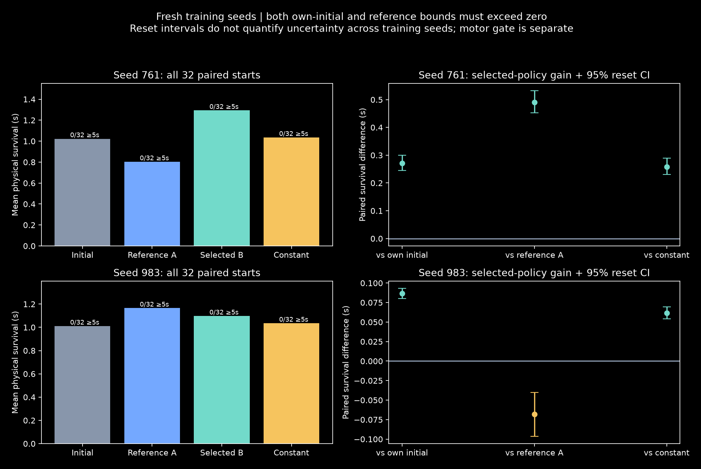
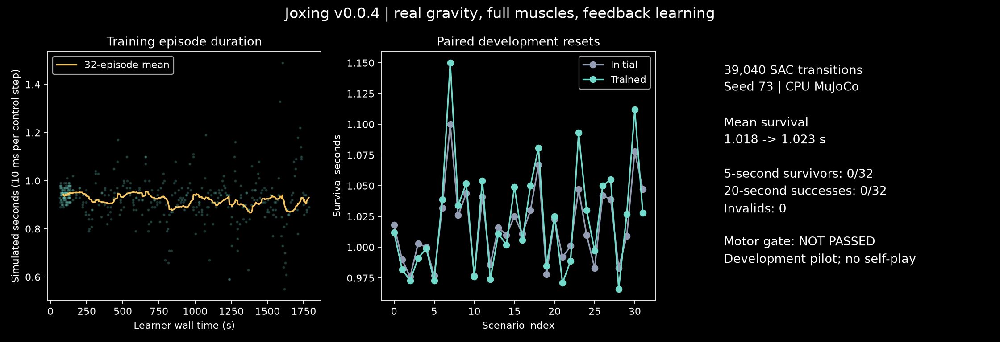
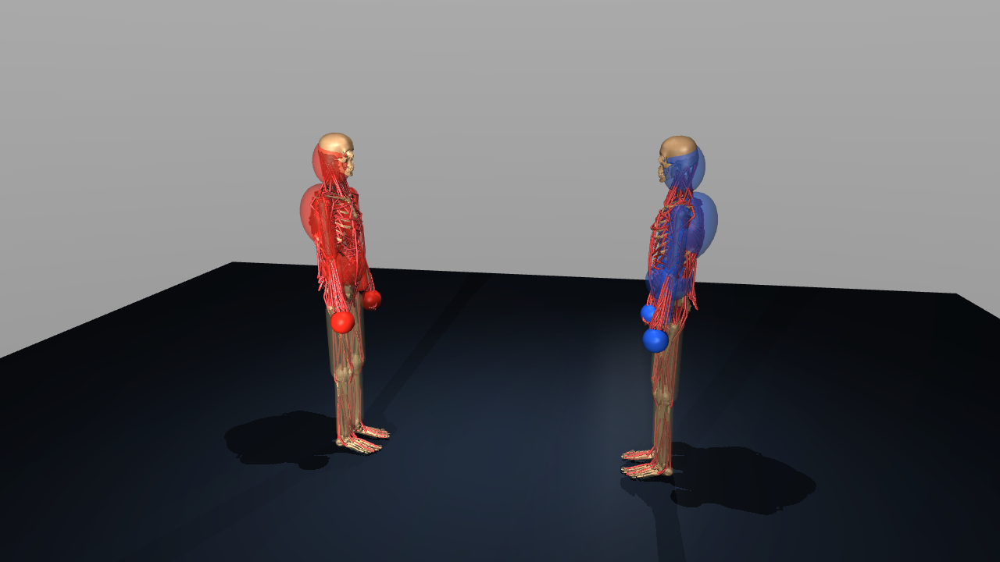
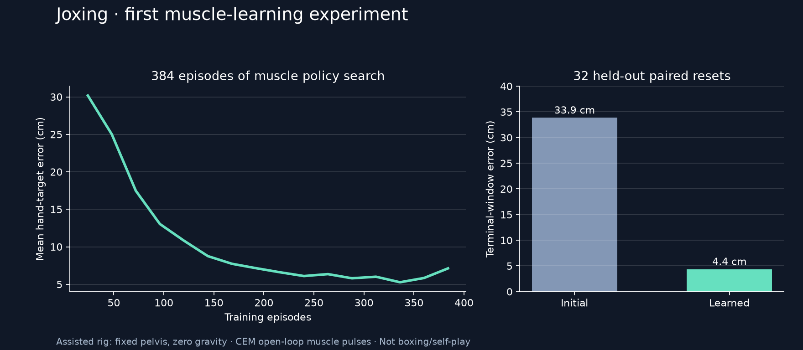

# Joxing

**Public repository: [neverhuman/Joxing](https://github.com/neverhuman/Joxing).** Clone and read the source, tests, plans and published evidence without GitHub credentials.

Muscle-driven boxing research using two [MS-Human-700](https://github.com/LNSGroup/MS-Human-700) humans in one MuJoCo world and the [msgym](https://github.com/LNSGroup/msgym) control ecosystem.

**Latest release: [v0.0.10](https://github.com/neverhuman/Joxing/releases/tag/v0.0.10).**
Two fresh motor seeds executed16,384transitions/896optimizerupdates; all32evaluations
valid and both replays exact. Survival changed−0.066s/+0.016s, with1/8five-second
survivors each: **both improvement gates failed**.
[Results](docs/V0.0.10_RESULTS.md) · [All attempted outcomes and audit](artifacts/v0.0.10/D2/) · [Complete raw evidence](https://github.com/neverhuman/Joxing/releases/download/v0.0.10/joxing-v0.0.10-raw.tar.gz).

**Active: [v0.0.11 connected two-player loop and recording](docs/V0.0.11_MISSION.md).**
The first [one-second diagnostic clip](artifacts/v0.0.11/D0/first-diagnostic.mp4)
is available. Both untrained athletes lose their upright stance; no boxing or
learning is demonstrated. The shared observation/history/command/contact path
passed236Linux tests and seven registered cases/2,642physics steps, including
three exact replays. A decoder failure and its separate zero-physics repair are
both retained. [Full D0 results](docs/V0.0.11_D0_RESULTS.md) ·
[All attempts and video](artifacts/v0.0.11/D0/).

The opt-in [sensor-timed variant](docs/V0.0.11_D1_SENSOR_TIMING.md) now passes
all eight registered sensor conditions, four exact checkpoint replays and the
original zero-delay oracle. [Completion results](docs/V0.0.11_D1_COMPLETION_RESULTS.md)
retain all18attempt rows, including earlier setup/storage failures. All402Linux
tests pass; only317new steps completed the two previously unexecuted conditions.
Lossless storage preserved all112retained files. No stable motor, valid native
boxing bout or competitive learning is claimed; whole-v11completion remains gated.

**Prior release: v0.0.9.** Exact scalar CPU rollout scales to **520.7 native control transitions/s at16workers** on xbabe3, with all78cases and62parallel histories matching serial. Frozen-actor batching failed its unchanged parity gate; the exact collector candidate improved only1.8% and was declined. All failures/not_run cases, experiments and raw evidence are retained. [Results](docs/V0.0.9_RESULTS.md) · [Experiment book](experiments/v0.0.9/README.md) · [Full raw archive](https://github.com/neverhuman/Joxing/releases/download/v0.0.9/joxing-v0.0.9-raw.tar.gz).

**Completed: [v0.0.10 physical motor adaptation](docs/V0.0.10_RESULTS.md).** The input audit found a reference seam velocity defect, excluded by the current reset grid; its link to falls is unproven. The correction passed42reference checks and171Linux tests. The neutral residual interface passed all four physical replay paths and178Linux tests; an independent audit verified every saved action/contact/state tail. The [two-seed learning pilot](docs/V0.0.10_D2_PILOT.md) now has tested worker/evaluation foundations; all32fixed evaluations and both exact replays completed after196Linux tests; the two-seed pilot failed its motor improvement gates. [Diagnostic](docs/V0.0.10_D0_RESULTS.md). The [current mission](docs/MISSION.md) and20-minute supervisor track actual work, faults and evidence. The [self-play/HPC route](docs/SELF_PLAY_HPC_PLAN.md) connects motor qualification to simultaneous opponent-aware games, causal history/jitter and frozen historical leagues, then1,000→10,000→100,000valid games.

**Pretrained motor progress:** [watch two pretrained athletes walking together](artifacts/v0.0.11/shared-motor-physical/first-pretrained-trial.mp4) for3.52simulated seconds in one world, with700muscles each and no tracking/physical failure in the first fixed trial. [Full partial results](docs/SHARED_MOTOR_PHYSICAL_RESULTS.md). The861pass/1known-xfail Linux gate and first-trial measurement/policy audit pass. The four-world/replay proof remains incomplete after the unchanged storage cap; all failures and not_run slots remain. No boxing, guard or self-play learning is demonstrated. [Next: lossless evidence compression](docs/SHARED_MOTOR_STORAGE_CONTINUATION_PACKET.md) before unfinished/recovery/replay work.

**Evidence codec qualified:** all23 saved arrays reconstruct exactly in two decoders after1,088Linux tests plus one known referee xfail. Stored size fell31% (19.21→13.25MB), peak memory stayed below512MiB, and no simulation was repeated. [Results and limits](docs/MOTOR_CODEC_RESULTS.md) retain the earlier memory failure and every incomplete attempt. The native walking/replay proof remains incomplete; the remaining storage does not support all projected continuation tapes.

**Next: explain legal scoring before more training.** The separate [Grokbot diagnostic lane](grokbot/STATUS.md) passed its short v0.0.19 motor criterion; v0.0.21 reached48valid games but42draws, and one replay scored0–0 despite classified touches. Its longer-trained policy failed the match-strength check. [Scoring diagnosis plan](docs/SCORED_CONTACT_DIAGNOSTIC_PACKET.md) traces staged contacts through unchanged rules and distinguishes touches, legal points and decisive games. No new competitive-learning claim or native release tag.

Scoring diagnostics now have26new passing tests, plus43combined rule/referee checks. Development rigid-body controls score2/1points through the real production adapter in either contact order; saved native guard controls correctly score zero. [Registered phase A](docs/SCORED_CONTACT_DIAGNOSTIC_PACKET.md) is running on xbabe1 from public frozen source `196820f`: a fresh Linux source gate precedes the bounded saved/rigid-control audit. Formal outcomes are pending. These controls do not show a native athlete landing a legal punch.

**Next native recording wave:** [fixed three-second interaction and exact continuation](docs/NATIVE_STRIKE_MISSION.md) now has42targeted passing tests. It preserves all1,400muscles, controller/RNG state, actual contact evidence and score timing. A bounded chain first qualifies the legacy-report repair, then conditionally runs the frozen controllers and records the entire first fixed interaction. No formal three-second result yet; zero legal points will remain visible. The earlier scoring run's data-format failure is retained.

**Visible-bout priority:** [delivery milestones and recording contract](docs/BOUT_RECORDING_MILESTONE.md). Passive two-body recording, zero-step playback and real shared-state limb-velocity measurements are implemented; first connected diagnostic footage is a v11 deliverable. No native boxing bout is available yet.

**Integrated next-wave plan:** [two-player environment, game tests, causal history, positive-control league, boxing motors and measured HPC](docs/SELF_PLAY_EXECUTION_PLAN.md). A new zero-step geometry audit confirms head-surface coverage and own-contact problems in the composition scene. Build and test the shared match loop alongside the bounded motor work; keep native competitive learning gated.

**The motor bottleneck remains:** v0.0.8's40valid trials all failed to reach20seconds, collapsing around5.03seconds. All12source replays were exact. Native walking throughput is not boxing or optimizer throughput; valid boxing games remain0. [Physical results](docs/V0.0.8_RESULTS.md) · [Replay](artifacts/v0.0.8/physical/physical-motor.mp4).

**Prior v0.0.6 qualification:** the frozen upstream controller completed 40/40 short native walking tasks with exact Linux replay. Decoder schedule state lost on load was reproduced and repaired; no new optimization occurred. [Results](docs/V0.0.6_RESULTS.md).

**Prior training result, v0.0.5:** 1.44 million transitions and 912 new evaluations, zero invalids. Candidate B improved against its initial policy on two fresh seeds but lost to reference A on one. Replicated superiority and the five-second motor gate failed; every final policy had 0/32 five-second survivors. [Results](docs/V0.0.5_RESULTS.md).

The [state/history code audit](docs/STATE_HISTORY_SELF_PLAY_AUDIT.md) addresses opponent motion, temporal memory, responsive muscles and jitter. Current SAC observes its own velocity/activation and changes muscle commands at 100 Hz **simulated time**. The new diagnostic shared loop exposes opponent observations/history and candidate contact staging; a learned temporal actor, qualified match referee and self-play league remain missing. The [motor-teacher roadmap](docs/UPSTREAM_MOTOR_TRANSFER_PLAN.md) now has native qualification evidence; glove and stationary/reach transfer remain next work.

**Current stage: executable foundation, not trained autonomous boxing.** The project preserves 700 muscles per actor, defines an auditable points game, tests contact accounting and anti-farming scoring, and includes a small constrained motor-learning experiment. Full-body stance, punching, self-play and GPU physics remain gated work.

**Prior completed proof: v0.0.2.** Muscle-driven strike, one-point referee, measured withdrawal and full mid-contact replay passed a frozen three-seed proof. Trained policies completed hit-and-withdrawal in 192/192 fresh trials versus 0/192 baseline withdrawals; hits remained 192/192 for both. Four CPU workers finished in 4 minutes 17 seconds. This remains a fixed-pelvis, zero-gravity diagnostic.

[v0.0.2 results and receipts](docs/V0.0.2_RESULTS.md) · [Iteration plan](docs/V0.0.2_PLAN.md) · [Before/after video](artifacts/v0.0.2/strike-before-after.mp4)

[Documentation index](docs/README.md) · [Training sequence and test gates](docs/TRAINING.md) · [v0.0.5 execution plan](docs/V0.0.5_PLAN.md) · [Execution status](docs/STATUS.md)

## v0.0.5: what the larger wave established

The original four 40,000-transition conditions tested reward units and entropy temperature. Its best gain was 0.102 seconds, below the registered confirmation threshold. Following the requested budget increase, four independent learners used 16 simulation workers total and 160,000 transitions per condition. Candidate B qualified in the new screen, then faced reference A on fresh seeds:

| Training seed | Initial survival (s) | Final A (s) | Final B (s) | B versus A |
|---|---:|---:|---:|---|
| 761 | 1.023 | 0.803 | 1.294 | +0.491s, positive paired interval |
| 983 | 1.011 | 1.165 | 1.097 | −0.068s, negative paired interval |

These are moving-start fall-recovery episodes, not stationary stance or boxing games. Both waves retain all 912 evaluation attempts and 14,736 completed stochastic motor episodes. Reset intervals do not measure uncertainty across training seeds. The frozen constant evaluated confirmation starts before learner training; learner-policy evaluations were deferred until final actor save. This timing limitation and failed strict cross-platform policy replay are disclosed in the [results](docs/V0.0.5_RESULTS.md).

Real optimizer throughput improved 4.69× on a common-data benchmark; a separate 16-worker rollout benchmark reached 844.67 transitions/s with optimization excluded. The full extension averaged about 360 training transitions/s including setup/evaluation. CPU physics remains the reference; GPU physics is unqualified. Source-host replay passes, all owned jobs exited, and no larger motor proof or competitive training was started.



## v0.0.4 background: gravity and feedback learning

This iteration implements the body/environment/pilot stages of the earlier v0.0.3 plan. It asks whether feedback through all 700 muscles can improve local balance under ordinary gravity.

| Stage | Work and evidence | Gate to advance |
|---|---|---|
| 1. Qualify the body | Native-root falls, foot contact, muscle/inertia preservation, assistance audit | 32 accepted development resets and twelve finite root probes |
| 2. Test the environment | 1,023 measured observation values, 138 named muscle groups, push impulse, failures and snapshots | Physical/API regression tests; explicit support-channel order across sorted JSON |
| 3. Train and evaluate the pilot | SAC seed 73, up to 100,000 control transitions / 30 minutes; paired initial/final policies on 32 development starts | Publish all 64 attempts, survival change, faults and resource stop |
| 4. Qualify further training | At least 16/32 development starts survive 5 seconds, zero invalids | A failed pilot blocks the larger motor proof |
| 5. Later formal proof | Three training seeds; 768 held-out quiet/push attempts, up to 20 seconds each | Separately gated future run; >=61/64 stance and >=58/64 recovery successes per seed |

Each pilot evaluation lasts up to 20 seconds. Reset-only preparation/projection is logged; there is no fixed pelvis, gravity compensation or state overwrite during the evaluated trajectory. The initial hand position is a posture target, not a raised boxing guard. Report competence separately from measured learning. This historical pilot used at most four CPU simulation workers with one BLAS/OpenMP/Torch thread each; the current v0.0.5 allowance is 16 aggregate workers as described above. GPU simulation remains gated by failed parity tests. The larger program retains a 40-million-substep/four-hour/10-GiB cap; these are limits, not promised training times.

The [training guide](docs/TRAINING.md) distinguishes executable pilot commands from the still-planned formal proof and self-play. Full-body contact coverage, raised guard, reliable stance and sporting fall/foul attribution remain open. Linux snapshot continuation is exact; strict Linux-to-Mac closed-loop full-state parity misses tolerance and remains explicitly failed. The 1/2/4-worker inference/support/reset benchmark measured 65.7/131.8/240.5 control transitions per second, with optimizer work excluded.





## Start

```bash
git clone --recurse-submodules https://github.com/neverhuman/Joxing.git
cd Joxing
uv sync --extra dev --extra viz
uv run pytest -q
uv run joxing inspect
uv run joxing fixture
uv run joxing render
uv run joxing benchmark --steps 500
OMP_NUM_THREADS=1 OPENBLAS_NUM_THREADS=1 uv run joxing train-reach --workers 4 --out runs/reach
OMP_NUM_THREADS=1 OPENBLAS_NUM_THREADS=1 uv run joxing train-strike --workers 4 --out runs/v0.0.2/reproduction
```

The gravity audit needs only the base dependencies. SAC and its reports use the optional motor extra:

```bash
uv run joxing balance-probe --out runs/v0.0.4/my-probe
uv sync --extra dev --extra viz --extra motor
OMP_NUM_THREADS=1 OPENBLAS_NUM_THREADS=1 uv run joxing train-stance --out runs/v0.0.4/my-pilot --steps 100000 --workers 4 --seed 73 --wall-s 1800 --eval-count 32
```

Runs refuse to overwrite an existing directory. `train-stance` executes a bounded development experiment; it does not start self-play or a formal motor proof. Linux installs CPU Torch wheels; NVIDIA hardware is optional for these commands.

Python 3.12+, MuJoCo 3.8.0. On headless NVIDIA Linux use `MUJOCO_GL=egl` for rendering. Mac can run CPU physics and native rendering without Docker. Run from the checkout: upstream models are pinned Git submodules and are not included in the Python wheel. Generated XML/receipts use local assets; rebuild from the pinned checkout when moving machines.

## Read first

- [Code audit: game state, motion history, jitter and repeated self-play](docs/STATE_HISTORY_SELF_PLAY_AUDIT.md)

- [Game rules and how RL earns reward](docs/GAME.md)
- [Review of all four supplied specs](docs/SPEC_REVIEW.md)
- [Additional boxing/HPC proposal review](docs/EXTERNAL_REVIEW_2026-10-26.md): useful defense scenarios, opponent sampling and profiling ideas, with explicit limits on model/rules changes.
- [Actual compute inventory and HPC strategy](docs/COMPUTE.md)
- [Implementation gates and worker-ready handoff](docs/IMPLEMENTATION.md)
- [Delivered status, commands and evidence](docs/STATUS.md)

The candidate game awards head 2 points and torso 1 point per qualified direct glove encounter. Blocks score zero; sustained pressure cannot score repeatedly. Force and impulse remain visible evidence. Canonical tactical utility is win +1, loss -1, draw 0. No injury model is claimed.

## What executes today

- Namespaced dual scene with 1,400 native muscles, added glove equipment, provisional target/guard shells, ownership maps and mass/parameter checks.
- Staged CPU contact capture and independent momentum-consistency fixtures.
- Pure hit-event referee with direct-target impulse, onset gates, one-score locking, geometric/retraction input contract, idempotent delivery and mid-event restore.
- Candidate match-objective potential shaping with terminal return test.
- CPU diagnostic benchmark and episodic CEM muscle-reach policy search with explicit assistance, held-out reset evaluation, checkpoints and generation logs.
- Native-root gravity rig with reset-only equality projection, signed/persistent support, all-muscle feedback control, bounded SAC, fault receipts and complete control-boundary evaluation snapshots.

The referee is not yet connected to a production two-agent environment. Geometry fitting, complete self-contact, legal/foul adjudication and stable motor skills must pass before self-play. A supplied spec's proposed code or measurements are never treated as delivered capabilities.

## First measured learning result

On xbabe1, four CPU workers completed 384 CEM muscle-reach training episodes in 35 seconds. Over 32 paired held-out resets, mean terminal-window hand-target error fell from 33.9 cm to 4.4 cm. This is a fixed-pelvis, zero-gravity open-loop arm-control diagnostic, not learned boxing or self-play. One training seed and one target neighborhood limit the claim.



[Before/after replay](artifacts/reach-before-after.mp4) · [Run receipt](artifacts/receipts/reach-seed7.json) · [Results and limitations](docs/RESULTS.md)

Native teacher reproduction uses the separate locked runtime and commands in the [v0.0.6 results](docs/V0.0.6_RESULTS.md#reproduce-the-bounded-native-qualification); its 3,601 feature interface differs from the stance rig. Mac native compiled-contract portability remains unqualified.

Joxing code is Apache-2.0. Upstream submodules retain their licenses. Supplied engineering documents under `docs/references` retain their original authorship; their inclusion is project reference material, not a separate license grant for third-party datasets. No additional motion-capture corpus is bundled by Joxing; the pinned msgym submodule includes its upstream sample trajectory, whose provenance must be checked before teacher transfer.
