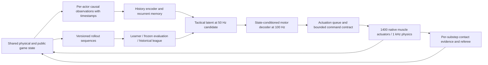

# Game state, temporal memory, muscle feedback and repeated self-play

Code review requested during v0.0.5: the athletes must observe their own and their opponent’s motion, retain relevant history, change muscle commands continuously, tolerate timing/command jitter, and improve through many short games. This is a review and implementation handoff. Features described as missing or proposed are not implemented by this document. The separately frozen v0.0.5 experiments continue unchanged.

**Finding:** the current stance learner is a real feedback muscle controller, but it is not a stateful two-player boxing policy. Increasing episode count alone cannot supply the missing opponent, game, history, referee and league interfaces.

## What works today

| Mechanism | Evidence in executable source | Practical meaning |
|---|---|---|
| Physical dynamic state | `stance_env.py:StanceEnv.observe`, `balance.py:BalanceModel` | 85 relative coordinates,85 generalized velocities transformed by`tanh(qvel/10)`,700 muscle activations, pelvis orientation/translation, hand errors, three support channels and 138 previous actions:1,023 values. Velocity is already present; it is not necessary to infer every velocity from images. |
| Feedback actions | `wave.py:train_run`, `stance_env.py:step`, `groups.py:expand` | SAC’s feedforward policy consumes the latest observation and emits 138 normalized groups. They expand to all 700 native muscle excitations; no animation or joint-pose writes produce the evaluated motion. Native activation dynamics remain present. |
| Simulated cadence | `BalanceConfig`, `StanceEnv.step` | A new muscle command every 10 ms of simulated time, held over ten 1 ms physics steps. Forces and support are checked each physics step. |
| Physical contact velocity | `physics.py:point_velocity`, `step_contacts` | Jacobians provide contact-point velocities; geometry and velocity are captured before solve, force afterward. This is a useful foundation for opponent-motion and legal-hit evidence. |
| Candidate scoring history | `rules.py:HitTracker`, `Encounter` | Per-glove onset eligibility, force-integrated impulse, encounter lock/retraction, stable event IDs and an event ledger prevent repeated scoring from held contact in tested fixtures. Head 2 / torso 1 / guard 0 are implemented candidate values. |
| Two anatomies and ownership | `scene.py:build_scene` | A composition diagnostic contains two namespaced 700-muscle athletes and explicit actuator ownership. It is not the environment used by SAC. Shell fit, surface coverage, self-contact and competition gates remain open. |
| Replay and experiment accounting | `StanceEnv.snapshot/restore`, wave runners, tests | Engine integration state, activation, application state, monitor timers, previous action and RNG are saved at control boundaries. Raw attempts and faults are retained. Linux policy/action continuations pass; strict cross-host policy parity remains failed. |

The 72-test Mac/Linux suite includes real observation/activation checks, ten-substep control cadence, native muscle/inertia preservation, support persistence, reward scaling without physical drift, real optimizer updates, correct terminal bootstrapping, snapshot restoration and independent seeds. These tests establish mechanisms, not boxing competence.

`scripts/audit_control_state.py` makes the observation/network/recorded-command review reproducible. [Its receipt](../artifacts/v0.0.5/control-state-audit.json) verifies the 85 velocity channels against actual engine state and records network types and action variation. Its counterfactual velocity-input probe is an offline sensitivity check, not a physical motor trial.

## Missing pieces and important distinctions

| Gap | Current behavior | Needed behavior |
|---|---|---|
| Opponent state | `StanceEnv` contains one athlete. No opponent observation exists. | Visible opponent pose, linear/angular velocity, glove/head/trunk/foot trajectories, separation and facing in the learner’s coordinate frame. |
| Public game state | Balance reward uses posture, drift, hand tracking, effort and action change. It does not call `match_reward`. | Round clock/phase, public score, fouls after adjudication, arena distances and recent public scoring events, supplied to both actors fairly. |
| Policy memory | SAC uses `MlpPolicy`; exported actors return no recurrent state. Only the last action is in the observation. | A bounded observation/action history and an explicitly carried recurrent state for partially observed tactics and timing uncertainty. |
| History versus logs | `env.trace` is saved, but `observe()` does not feed it to the network. The SAC replay buffer trains weights from transitions; it is not acting-time memory. | Time-stamped actor history passed to the encoder, reset/masked at real game boundaries and saved in replay. |
| Complete Markov information | Relative-reset coordinates omit their reference pose; time-to-push/horizon and support-persistence timers are not explicit observation fields. | Define which state is visible and which is hidden. Include public clock/phase and suitable pose representation; use history for hidden dynamics instead of assuming the existing vector is complete state. |
| Stable muscle behavior | Muscle activation has dynamics and there is a small action-change penalty. There is no explicit action queue, timing noise or tested anti-chatter contract. | Measure command variation and actual movement; qualify any rate limit/filter with its added delay and hash it as a new action contract. |
| Two-player stepping | The dual scene is disconnected from the single-athlete SAC environment. | Both observations from one completed state, both decisions captured before either action advances physics, then one shared simulation and referee. |
| Sporting termination | Hit fixtures exist. Full foul/fall/exit attribution and simultaneous loss rules are unresolved. | An authoritative match state machine whose valid termination ends both actors consistently; numerical invalids are quarantined. |
| Jitter and latency | Fixed ideal simulated cadence; no sensor-age features, delayed queues, packet drops or timing randomization. `target_jitter_m` in the strike rig is spatial reset variation, not timing jitter. | Explicit observation and actuation delay/noise contracts, causal queues and independent reproducible timing RNGs. |
| League and improvement proof | No historical-opponent sampler, payoff matrix, frozen opponent panel or tactical PPO exists. | Immutable opponent bundles, historical/challenging opponents, held-out paired evaluation and promotion from measured strength. |
| Real-time qualification | 100 Hz is a simulated control frequency. | Separately measure wall-clock inference deadlines and full physics-loop deadlines. The current native pipeline is not qualified as a wall-clock 100 Hz game. |

The older reach/strike policies are explicitly two-/four-phase open-loop pulses. Their contact/withdrawal proof is valuable but does not provide opponent-reactive behavior. Newer stance SAC supplies feedback; it does not inherit a tactical game from those earlier tests.

## A measured command-stability issue

On the preselected original-wave scenario 60000, deterministic final policies produced these normalized command statistics after the 0.10 s snapshot:

| Arm | Mean absolute change per command update | Fraction of actions with absolute value>=0.99 | Groups varying over the trace |
|---|---:|---:|---:|
| A |0.016744|0.7%|138/138|
| B |0.017901|3.1%|138/138|
| C |0.396146|14.8%|138/138|
| D |0.050784|99.2%|11/138|

This exposes behavior worth investigating: C changes commands sharply; D is almost entirely saturated. These are normalized command differences, not measured limb jerk, and one short trajectory cannot establish their cause. They do not prove that filtering fixes the policy. Preserve the actual traces and compare smoothing/delay interventions in a new registered motor experiment. The running extension keeps its action contract unchanged.

The [extension screen trace audit](../artifacts/v0.0.5/extension/control-state-audit.json) keeps the same diagnostic on scenario 64000. Trained A/B/C/D mean command changes are 0.029646/0.010952/0.011311/0.000952; saturation fractions are 12.0%/1.3%/11.3%/99.9%. D is still mostly saturated, while C’s sharp original-wave command changes do not generalize to this seed/budget. These are descriptive traces, not a comparison of physical jerk or a new selection criterion.

The current learner also discounts each 10 ms transition by 0.99: a reward five seconds ahead has weight `0.99**500 ≈ 0.00657`. That is roughly a one-second exponential discount timescale. It is a design choice to revisit in a new motor protocol, not evidence that changing gamma would fix balance. The tactical match objective already specifies gamma=1 and terminal win/loss utility; do not silently carry the motor discount into that game. High-dimensional stochastic exploration, reward units, activation dynamics and moving resets all need controlled comparisons rather than attributing every failure to missing memory.

## Recommended control and memory architecture

Use a shared physical world and separate actor observations. A policy can react every tick with fixed weights; learning updates weights from collected experience on a separate learner. It does not need to perform an optimizer step before every muscle adjustment. Freeze the deployed policy bundle within each game; exchange bundles at defined rollout/game boundaries.



This is the proposed P2/P3/P5 integration, not a delivered loop. Keep all 700 muscles per athlete. A low-dimensional tactical latent reduces exploration difficulty; a feedback decoder still controls the actual muscles. Competent unassisted stance/reach/return must precede competitive promotion under the existing repository gates.

There is no universally best algorithm for this unqualified anatomy/game. A well-supported starting design is SAC for reusable motor skills, then recurrent PPO for tactics with frozen motor and opponent bundles. Compare memoryless state, a short frame stack and a GRU/LSTM with matched budgets rather than assuming a bigger memory wins. [SB3’s recurrent PPO documentation](https://sb3-contrib.readthedocs.io/en/master/modules/ppo_recurrent.html) explicitly requires carrying hidden state and episode-start masks; adding its class name alone would not implement correct memory.

Competitive self-play has produced physical tactics in other simulated games; it required an actual game and carefully defined rewards. [OpenAI’s competitive self-play research](https://openai.com/index/competitive-self-play/) is relevant precedent. For physical control, [humanoid1v1soccer research](https://arxiv.org/abs/2304.13653) demonstrates high-frequency feedback with targeted randomization, but its 20-joint robot does not validate this 700-muscle body.

### Observation contract to implement

Create versioned `ActorObservation`, `CriticState` and `ActorMemory` schemas. Actor input should contain:

- Own joint pose/velocity, muscle activation, orientation, support, requested and actually applied actions; explicitly computed glove/head/feet/trunk positions and velocities reduce the kinematics the network must rediscover.
- Opponent visible keypoint pose/velocity, relative facing/range and visibility masks. An unavailable value has a mask and age, not a fabricated current value.
- Public clock, round/mini-game phase, score difference, adjudicated fouls, ring distances and bounded recent public event history.
- Capture tick, feature age, actual decision interval, requested/applied-action history and recurrent hidden state.

Keep opponent muscle activations, future actions, policy internals and private referee state out of actor observations. A centralized critic may receive privileged state through a separate interface. Test that changing critic-only values cannot change an actor action.

Use actor-local coordinates consistently. If `r=R_self.T@(p_opponent-p_self)`, its time derivative is:

```python
v_relative = R_self.T @ (v_opponent - v_self) - np.cross(omega_self_local, r)
```

The rotation term matters: a turning observer sees a stationary target move in its own frame. Test this analytically and against finite differences. Derive point velocities through the existing Jacobian helper and preserve pre-/post-solve staging. Do not equate a generalized joint velocity with Cartesian glove velocity.

### Timing, noise and command jitter

Start with a deterministic zero-delay oracle. Then preregister candidate observation/action delays of 0/10/20/40 ms, bounded tick jitter, dropped updates and observation noise in named units. These are proposed test levels, not validated defaults. Keep physics dt fixed while testing latency; shrinking or enlarging dt is a separate physics variant.

At each 1 ms tick, ingest due observations and apply only causally due commands. Commands carry actor ID, sequence number, capture/decision/apply ticks and bundle hash. Late stale packets cannot overwrite a newer command. On a dropped update, hold the last valid command under the registered contract. Both players get the same class of timing treatment; random draws use separate per-actor RNGs. Train with the selected delay distribution and evaluate frozen held-out schedules.

A filter can reduce chatter and add harmful reaction delay. Compare actual limb velocity/acceleration, command total variation, overshoot, stability and match strength jointly. Rate limiting/filtering must be included in action hashes and replay state; never add it only at evaluation. Muscle activation already supplies physical dynamics, so additional filtering needs evidence. Keep permanent tactical reward changes separate from the canonical win/loss objective.

Save history buffers, validity masks, recurrent states, delay/filter queues, outstanding commands, clocks, normalizers and timing RNGs in `ReplaySnapshot`. A collector chunk boundary preserves them. A real new game resets them; padded training sequences use explicit masks and burn-in. Correct restored physics with missing recurrent memory is not complete policy replay.

## Mini-games and making “smarter” measurable

Use a curriculum of versioned tasks: validated motor/recovery and reach-return; scripted moving/guarding opponents; short two-player score rounds; then full 60-second rounds. A 2-second or 5-second round is a different game-duration variant, not an external collector truncation of the 60-second round. Keep head 2 / torso 1 / guard 0, event locks and attribution rules explicit. Do not declare a first brush a win or let an illegal shove exploit termination. Simultaneous contacts are adjudicated together.

Train against immutable historical bundles as well as current/challenging opponents. Keep a sampling floor so old styles remain represented. Full bundles include actor, decoder, normalizers, observation/action contracts, timing, RNG/recurrent conventions and rules/model hashes. [AlphaStar’s league work](https://deepmind.google/blog/alphastar-grandmaster-level-in-starcraft-ii-using-multi-agent-reinforcement-learning/) explains why self-play can cycle and forget previous opponents; improvement is not guaranteed to be monotonic.

Evaluate against a frozen panel with paired starts and swapped sides. Report legal scores, win/draw/loss, falls/fouls, invalids, contact quality, response latency and confidence intervals across training seeds. A moving training population can stay near 50% win rate while everyone improves or nobody does. [OpenAI’s multi-agent results](https://openai.com/index/emergent-tool-use/) likewise distinguish competitive training from reliable evaluation. Count attempted/valid/invalid/not_run games separately; repeated quick falls are not evidence of intelligent exchanges.

The requested scale is plausible as an engineering goal, not a measured current capability. At 100 Hz control / 1 kHz physics, 100,000 two-second games require 20 million world control transitions and 200 million physics steps, before resets, evaluation or invalids. Both actors provide decisions, but that does not double world physics steps. This exceeds the current 40-million-step protocol cap. The 845 transitions/s benchmark is single-athlete rollout throughput, excludes optimization and does not forecast a 1,400-muscle contact/referee game. Benchmark the complete dual-world workload before committing time/cost for that scale.

Profile Python instrumentation as well as the native solver. `step_contacts` currently constructs Jacobians for every captured contact point; `FaultRecorder` snapshots the full application state, including a growing trace, before each control step. Those are valid correctness mechanisms with potential scaling costs, especially when episodes become long. Measure their contribution before attributing every missed deadline to anatomy or buying more compute. Any cached point-velocity or compact fault-snapshot implementation must pass the existing force, last-valid-state and full replay oracles; telemetry cannot be dropped merely to inflate throughput.

### Measured inference and control-path cost

[Isolated actor timing](../artifacts/v0.0.5/extension/actor-latency-mac.json), measured with `scripts/benchmark_actor_latency.py`, used one CPU Torch thread, eight screen actors, 100 warmup calls and 1,000 timed calls per actor/batch case. Single-observation medians range 0.062–0.064 ms; p99 ranges 0.067–0.124 ms. Batch-four medians range 0.078–0.081 ms. None of the 16,000 timed calls exceeded 10 ms. This measures repeated `actor.predict` on restored recorded observations, including conversion, with physics/observation construction/transport/optimizer excluded. It is not a guaranteed deadline or a two-player latency test.

[Recorded-action profiling](../artifacts/v0.0.5/extension/control-profile-mac.json), using `scripts/profile_control_path.py`, restores the selected B screen’s predeclared first scenario 64000. Three unprofiled continuations through the training `FaultRecorder` wrapper achieved a median 139.65 control steps/s. Three additional profiled continuations expose costs; for the middle repeat, native `mj_step1`/`mj_step2` accounted for about 76% of total profiled wall time, fault snapshots about 6%, and `point_velocity` about 2%. These non-overlapping categories use cumulative times; other cumulative functions overlap and must not be added. All six continuations retained the outcome/tick and reproduced the recorded integration state within 2.0e-11; 6,498 physics steps were charged to diagnostic work. The trace is short, already in progress, and excludes resets, inference, IPC and learning. Profiling adds overhead and longer histories may change the split.

These measurements support fast policy selection on the measured Mac while leaving full-game throughput and deadlines unqualified. They also show why removing Python telemetry alone is unlikely to deliver an order-of-magnitude speedup on this trace. Preserve correctness while investigating solver/backend cost and measured learner/rollout overlap.

Reproduce these read-only diagnostics against the curated evidence, with fresh output paths:

```bash
OMP_NUM_THREADS=1 OPENBLAS_NUM_THREADS=1 MKL_NUM_THREADS=1 uv run python scripts/benchmark_actor_latency.py --run artifacts/v0.0.5/extension --out artifacts/generated/actor-latency.json
OMP_NUM_THREADS=1 OPENBLAS_NUM_THREADS=1 MKL_NUM_THREADS=1 uv run python scripts/profile_control_path.py --record artifacts/v0.0.5/extension/S-B/trained-replay.json --out artifacts/generated/control-profile.json
```

The [motor-teacher transfer plan](UPSTREAM_MOTOR_TRANSFER_PLAN.md) provides a concrete next P3 experiment using the released upstream controller. Its metadata is inspected, but it has not been evaluated or transferred. This is complementary to the missing state/history/game interfaces below.

## Ordered implementation handoff

Objective: qualify a causal, stateful two-player game and demonstrate improved frozen-panel strength. Non-goals: injury models, unvalidated anatomy simplification, silent scoring changes or claiming wall-clock real time from a simulated cadence. Completion requires the missing mechanisms below, stable motor/contact gates, all raw games and a preregistered strength improvement; stop on numerical faults, observation leakage, unfair update order, duplicate scoring, replay mismatch or resource caps.

Read first, in order: root `AGENTS.md`, `/Users/bentaylor/.codex/RTK.md`; this audit; `docs/{GAME,IMPLEMENTATION,TRAINING,STATUS}.md`; `src/joxing/{scene,physics,rules,balance,support,groups,stance_env,wave,wave_extension}.py`; current physical/scoring/balance/learner tests; original specs only as proposals. Local root: `/Users/bentaylor/Documents/ChatGPT/JOXING`. Use master P1/P2/P3/P5 gates; do not create a competing game specification.

One integration owner. `third_party/**`, original references and published raw evidence are read-only. `runs/**` and `artifacts/generated/**` are generated. No concurrent schema writers. The active extension checkout/source remains frozen until it exits. Do not silently add history/jitter/opponent inputs to its 1,023-value observation or reuse incompatible checkpoints.

1. **Feasible motor prerequisite:** quantify initial pose/velocity/COM/support in `balance.py:prepare`; distinguish stationary-stance and initial-fall-recovery variants. Preserve all 700 muscles and native force generation. Qualify useful feedback motor control before competitive training. The current one-second falls make an immediate 100,000-fight launch a poor test of tactics.
2. **P1 geometry/physical adapter:** finish `scene.py`, `geometry.py`, semantic surface registry, own/opponent contact coverage and pre-impact motion fixtures. Validate fast moving/rotating gloves, guard occlusion, floor/self contact and dt convergence. Compilation alone is insufficient.
3. **P2 authoritative game:** implement `env.py:BoxingEnv`, `referee.py:MatchState`, `observations.py:ActorObservation/CriticState`, `history.py:TimedHistory`, `latency.py:ActionQueue`, `replay.py:ReplaySnapshot`. Both actions use the same completed tick. Central referee emits legal score events and resolves bell/foul/fall/boundary outcomes. Version every interface.
4. **Timing and observation tests:** create `test_observations.py`, `test_history.py`, `test_latency.py`, `test_observation_leakage.py`, `test_env.py`. Verify velocity frames, no future-state access, player-swap symmetry, sequence masks, queue order, stale/drop behavior and no hidden-state leakage across games. Compare zero-delay against the deterministic oracle.
5. **P3/P5 temporal actor:** add `rl/{actor,critic,rollout,ppo}.py` with a recurrent tactical actor, state-conditioned muscle decoder and separate privileged critic. Tests must reconstruct hidden state across rollout chunks and restore during a delayed pending action and contact. Keep policy weights/bundles coherent across a match.
6. **League and proof:** implement `league.py`, `evaluation.py`; retain full historical bundles/payoff matrix; freeze an evaluation panel and paired-side scenarios before candidate training. Follow master promotion thresholds and multiple-seed requirements. Include memoryless/stacked/recurrent and zero-delay/jitter ablations with equal compute and declared metrics.
7. **Scaling:** benchmark 1/4/8/16 CPU worlds on the complete dual game including inference, history, referee, reset, queue transport and optimization. Source/backend changes require parity/feature receipts. Only then propose 100,000 mini-games with explicit horizon, total steps, wall/RAM/disk limits and fresh shared-host inspection.

Expected validation after implementation (commands are future interfaces/tests): `uv run pytest -q tests/test_observations.py tests/test_history.py tests/test_latency.py tests/test_observation_leakage.py tests/test_env.py`; complete existing regression suite and Ruff; replay the full actor/game/queue state; independently recompute panel scores from all raw matches. Missing files are a missing implementation, not a passed test. Every stage retains exact commands, config/source hashes, seeds, wall/physics counters, failed attempts and not_run reasons. Final handoff lists achieved gates, remaining blockers, owned job PIDs or confirmed exit, exact reproduce commands, artifact paths and public Git commits. No newly named executable match/league command is claimed until implemented.
