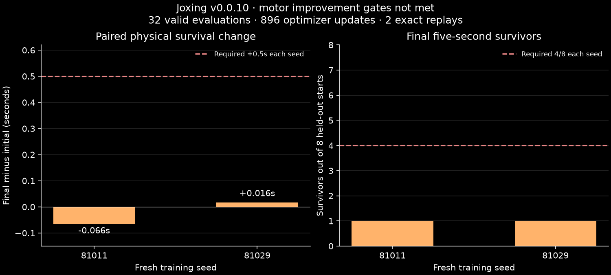

# v0.0.10 results: physical residual pilot

The fixed motor pilot is concluded. **Neither seed met the improvement gate.**
The ordinarySAC138 learner executed16,384transitions and896actual optimizer
updates through all700native muscles per athlete. All32held-out evaluations
were valid, and both required mid-command final-policy replays were exact.
This is one-athlete motor adaptation; native boxing games remain0.

| Training seed | Initial mean survival | Final mean survival | Paired change | Final ≥5s | Result |
|---|---:|---:|---:|---:|---|
| 81011 | 4.8100s | 4.7438s | −0.06625s | 1/8 | Gate failed |
| 81029 | 4.8100s | 4.8263s | +0.01625s | 1/8 | Gate failed |

Each seed required at least+0.5s mean paired gain and4/8final five-second
survivors, zeroinvalids and its exact replay. All8fixed starts83000–83007are
retained for each stage/seed; the two seeds share these starts. No checkpoint
selection, pooled-seed rescue, dropped unfavorable case or threshold change.
These are directional pilot criteria, not a powered population claim.



## What executed and was independently checked

D0checked7saved-input cases with0newphysics and found a reference seam velocity
defect, excluded by the reset grid; causality for falls remains unproven.
R1qualified only the named opt-in root-velocity seam correction across42cases,
4,914samples and0physics. The legacy/default source was preserved.
D1qualified four neutral-residual source-v8 physical replay paths,10,394physics,
with typed reference/snapshot arithmetic preserved and an independent raw audit.

D2executed frozen source`b1d1690ec6bc0c4d248336ce407a5c71a3f0e7c6` on
`xbabe3:/home/ubuntu/joxing/v010-pilot-20261027`. Canonical protocol
`725313890a6e260887fb4542a39878646a8c73508c5a6a35f8294d69061013ec` was publicly
pushed and anonymously byte-verified before outcomes. Linux full196tests passed
275.02s before launch; local frozen-source196tests passed177.52s. Four persistent
one-thread workers per seed, closed before each scalar evaluation/replay.

Training consumed163,840physics,8,192transitions/448updates per seed,1,024warmup
transitions before actual updates at1,040,1,056,…8,192. Both fresh initial
residuals were exactly zero; teacher/normalizer/decoder0.075 and group mapping
were immutable. Initial/final actor, critic, target, optimizer and checkpoint
hashes are retained. Fresh learner/replay per seed; evaluation never trains.
There were64completed and8partial motor episodes, never boxing games.

Training pool startup+learning:136.782s and146.098s, including7.344s/7.732s startup;
actual optimizer time37.028s/35.003s. Aggregate pool throughput57.92transitions/s
(16,384/282.8797s); this includes learner/output overhead but excludes separate
held-out evaluations/replays. It is neither game throughput nor the earlier
rollout-only v9benchmark. D2supervised stage495.830s; its parent clock begins
atPilotRun construction, while import/preflight/final-manifest overhead is
reported separately by supervision rather than counted as simulated time.

The preregistered auditor independently reads every saved held-out command,
signed contact/load/posture interval, typed initial/mid/final state and replay
tail. It reconstructs group decoding, first persistent physical failure,
reward, masks and survival; checks all worker reset/chunk/reward/counter/update
records and loaded checkpoint/optimizer hashes. Saved terminal cached observation
is normalized independently. Other per-control observation hashes rely on frozen
executable assertions plus the two exact closed-loop replay tails, because those
raw caches were not all persisted. Training full substep contacts are not saved;
training first-failure records are checked rather than independently re-simulated.
The audit performs0newphysics/teacher inference and makes no broader claim.

All36D2rows completed:2training,32evaluations,2replays;0invalid/incomplete/not_run.
Both scripted independent audit and a later source/upstream/process audit passed.
All35recorded process identities exited, ownedscanempty and source unchanged
at10:58:23UTC. Local archive copy verifies all668manifested files and their
276,715,588bytes. A positive software/audit result does not rescue the failed
motor objective.

## Caps, artifacts and reproduction

Whole-version main251,144physics/495.045196s including D0/R1/D1, within
550,000physics/1,800s. Separate replayreserve4,494physics/18.962701s, within
50,000/300s. Total255,638formal physics; regression fixtures are separate.
D2raw276,715,588manifested bytes; raw credits were888MiB including conservative
32MiBpriorcharge, within1GiB. Complete raw/checkpoints and negative development
receipts are retained; archive packaging is a post-run0physics operation.

[All-row result](../artifacts/v0.0.10/D2/result.json),
[independent audit](../artifacts/v0.0.10/D2/audit.json),
[process/source exits](../artifacts/v0.0.10/D2/exit-audit.json),
[final accounting](../artifacts/v0.0.10/final-accounting.json),
[complete raw checksums](../artifacts/v0.0.10/raw-archive.json),
[experiment book](../experiments/v0.0.10/README.md).

Full raw release asset:`joxing-v0.0.10-raw.tar.gz`, 234850618bytes,
SHA256`296a30a1d070102a3f7683b3062fb97c5661a80007ffbe5581cf086020b84cfc`. Publication receipt confirms when it becomes public.

Reproduce D2from a fresh checkout at exact sourceb1d1690, its v10locked runtime
and the input file hashes in experiments/v0.0.10/protocol.json. Do not run that
old machine protocol against later development main: intentional file hashes
will reject drift. Source-host Linux replay was qualified; no strict cross-host
inference parity or native muscle competence is implied.

```text
rtk proxy uv run --project experiments/v0.0.10/runtime --locked python scripts/train_motor_residual.py --protocol experiments/v0.0.10/protocol.json --protocol-sha256 725313890a6e260887fb4542a39878646a8c73508c5a6a35f8294d69061013ec --inputs /path/to/verified/inputs --out runs/v0.0.10/fresh-attempt
```

This command requires the full Linux qualification/supervisor and no active
owned job, fresh capacity and a new recorded attempt. It is a reproduction
recipe, **not authorization for an unchanged rerun**. Current development uses
the new v11locked runtime; no old qualified runtime or third_party file changed.

## Decision

Do not enlarge this walking experiment. Activate
[V0.0.11_MISSION](V0.0.11_MISSION.md): simultaneous opponent-aware shared-world
loop, causal observation/history/action queues, physical contact-to-referee,
application replay and the first clearly labeled diagnostic recording.
Body measurement, passive recording and causal history foundations exist;
BoxingEnv, safe actor observation assembly, action queues and connected referee
remain to implement. Train stationary guard/reach/return/contact recovery in
the exact match scene after a finite goal contract, not by rescaling this result.
Competitive native learning remains behind motor/contact/rules/replay gates.
