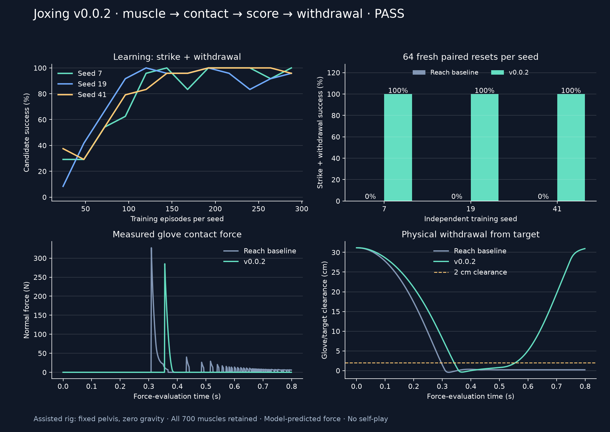

# v0.0.2: learned muscle strike → contact → score → withdrawal

**Proof gates passed.** A learned controller on the actual 700-muscle model now strikes a physical target, earns one legal point, withdraws and rearms. The same reference controller previously reached and contacted the target but remained near it. This is an assisted motor integration proof, not unassisted boxing or self-play.



[Before/after video](../artifacts/v0.0.2/strike-before-after.mp4) · [Frozen protocol](../artifacts/v0.0.2/protocol.json) · [Complete result](../artifacts/v0.0.2/proof-result.json) · [Independent replay audit](../artifacts/v0.0.2/independent-replay-audit.json)

## Measured result

| Training seed | Baseline hits | Baseline hit + withdrawal | v0.0.2 hits | v0.0.2 hit + withdrawal | Mid-contact replay |
|---|---:|---:|---:|---:|---|
| 7 | 64/64 | 0/64 | 64/64 | 64/64 | Exact final engine state and ledger |
| 19 | 64/64 | 0/64 | 64/64 | 64/64 | Exact final engine state and ledger |
| 41 | 64/64 | 0/64 | 64/64 | 64/64 | Exact final engine state and ledger |

Three independently sampled CEM searches used a common prior reach controller, explicitly converted into four pulse phases. Each search ran 12 generations × 24 candidates (288 training episodes). There were **864 training episodes, 384 paired initial/trained evaluation attempts and 21 diagnostic attempts**, with **zero invalid episodes**. Total wall time was **256.813 seconds (4 minutes 17 seconds)** on xbabe1, capped at four CPU workers and one OpenMP/BLAS thread each. No GPU training or physics was used.

Qualification required exactly one torso point, at least 2 cm physical clearance, at least 3 cm measured retraction and the referee ready for a fresh encounter. All trained policies exceeded the thresholds: worst held-out final clearance was 30.3 cm and worst retraction was 27.4 cm. This large withdrawal is useful for this controlled task; it is not a trained boxing guard return.

Baseline and trained policies both scored one point in every evaluation. The improvement is **completing the strike-and-withdrawal sequence**, not scoring more points or maximizing force. Candidate learning curves show exploration batches; the held-out table uses only the final fitted mean policy, never the best test candidate.

## Game/referee proof

- Real muscle excitation drives the glove into a fixed target. No pose/velocity writes occur after reset during a rollout.
- Contact evidence uses pre-solve point velocity, including rotation, the actual glove face orientation, trunk-relative active motion, engine geometry clearance and measured anatomical-forward extension.
- The unchanged candidate rulebook requires at least 0.25 N s direct eligible impulse, qualified onset motion and glove face alignment. Torso earns 1 point, head role 2, guard role 0; force never multiplies points.
- The baseline remained in force-producing contact for more than the scoring window, yet scored once. Full physical impulse is logged separately from eligible scoring-window impulse.
- Fixed-scenario head-role controls scored 2, guard-role controls scored 0 despite nonzero physical impulse, and passive controls scored 0 for every seed. These are semantic spherical-target variants; they do **not** establish anatomical head/chest fitting or a guard physically shielding an opponent's chest.
- Full `mjSTATE_INTEGRATION` plus scorer, clock, held pulses, target/reference values and telemetry were restored during contact at ticks 357, 328 and 292. All three continuations matched final engine state and event ledger exactly on xbabe1.

Independent verification on the local Mac checked protocol digest, checkpoint hashes, all evaluation IDs and raw success counts, then reran every exported policy and restored each Linux contact snapshot. Maximum qpos differences were below 1e-12; force/position/time trace differences were below 1.3e-11 in their recorded units. Event identities, points and timing matched. This is controlled short-task reproducibility, not a claim of universal cross-platform chaotic boxing determinism.

## What was fixed before evaluation

The pilot used seed 7, 8 generations × 16 candidates and development reset IDs 10000–10007. It completed in 34.8 seconds with 8/8 strike-withdrawal successes. Before launching the final proof, the training budget was set to 12 × 24 per seed and final IDs were moved to **20000–20063**, disjoint from pilot evaluation. Diagnostic video/replay was fixed to training seed 7 and scenario 20000. Candidate rules, thresholds, physics and ±1 cm target variation were not relaxed.

The final frozen protocol hash is `36c229d690f79a60edeab302948529342980c2ae6fa766c40785a3512641848a`; executed source commit is `3f2be02023baf996a9d813e729ecd7648b779d91`. All seeds, failed candidate outcomes, rewards, checkpoints, raw evaluation rows, force traces and snapshots are preserved in the [proof archive](../artifacts/v0.0.2/proof-run.zip). The [pilot archive](../artifacts/v0.0.2/pilot-run.zip) remains separate.

## Engineering and compute scope

The fixture retains all 700 muscles and source muscle dynamics/gain/bias/control ranges. Native segment masses and inertias are unchanged; one explicit 0.283 kg glove is added. Package version is 0.0.2. CPU contact filtering preserves solved force/staging checks while avoiding unrelated per-contact work. JSON progress and numeric checkpoints replace atomically. Numerical failures preserve a last-valid integration state and halt training instead of entering selection.

The bounded assay integrated 1,014,223 physics substeps including training, evaluation and partial diagnostic replays: about 3,949 aggregate substeps/s, including search, checkpointing, referee and worker overhead. This measures the assisted single-human assay, not two-human PPO or GPU throughput. The existing GPU parity failure remains unresolved and unchanged.

Final verification: **40 tests pass on Mac and Linux**, plus Ruff. Tests cover native muscle/inertia preservation, rotating point velocities, filtered/unfiltered force agreement, actual muscle contact scoring once through held contact, control ownership, full engine/application restore and the preceding referee/physics regressions.

## Reproduce and continue

From `/Users/bentaylor/Documents/ChatGPT/JOXING`:

```bash
rtk uv sync --extra dev --extra viz
rtk uv run pytest -q
rtk proxy env OMP_NUM_THREADS=1 OPENBLAS_NUM_THREADS=1 uv run joxing train-strike --out runs/v0.0.2/reproduction --workers 4
rtk uv run python scripts/verify_strike.py --run runs/v0.0.2/reproduction --out runs/v0.0.2/reproduction/audit.json
rtk uv run python scripts/report_strike.py --run runs/v0.0.2/reproduction --out artifacts/generated/v0.0.2-reproduction --video
```

`train-strike` rejects reuse of an existing protocol directory. Use a new run path. The original compute run lives at `/home/ubuntu/joxing/bootstrap-20261026/runs/v0.0.2/proof-01` on xbabe1; a local copy is under `runs/v0.0.2/proof-01`. No training job remains active.

Next gate is gravity and balance: validate the native-root/fall behavior, build a nonpenetrating stance/reset bank and train an unassisted stance/reach-return controller before adding an opponent. Full collision coverage, self-contact, foul/fall/boundary adjudication, recurrent tactics and fixed-panel competitive improvement remain open. No self-play claim or injury calibration follows from this release.
