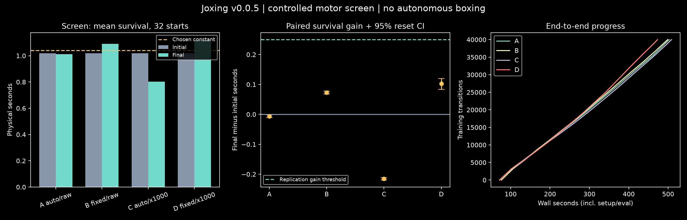

# v0.0.5 results: controlled objective and throughput wave

The original preregistered wave is complete: **160,000 training transitions, all336evaluation attempts, zero invalids**. The largest gain was0.102seconds; no arm met the0.25-second replication threshold or produced a five-second survivor. This is a completed controlled experiment with small short-horizon gains, not a passed motor gate.

The user then explicitly authorized increased workers and training budgets. A separately preregistered [160,000-step-per-arm extension](V0.0.5_BUDGET_ADDENDUM.md), source `76f6e5c`, will run four conditions concurrently. Its screen is complete; fresh-seed confirmation is running. The release will be finalized after those results and independent audits conclude.

## Original-wave measurements

| Arm | Temperature / reward multiplier | Initial mean (s) | Final mean (s) | Paired gain (s),95%reset CI | Five-second survivors |
|---|---|---:|---:|---|---:|
| A | auto /1 |1.017750|1.011563|−0.006188 [−0.010531,−0.001938]|0/32|
| B |0.0001 /1 |1.017750|1.090938|+0.073187 [0.068406,0.077656]|0/32|
| C |auto /1000 |1.017750|0.802313|−0.215438 [−0.219438,−0.211281]|0/32|
| D |0.0001 /1000 |1.017750|1.120156|+0.102406 [0.084000,0.120469]|0/32|

Every arm completed40,000transitions and9,500optimizer updates. D was the registered screen winner, but its gain was below0.25s; all four conditional replication slots are explicitly `not_run`, reason `no_meaningful_screen_gain`. Small positive reset intervals for B/D do not establish replication across training seeds. The chosen constant excitation0.05 averaged1.041406s on the same32starts. See raw [selection](../artifacts/v0.0.5/selection.json), [comparisons/factorial effects](../artifacts/v0.0.5/conclusion.json) and [registry](../artifacts/v0.0.5/registry.json).

B0 completed48diagnostic and32screen baseline episodes. All8diagnostic starts were already tilted about8.2–9.2degrees, with pelvis-tilt velocity about1.1rad/s after gravity preparation. These are mechanically accepted moving starts: the task measures initial-fall recovery, not stationary quiet stance. No reset was made easier during the wave. This diagnosis should guide the next motor-control design.

P0 measured91.993versus19.621optimizer updates/s, a4.688× speedup for the smaller common learner on the same real data. This includes actor, critic, temperature optimization and replay sampling. It excludes physics; the fourfold lower update ratio is a separate compute change. Entire original wave wall was2,358.383s, with2,148,064accounted physics/preparation steps. All training/evaluation processes exited.

At the user’s request the host allowance increased4→16. H0 measured medians220.48/436.01/646.79rollout transitions/s at4/8/12workers alongside the four-worker wave, then844.67at16workers after it exited. There were24,000timed rollout transitions and zero invalids. Setup is separate; optimization is excluded. Shared-host timing and different concurrent load limit old-versus-new throughput comparisons.

Linux independently recomputed all336attempts, raw summaries, selection, actor hashes and physics accounting; all policy/action continuation references were exact. Mac accounting and repeated local continuation pass, while strict cross-host closed-loop full-state parity remains failed. Recorded Linux actions reproduce engine state to near machine precision on Mac for the examined snapshots, unlike recomputing actions from the network. This localizes an important policy-arithmetic contribution without qualifying universal engine/GPU parity. Both passing and failing receipts remain published.



[Fixed-scenario initial/final video](../artifacts/v0.0.5/wave-before-after.mp4): armD, scenario60000, shared clock, ended frames labeled. This is the predeclared first screen scenario and the registered winner, not a favorable clip selected by outcome. The posture remains visibly unstable.


## Larger-budget screen, confirmation pending

The extension completed 640,000 screen transitions: 160,000 and 39,500 optimizer updates per arm. Its four conditions share seed 547 and 32 new paired starts. Initial mean survival was 1.059063 seconds.

| Arm | Final mean (s) | Gain (s), 95% reset CI | Five-second survivors |
|---|---:|---|---:|
| A | 0.893156 | −0.165906 [−0.175250, −0.156530] | 0/32 |
| B | 1.313469 | +0.254406 [0.225810, 0.285813] | 0/32 |
| C | 1.245156 | +0.186094 [0.156249, 0.216656] | 0/32 |
| D | 1.126563 | +0.067500 [0.055813, 0.079187] | 0/32 |

B narrowly cleared the registered 0.25-second screen threshold and exceeded reference A by 0.420313 seconds. It was frozen as the candidate before confirmation outcomes. [The screen-freeze receipt](../artifacts/v0.0.5/extension/screen-freeze.json) independently recomputes selection and records hashes, 288 new screen evaluation attempts, zero invalids, and eight reused diagnostic rows excluded from that denominator. Full completed screen records are retained alongside it.

Matched A/B confirmation jobs for fresh seeds 761 and 983 now run at the same 160,000-transition budget. Initial and final confirmation evaluations remain deferred until each final actor is frozen. A qualifying screen is not a replicated result; the five-second motor gate remains unmet.

## What was frozen

The plan was committed as `09cbacb`; machine protocol and executable source as `6ac2bad` before formal execution. Protocol SHA256 `7a4ca4a6b841ca39ca8141db83d1e0e05b01d49054408d71197ac28ecff97fe5`; source SHA256 `8b45216daf642dc2ec9e76b37d0e76533310666d26d7c8943e6e9bf33ba20ba0`. The active xbabe1 checkout stayed frozen during execution. User-requested host increase was preregistered separately as `b3ec872`; the original scientific protocol was not rewritten.

Native gravity,700muscles,138action groups,1,023observations, anatomical inertia, reset-only projection/preparation, fall criteria and game points are unchanged fromv0.0.4. Training reward units and entropy temperature are explicit algorithm interventions. Hand targets are reset positions, not a boxing guard. These are motor experiments, not trained boxing or self-play.

Six constant excitations on8diagnostic starts determine a frozen baseline. A real optimizer benchmark must exceed2× speedup before four matched SAC conditions run: auto/raw(A), fixed0.0001/raw(B), auto/×1000(C), fixed0.0001/×1000(D). Every screen condition uses seed149, the same canonical initial actor,40,000transitions/900seconds,128×128network,batch64,warmup2000, and one gradient update per four transitions. All32initial/final physical starts are paired. Selection requires at least0.25seconds gain over initial and, for non-A, at least0.10seconds over A. Only a qualified selection opens fresh-seed263/431 confirmation and reset IDs61000–61031.

## Scope and interpretation

The2×2 screen is exploratory and one training seed; reset bootstrap intervals are not uncertainty across training seeds. The smaller learner and lower update ratio differ fromv0.0.4, so old-versus-new performance is contextual. Only the within-wave arms hold those controls fixed. Faster optimizer updates do not establish faster learning. Scaled rewards and critic losses cannot establish motor improvement; raw survival and unchanged five-second gates determine that.

Recorded-action engine replay and closed-loop policy replay are distinct tests. Strict same-host1e-9 and cross-host full-state1e-5 tolerances remain unchanged, including solver warmstart state. Passing an action trace does not repair a failed cross-host closed-loop check or qualify GPU physics.

## Reproduce

From a fresh clone with pinned submodules and the locked dependencies:

```bash
uv sync --extra dev --extra viz --extra motor
OMP_NUM_THREADS=1 OPENBLAS_NUM_THREADS=1 MKL_NUM_THREADS=1 uv run python scripts/run_wave.py --protocol experiments/v0.0.5/protocol.json --out runs/v0.0.5/reproduction
uv run python scripts/verify_wave.py --run runs/v0.0.5/reproduction --out runs/v0.0.5/reproduction-audit.json
uv run python scripts/report_wave.py --run runs/v0.0.5/reproduction --out artifacts/generated/v0.0.5-reproduction --video
```

Actor-only `.pt` bundles load via `stable_baselines3.sac.policies.Actor.load(path, device="cpu")`. Full optimizer/replay directories remain under ignored `runs`; these are not exact training-resume checkpoints. Raw rows, descriptions, attempts, negative results and actor bundles are curated inGit. Read the [experiment book](../experiments/v0.0.5/README.md), [preregistered plan](V0.0.5_PLAN.md), [host addendum](V0.0.5_RESOURCE_ADDENDUM.md) and [raw evidence](../artifacts/v0.0.5/).
