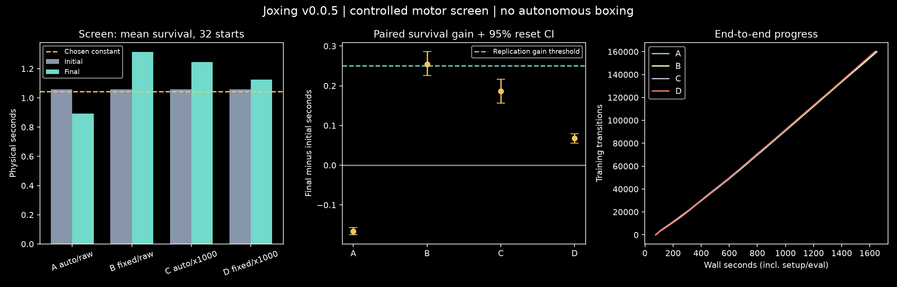

# v0.0.5 results: controlled motor learning and compute

**Both waves are complete: 1,440,000 training transitions, 354,000 scheduled optimizer updates, all 912 new evaluation attempts, zero invalid evaluations.** The extended candidate improved over its initial policy on both fresh training seeds, but lost to reference A on seed 983. The registered replicated-superiority criterion failed. Every final policy had **0/32 five-second survivors**; motor competence and autonomous boxing remain unproved.

This release delivers a controlled experiment, faster measured computation, complete positive/negative evidence, and a code audit of the state/history/game interfaces. It does not establish that more episodes alone produce a boxing game. [Experiment book](../experiments/v0.0.5/README.md) · [Evidence](../artifacts/v0.0.5/) · [State/history audit](STATE_HISTORY_SELF_PLAY_AUDIT.md) · [Next motor-teacher plan](UPSTREAM_MOTOR_TRANSFER_PLAN.md).

## Original registered wave

| Arm | Temperature / reward multiplier | Initial mean (s) | Final mean (s) | Paired gain (s), 95% reset CI | Five-second survivors |
|---|---|---:|---:|---|---:|
| A | auto / 1 | 1.017750 | 1.011563 | −0.006188 [−0.010531, −0.001938] | 0/32 |
| B | 0.0001 / 1 | 1.017750 | 1.090938 | +0.073187 [0.068406, 0.077656] | 0/32 |
| C | auto / 1000 | 1.017750 | 0.802313 | −0.215438 [−0.219438, −0.211281] | 0/32 |
| D | 0.0001 / 1000 | 1.017750 | 1.120156 | +0.102406 [0.084000, 0.120469] | 0/32 |

Every arm completed 40,000 transitions and 9,500 updates. D won the screen but missed the 0.25-second gain threshold. All four conditional replication slots are explicitly `not_run`, reason `no_meaningful_screen_gain`. B/D's positive reset intervals do not establish replication across training seeds. Constant excitation 0.05 averaged 1.041406 seconds on the same 32 starts. [Selection](../artifacts/v0.0.5/selection.json) · [Raw comparisons/factorial effects](../artifacts/v0.0.5/conclusion.json) · [Registry](../artifacts/v0.0.5/registry.json).

B0 completed 48 diagnostic and 32 screen baseline episodes; the four policy pairs contributed 256 attempts, totaling 336. Original wave wall time was 2,358.383 seconds, with 2,148,064 accounted physics/preparation steps. All scheduled training finished within its bounds.

[Original initial/final replay](../artifacts/v0.0.5/wave-before-after.mp4): selected arm D, predeclared first scenario 60000, common clock and ended-frame labels. It was rendered on Mac; the cross-host limitation below applies. The posture is visibly unstable. [All stochastic episode durations](../artifacts/v0.0.5/wave-training-durations.png) use control-step duration approximations, not deterministic evaluation survival.

## Authorized larger-budget screen

The user explicitly authorized increased workers and training budgets. A [separate addendum](V0.0.5_BUDGET_ADDENDUM.md) and [protocol](../experiments/v0.0.5/extension-protocol.json) were committed before execution. Each arm retained the same algorithmic/physical contracts with 160,000 transitions / 2,700 seconds, first limit. Four learners ran concurrently, four simulation workers each, 16 total. New seed 547 and starts 64000–64031 make this a new development screen, not replication of the original screen.

| Arm | Initial mean (s) | Final mean (s) | Paired gain (s), 95% reset CI | Five-second survivors |
|---|---:|---:|---|---:|
| A | 1.059063 | 0.893156 | −0.165906 [−0.175250, −0.156530] | 0/32 |
| B | 1.059063 | 1.313469 | +0.254406 [0.225810, 0.285813] | 0/32 |
| C | 1.059063 | 1.245156 | +0.186094 [0.156249, 0.216656] | 0/32 |
| D | 1.059063 | 1.126563 | +0.067500 [0.055813, 0.079187] | 0/32 |

B narrowly cleared the registered 0.25-second gain threshold and exceeded A by 0.420313 seconds. [The screen-freeze receipt](../artifacts/v0.0.5/extension/screen-freeze.json), committed as `36fe5b6` before fresh-seed outcomes, independently recomputes selection and hashes every completed screen artifact. The frozen constant averaged 1.043500 seconds on this bank. The screen contributed 288 new attempts; eight reused diagnostic rows were excluded from the new-attempt denominator.

## Fresh-seed confirmation: superiority did not replicate

All four confirmation jobs completed 160,000 transitions and 39,500 updates. Each seed pairs reference A with selected B and the same 32 starts 65000–65031. Initial actors match within each seed; initial/final learner-policy evaluations occur after final actor save.

| Seed | Initial mean (s) | Final A (s) | Final B (s) | B minus initial, 95% reset CI | B minus A, 95% reset CI |
|---|---:|---:|---:|---|---|
| 761 | 1.022875 | 0.803000 | 1.293531 | +0.270656 [0.244531, 0.299500] | +0.490531 [0.452125, 0.532286] |
| 983 | 1.010531 | 1.165406 | 1.097188 | +0.086656 [0.080030, 0.093156] | −0.068219 [−0.096314, −0.040187] |

B also exceeded the frozen constant baseline (mean 1.035438s): gains 0.258094s [0.230091, 0.289219] and 0.061750s [0.054062, 0.069375]. These are small, short-horizon motor improvements. The registered criterion requires positive lower bounds versus both own initial and A on **both seeds**; seed 983 fails the latter. Do not declare fixed temperature universally superior or select a new default from the favorable seed. These reset intervals are not uncertainty across training seeds.

The extension completed 1,280,000 training transitions, 316,000 updates, 576 new evaluations and zero invalids in 3,555.388 wall seconds. Its accounted physics/preparation total is 13,841,563. Both waves together used 15,989,627 formal physics/preparation steps; adding the conservative one-million-step supplementary reserve remains below the 40-million cap. Aggregate extension throughput including its setup/baselines/evaluations was about 360 training transitions/s, not a pure rollout or per-world latency measurement. All owned training/benchmark PIDs exited; [lifecycle receipt](../artifacts/v0.0.5/process-exit.json).

The monitor files contain 14,736 completed stochastic **motor episodes** across both waves, plus partial episodes at collection stop. They are not boxing mini-games. All 12 final policies failed the five-second continuation gate; the larger formal motor proof and self-play were not launched. [Final extension registry](../artifacts/v0.0.5/extension/registry.json) · [Comparisons](../artifacts/v0.0.5/extension/conclusion.json) · [Training history](../artifacts/v0.0.5/extension/wave-training-durations.png).

[Source-host initial/final video](../artifacts/v0.0.5/extension/wave-before-after-linux.mp4) uses selected B and the predeclared first screen scenario 64000, rerun on xbabe1 with CPU physics and EGL rendering. Rendering acceleration is not GPU physics. [Render receipt](../artifacts/v0.0.5/extension/render-receipt.json). This is a development clip of falling bodies, not a favorable scenario selected to imply competence.

### Confirmation-bank timing limitation

The source runs the frozen constant baseline on confirmation IDs before launching the confirmation learners. Thus the strict statement that **no process opens those IDs before final actors freeze** is not satisfied. Initial/final learner-policy evaluations are deferred until final actor save; the learner uses disjoint training reset IDs, and B/config/criteria stayed frozen before confirmation outcomes. No retuning occurred. The precommitted source/raw records preserve this order; it was disclosed as `eba0959` before outcomes. Interpret this as limited policy confirmation, not a completely sealed-bank formal proof. Historical preregistration wording is retained; a future formal proof must defer every comparator or explicitly register the exception.

## Compute, replay and code findings

P0 measured 91.993 versus 19.621 real optimizer updates/s, a 4.688× speedup for the smaller network/batch on common real data. This includes replay sampling and actor/critic/temperature optimization, excludes physics, and is separate from reducing the update ratio to 0.25 per transition. Faster optimization is not proof of better learning.

The user-authorized worker allowance rose 4→16. H0 rollout medians were 220.48/436.01/646.79 transitions/s at 4/8/12 workers alongside the original four-worker wave, then 844.67 at 16 after it exited. There were 24,000 timed transitions and zero invalids. Setup is separate; optimizer work is excluded. Shared-host load and different run budgets prevent interpreting all old/new timing differences causally.

Both independent **Linux audits pass**: raw rows/counts, pairing, summaries, selection, actor hashes, physics accounting and exact source-host policy/action continuations. Mac accounting and repeated local continuation also pass. Strict cross-host closed-loop full-state parity **fails**, with unchanged tolerance 1e-5; the extension's largest full integration-state error is 4.247, while outcomes/ticks still match on these snapshots. Recorded Linux actions reproduce the examined Mac engine states within 1.20e-10. This exposes a policy-arithmetic contribution without proving universal engine/GPU parity. Full-state vectors mix state types; 4.247 is not a position error in meters. Both passing and failed receipts are preserved. [Original Linux](../artifacts/v0.0.5/audit-linux.json) / [Mac](../artifacts/v0.0.5/audit-mac.json); [extension Linux](../artifacts/v0.0.5/extension/audit-linux.json) / [Mac](../artifacts/v0.0.5/extension/audit-mac.json).

Mechanically accepted starts are already tilted about 8–9 degrees with pelvis-tilt velocity about 1.1rad/s after gravity preparation. This is initial-fall recovery, not stationary quiet stance. No reset was made easier mid-wave. The next motor design must establish feasible stationary/recovery tasks rather than assume these are at rest.

The requested code audit confirms own-body velocities, activation and previous actions feed the muscle controller at 100Hz simulated cadence. Opponent input, acting-time temporal memory, a connected boxing referee, latency/jitter queues and historical-opponent learning are missing. Saved traces/replay buffers do not supply recurrent acting memory. The audit specifies causal local-frame velocities, public game observations, history/reset masks, simultaneous actions, timing tests and frozen-panel evaluation.

Offline Mac diagnostics measured actor-call medians 0.062–0.064ms (one observation), with no >10ms calls in 16,000 batch-one/batch-four samples. The short recorded-action profile attributed about 76% of profiled time to native solver steps. These isolated measurements exclude full-game scheduling/transport and do not guarantee wall-clock real time. An [additive accounting correction](../artifacts/v0.0.5/diagnostic-accounting-correction.json) includes constructor preparation omitted from the earlier latency/profile counters; original raw measurements remain unchanged. Future scripts count it explicitly.

The [next motor-teacher plan](UPSTREAM_MOTOR_TRANSFER_PLAN.md) inspects the released DynSyn-SAC checkpoint's incompatible interfaces and a possible decoder-amplitude restoration issue. Metadata inspection is complete; teacher replication/transfer is proposed, not measured. It complements the missing opponent/history/game work and does not bypass motor/contact gates.

## Frozen implementation and validation

Plan commit `09cbacb`; original protocol/source commit `6ac2badea47271e42a4b60dbd65531a587fa4111`; original canonical protocol SHA256 `7a4ca4a6b841ca39ca8141db83d1e0e05b01d49054408d71197ac28ecff97fe5`; source SHA256 `8b45216daf642dc2ec9e76b37d0e76533310666d26d7c8943e6e9bf33ba20ba0`. Host increase registered as `b3ec872`.

Extension source/addendum commit `76f6e5ce47f9966d9896f08a03652c20dcc9db31`; canonical protocol SHA256 `0ec47e01e39823a7f68188a1ee179eb4cfc907d61922ec814afdb450f0016f47`; source SHA256 `ed1379dccbcbe57fe558f99643f637b4aa8224411ee2dfeae5aac5512ef9d37b`. Both remote checkouts stayed frozen through execution and every result asserts unchanged source.

Native gravity, 700 muscles, 138 groups, 1,023 observations, anatomical inertia, reset-only projection/preparation, physical failure criteria and game points stayed unchanged from v0.0.4. Hand targets remain reset positions, not a boxing guard. Common learner: 128×128, batch64, buffer50,000, warmup2,000, learning rate3e-4, gamma.99, tau.005, one update per four transitions. Only registered reward units, entropy and later budget/split changed. Within-wave comparisons are controlled; comparisons between waves/v0.0.4 have seed/budget/reset/compute confounds.

**72 tests pass on Mac (55.40s) and Linux (83.23s)** for the extension source, including real parallel worker execution, deferred evaluation and peer-stop fault preservation. Earlier source had 70 passes. Complete logs and development startup failures are retained. Final diagnostics/report scripts also passed Ruff and actual data executions; plots/video were inspected. Source-host replay and cross-host failure remain separate from the unit-test count.

## Reproduce and handoff

Use a fresh clone with pinned submodules and locked dependencies, and fresh output paths. [TRAINING.md](TRAINING.md#authorized-larger-budget-extension) gives executable original→extension commands and offline audits/reports. The extension inherits a four-hour deadline from its parent's timestamp: an archived parent cannot launch a new run after that deadline. Reproduce a fresh parent first; never alter the old timestamp to bypass the cap. The original and extended protocols are separate; do not pool their reset intervals as one confirmatory experiment.

Actor-only `.pt` bundles load through `stable_baselines3.sac.policies.Actor.load(path, device="cpu")`. They support inference; full ignored optimizer checkpoints do not include exact replay/RNG training resume. Git retains every experiment description, raw attempt, actor, monitor/progress/loss/resource record, decision, fault/not_run reason, audit and derived visual. Artifact manifests hash curated files. [Release summary](../artifacts/v0.0.5/release-summary.json) provides machine-readable totals, limitations and next gates.

Continue with feasible motor resets and the teacher-compatibility experiment, then P1/P2/P3/P5's stateful game integration. Neither an optimizer-speed gain nor hundreds of thousands of quick falls establishes better boxing. Preserve these negative results and qualify the actual two-player workload before expanding to 100,000 short games.
