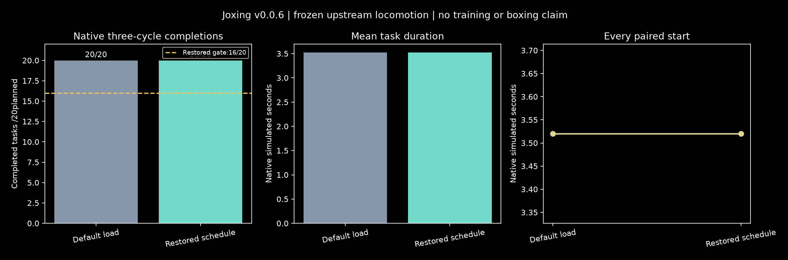

# v0.0.6: native motor-controller qualification

The released full-body DynSyn-SAC controller is now reproducible on the Linux source host and completed **40/40 registered native locomotion attempts, zero invalids**. The decoder schedule is lost on ordinary checkpoint load; explicit restoration and corrected save/load are tested. This is a frozen upstream policy, with **zero Joxing training updates**. It establishes a useful walking-controller dependency; quiet stance, raised guard, independent reach/return and boxing remain gated.

[Preregistered plan](V0.0.6_PLAN.md) · [protocol](../experiments/v0.0.6/protocol.json) · [experiment book](../experiments/v0.0.6/README.md) · [all evidence](../artifacts/v0.0.6/) · [Linux audit](../artifacts/v0.0.6/audit-linux.json) · [video](../artifacts/v0.0.6/native/native-controller.mp4) · [next mission](V0.0.7_MISSION.md).

## Registered experiments and results

Protocol commit `75e9a18` precedes checkpoint deserialization/native trajectories. Frozen implementation `97565e90012b59bb16db8c45e4aa7f095a905c3c`, source SHA256 `880ff9eecb52b4507ec1cd4e9b6cbb63eb5ffefd06dc36345bb2c54dea19211a`; protocol canonical SHA256 `cfea7b6cbbb31580d90ea26463512a756af03498a6251bce46d32e3038ac5554`. No source, anatomy, reward, threshold or normalizer changed during evaluation. Seeds 71000–71019 are paired exactly across the two conditions. All forty slots were registered before execution.

| Experiment | Question | Measured outcome |
|---|---|---|
| L0 | Does checkpoint loading retain scheduled decoder state? | Default layer amplitude `None`; training-step schedule 0.075. Restoring it changes normalized action probes by mean absolute 0.030902829 / maximum 0.074400783. Corrected save/load prediction error 0; actor tensor hash unchanged. |
| N0 default | Can the released default load complete native three-cycle locomotion? | 20/20 horizon completions; mean 3.52 simulated seconds; 0 invalid, 0 incomplete, 0 not_run. |
| N0 restored | Can the frozen schedule-restored controller meet>=16/20 completions? | 20/20; mean 3.52 s; 0 invalid, 0 incomplete, 0 not_run. Registered native diagnostic threshold passes. |
| R0 | Does the first registered snapshot continue exactly on Linux? | Seed 71000, control step 10, both modes: recorded commands, closed-loop policy and repeated closed-loop replay all have 0 integration-state/observation error; done/support telemetry agree. Strict threshold<1e-9 passes. |

Both decoder conditions reach the task ceiling. There is **no measured completion advantage from restoring the schedule**, and no learning-improvement comparison: the weights were already trained upstream. Saved 45 million upstream transitions are provenance, not new Joxing training. The probes are synthetic loader diagnostics, not a boxing performance metric.



## Actual physical and observation contract

The native task retains all 700 muscles, 85 position and 85 velocity coordinates, 700 activation values, ordinary gravity, and upstream muscle dynamics/termination. Native physics advances every 2 ms with ten substeps per 20 ms action (50 Hz). This differs from the earlier Joxing stance rig's 1 ms physics/10 ms control. There are no gloves, opponent, scoring referee, policy action filter, external forces, gravity support or kinematic pose writes during the measured trajectory. Reset initialization remains the upstream noisy reference reset with random_init=True and noise 0.001.

The 3,601 ordered observation features include actual pose/velocity/acceleration, muscle activation/force/length/velocity, keypoints and current/future **self-reference** trajectory targets. Future self-reference targets are known task inputs, not future opponent observations or game-state history. The actor is feedforward; temporal opponent memory, causal latency queues and league remain missing as detailed in the [state/history audit](STATE_HISTORY_SELF_PLAY_AUDIT.md).

The upstream three-cycle time horizon and mean-qpos tracking health are retained unchanged. No post-control sampled support failures were seen. That 20 ms sampling does not certify per-physics-step sporting fall/foul/contact rules. Native walking completion does not pass the five-second stationary development gate or the later formal motor proof.

Snapshots include engine integration state, solver warmstart, actual cached last actor observation, reference phase/trajectory, RNG and sampled-support timers. Recomputing a cached observation with `mj_forward` alone changes acceleration/force inputs; the actual cached policy input is therefore preserved. Independent replay validates both action-only physics and the closed-loop actor/normalizer path.

## Reproducibility, compute and limitations

The known archive `LocomotionFull.zip` is 223,978,082 bytes with SHA256 `2b2f0f1007d530db76463e7d3d5fb309b52c7b2a53649920ddfd9cf8a6880c57`. Original model member SHA256 `0a3607c0a9d745a6bb5a5ffceb7539a7405d455943abf283d4f8107f22a47829`; normalizer member `e359b32fa026a02746cffcba6ee3ef9cab4389d37c74b19bd21caa0f3abc0086`; canonical actor `963d2f56c5887f79e094ddf998316730475f979efb100073237cda81817e272e`. Plain frozen normalization statistics, probes and hashes are committed; large release/model/optimizer ZIPs and pickle stay ignored. Reacquire the exact upstream archive for full replay.

The release model revision differs from Joxing's pin, but complete source-tree comparison shows only a README change. The only native environment adaptation is canonical model-file lookup. Third-party source is unchanged. [Release comparison](../artifacts/v0.0.6/release-source-compatibility.json) and [source patches](../artifacts/v0.0.6/release-source-patches.json) record this explicitly.

An isolated locked runtime uses Python 3.12,NumPy 2.4.2,Gymnasium 1.2.3,SB3 2.7.1,Torch 2.10.0 CPU and MuJoCo 3.8.0. Mac full suite 80 passed/64.41 s; final 8 target checks passed/8.45 s. Frozen Linux source passed all 80 tests/94.03 s before launch. These are software/physical invariant checks, not 80 boxing matches.

xbabe1 ran one CPU world/one Torch-BLAS-OpenMP thread in `/home/ubuntu/joxing/v006-20261026`, with 900 wall-second/1 million-physics-step/1 GiB raw caps, first limit. N0 finished in 77.2294 wall seconds,70,400 physics steps and 601,600,339 raw bytes, including extracted checkpoint members. Fresh launch had 46 GiBavailable RAM and 319 GiBfree disk. The independent Linux audit added 9,960 physics steps; fixed-scenario video replay added 3,520. Test/development work is separately logged. No GPU physics or optimizer ran, and these counts are not full-game throughput. Both registered PIDs exited and no Python task remains in the dedicated checkout; [exit receipt](../artifacts/v0.0.6/process-exit.json).

**Mac portability remains unqualified.** Its auditor passed raw accounting, pairing, physics totals and actor/normalizer hashes, then failed the unchanged strict compiled-contract assertion before reference replay. Maximum body-mass difference 5.55e-17 and inertia difference 9.76e-19 are consistent with compiler rounding; the gate remains failed and Mac reference replay is `not_run`. No tolerance or historical hash was relaxed. [Failure receipt](../artifacts/v0.0.6/audit-mac-failure.json). Source-host Linux qualification passes independently.

Development failures remain visible: initial replay test stepped after a genuine physical termination and its harness was corrected; first deployment referenced an old clone's local origin and was repaired in the new dedicated checkout before tests; anonymous GitHub source inspection hit a rate limit and authenticated read succeeded; initial rendering exceeded Gym's framebuffer and a display-only repair generated the final video outside frozen source. [Development receipts](../artifacts/v0.0.6/development/). The small raw curation check found and added a missing unchanged parent log; all 135 curated raw files now match byte-for-byte. Historical `result.json` says replay pending because it precedes R0; the later independent audit resolves it without rewriting the run's raw result.

## Reproduce the bounded native qualification

Use a fresh output directory; this command does not run optimization or self-play. Run from the repository with pinned submodules initialized. Download the archive from the [upstream release](https://github.com/LNSGroup/msgym/releases/tag/Checkpoints) to ignored `runs/upstream-checkpoint-inspection/LocomotionFull.zip`; the runner verifies its exact SHA before extraction/deserialization.

```bash
uv sync --project experiments/v0.0.6/runtime
OMP_NUM_THREADS=1 OPENBLAS_NUM_THREADS=1 MKL_NUM_THREADS=1 uv run --project experiments/v0.0.6/runtime pytest -q
OMP_NUM_THREADS=1 OPENBLAS_NUM_THREADS=1 MKL_NUM_THREADS=1 uv run --project experiments/v0.0.6/runtime python scripts/run_upstream_motor.py --protocol experiments/v0.0.6/protocol.json --archive runs/upstream-checkpoint-inspection/LocomotionFull.zip --out runs/v0.0.6/reproduction
OMP_NUM_THREADS=1 OPENBLAS_NUM_THREADS=1 MKL_NUM_THREADS=1 uv run --project experiments/v0.0.6/runtime python scripts/verify_upstream_motor.py --run runs/v0.0.6/reproduction --out runs/v0.0.6/reproduction-audit.json
MUJOCO_GL=egl uv run --project experiments/v0.0.6/runtime python scripts/report_upstream_motor.py --run runs/v0.0.6/reproduction --out artifacts/generated/v0.0.6-reproduction --video
```

Set the render backend to suit the host; EGL above is the inspected headless Linux configuration. Qualification uses source-host replay; cross-platform compiled contracts remain a separate failed portability gate. Never reuse a completed run directory or silently substitute a checkpoint/library version.

## Next bounded mission

[v0.0.7](V0.0.7_MISSION.md) tests observation-correct glove/timestep transfer and longer frozen-policy locomotion: four conditions, the same 20 ms controller cadence, explicit canonical-name mapping for reference body arrays, preserved native anatomy, fresh paired seeds and registered resource/stop rules. It is ready to implement, not yet executed. The 20-minute supervisor reads [MISSION](MISSION.md), actual process/progress/faults and Git, advances healthy work, audits completion and starts the next small mission when idle. Full boxing/history/league work still follows motor, contact, game and replay gates.
