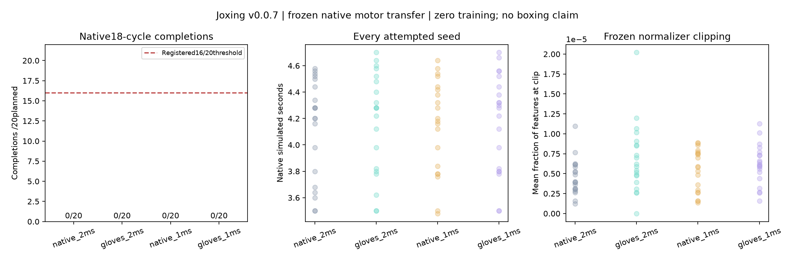

# v0.0.7: correct transfer, failed longer tracking

The glove/timestep adapter preserves native anatomy and observation semantics, and every first-seed continuation replays exactly on Linux. **All 80 registered longer native tracking trials completed with zero invalids, but none reached the 18-cycle horizon.** The unchanged native baseline also failed, so a glove-specific explanation is not established. This was a frozen upstream policy with zero optimization.

[Experiment book](../experiments/v0.0.7/README.md) · [protocol](../experiments/v0.0.7/protocol.json) · [adapter contract](NATIVE_TRANSFER.md) · [evidence](../artifacts/v0.0.7/) · [Linux audit](../artifacts/v0.0.7/audit-linux.json) · [fixed video](../artifacts/v0.0.7/transfer/native-transfer.mp4) · [full raw archive](https://github.com/neverhuman/Joxing/releases/download/v0.0.7/joxing-v0.0.7-raw.tar.gz) · [next mission](V0.0.8_MISSION.md).

## Registered results

Preregistration commit `884d753` precedes formal outcomes; frozen implementation `9e3ee335c3995c860b40237bf6f00ba155d5d62d`. The canonical protocol SHA256 is `cd07fccb4d600d67b0f97c5f557430a2613b688280e7bf26bb0dd2b27fb94d83`. Every seed 72000–72019 has all four conditions, with exact paired initial qpos/qvel/activation/phase/RNG. Actor tensors, normalization, anatomy, task health and controller cadence stayed fixed.

| Condition | Native horizon completions | Mean duration | Valid / planned |
|---|---:|---:|---:|
| Native, 2 ms physics | 0/20 | 4.129 s | 20/20 |
| Gloves, 2 ms physics | 0/20 | 4.171 s | 20/20 |
| Native, 1 ms physics | 0/20 | 4.145 s | 20/20 |
| Gloves, 1 ms physics | 0/20 | 4.178 s | 20/20 |

All four registered >=16/20 completion thresholds fail. No invalid, incomplete or not_run evaluations. There is no new training-improvement or boxing result. v6's three-cycle qualification still passes its original short task; v7 exposes its limited horizon rather than rewriting that historical outcome. The unchanged native baseline's failure blocks attributing overall long-task failure solely to equipment or finer integration.

The reference has 117 frames at 100 Hz:18 cycles means a 21.06 s threshold, sampled at 20 ms control boundaries. The mission's earlier ~21.12 s estimate multiplied rounded v6 endpoints and was inaccurate; a clarification was recorded before interpretation. The registered 18 cycles, native termination and all criteria remained unchanged. All observed terminations here occurred well before either estimate.

## Delivered mechanisms and independent checks

`ReferenceBodyMap` separates canonical trajectory indices from live body IDs. Inserting glove bodies shifts later body IDs; the original observation and reward paths would silently select wrong reference keypoints. Both paths now use the explicit map, with no invented or zero-filled reference feature. All 3,601 observation values retain their original order. Four native physical variants preserve 700 muscles, 85 qpos/85 qvel, native body inertias and joint/actuator/tendon/equality ordering. Glove bodies add exactly 0.566 kg. Native 2 ms feature, reward and integration-state equivalence is exact, including the actual preserved v6 source-host continuation.

Physics uses 2 ms or 1 ms substeps while control stays 20 ms (50 Hz). The known-hash upstream actor uses scheduled decoder amplitude 0.075 and immutable observation statistics. No action filter, optimizer, external assistance, pose playback or per-step state overwrite was added. Future self-reference inputs remain known task goals; opponent observations, recurrent history, transport jitter and self-play remain missing.

The independent Linux auditor checks all 80 rows, hashes, pairing, action dimensions/ranges, trace metrics, physics totals and normalizer/actor identities. Seed 72000 in all four conditions passes fixed-action, closed-loop and repeated closed-loop continuation: all 12 paths have **zero integration-state and cached-observation error**, below the unchanged1e-9 threshold. Accounting/replay pass; `native_transfer_diagnostic_passed=false` because task completion fails. No Mac compiled-contract/replay pass is claimed; v6's failed portability gate remains retained.

## What actually ended the task

The native termination measures mean absolute joint-pose tracking error above 0.06, excluding the first three translation coordinates. It is not a sporting fall rule. No 20 ms-sampled support failures were recorded in any formal episode. This does not establish physical survival beyond termination or per-substep contact/referee correctness.

A separately labeled post-hoc replay uses the fixed first seed in every variant, without continuing past native termination. Its final mean tracking errors are 0.06027–0.06139; largest deviations include knee/ankle and shoulder coordinates. Pelvis tilt is approximately 10.2–11.9 degrees, drop 2.1–3.2 cm, nonfoot load 0 N and foot support is still present at these sampled boundaries. The full joint errors, limb/body spatial velocities and forces are retained in [tracking-diagnostic.json](../artifacts/v0.0.7/tracking-diagnostic.json). Recomputed policy actions match recorded commands exactly. These observations motivate a physical-continuation diagnostic; they do not prove that the athlete would keep its balance.

Across all 80 trials, mean fractions of normalized features at the clipping boundary are approximately4.6e-6–6.9e-6 by condition. Widespread clipping is not supported by this measurement; clipping elsewhere or reference/control problems are not causally excluded. No post-hoc reward, normalization, termination or anatomy retuning was performed.

## Compute, receipts and limits

One xbabe1 parent owns four disjoint variant workers, one Torch/BLAS/OpenMP thread each, in `/home/ubuntu/joxing/v007-20261026`. Fresh launch had 41.4 GiB available RAM and 318 GiB free disk. The runner used 141.4419 wallseconds and 256,920 physics steps:249,460 formal steps over 16,623 control transitions plus 7,460 prerequisite/benchmark steps. Raw output was about 332 MB including the extracted original model, below 1 GiB. Source/assets remained unchanged.

The independent replay audit added38,730 physics steps/45.364 s; video replay added13,510 steps/33.625 s; the separate tracking diagnostic added13,510 steps. Total counted mission physics is 322,670, below 2 million. No GPU physics or optimization ran. Development tests/smoke are separately recorded. All registered launcher/parent/worker/audit/render/diagnostic PIDs exited and the dedicated checkout has no Python jobs; [exit receipt](../artifacts/v0.0.7/process-exit.json).

The one/four-worker benchmark ran two repeats each. Median concurrent loop throughput was 91.24/256.50 control steps/s; including startup/shutdown, the short 40-step cases achieved only 4.64/15.53 steps/s. The loop includes actor inference, normalization, CPU physics, support telemetry and snapshots; it excludes optimizer, match referee and disk output. Startup matters for tiny jobs. Neither metric predicts two-athlete boxing throughput.

Mac full 98 tests passed/126.46 s, then final 27 target tests passed/47.07 s. Frozen Linux source passed all 99 tests/151.18 s before formal launch. Ruff passes. The only data-copy failure was a missing local destination parent; the unchanged read-only copy succeeded after directory creation. Raw upstream config whitespace is preserved for bytewise hashes. Last periodic progress remained 79/80; final immutable evaluations/result correctly contain 80/80, independently audited. A future runner should flush its final progress rather than rewriting this receipt.

Every attempt/result, start, semantic map, oracle, progress/event, first-seed commands/traces/replays, audits, failures and visual is committed under artifacts/v0.0.7. Complete long trajectories are in the 22.2 MB public release archive, with full raw manifest and SHA256 in Git; large checkpoint/optimizer ZIPs and pickle are excluded. This preserves the full evidence without committing large raw runs.

## Next measured mission

[v0.0.8](V0.0.8_MISSION.md) adds substep physical motor evidence and an explicitly named tracking-independent continuation diagnostic. It preserves native failure times and old gates, tests the same controller after tracking failure, and requires exact pre-failure equivalence/replay. This determines whether to prioritize reference/control repair or a feasible static/recovery-reset and bounded muscle-learning pilot. Walking, quiet stance and sporting losses stay distinct. The 20-minute supervisor advances the current mission and retains every failure; competition remains disabled until motor/contact/rule/replay gates pass.
