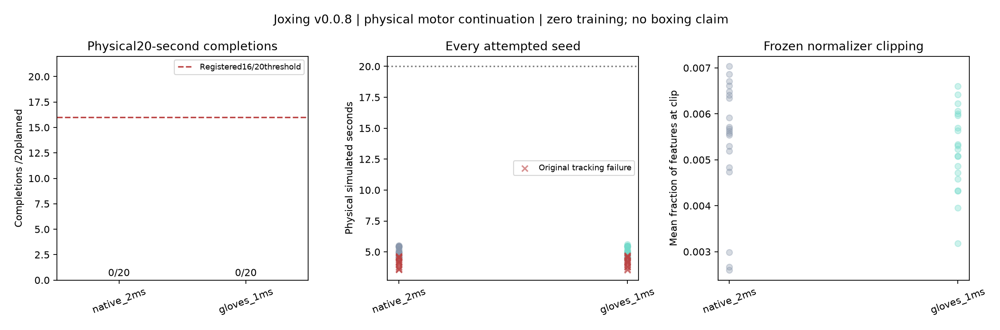

# v0.0.8: physical failure follows tracking failure

Completed October26,2026. All40 registered attempts finished with zero invalid/incomplete/not_run. **Neither condition completed20s; the physical motor gate failed.** Every episode latched persistent excess pelvis tilt. Full accounting and all12 source-host replay paths pass exactly. No new learning or boxing qualification is claimed.

| Condition | Valid/planned | Physical20s completions | Mean tracking failure | Mean final physical boundary | Mean tracking-to-physical latch |
|---|---:|---:|---:|---:|---:|
| Native2ms |20/20|0/20|4.185s|5.033s|0.839s|
| Gloves1ms |20/20|0/20|4.203s|5.026s|0.813s|

Required physical completion was>=16/20 per condition. These conditions combine equipment/timestep differences; their small lifetime difference does not identify a glove effect. v7's tracking failures remain failures. v8 demonstrates that preserving physical control for another fraction of a second is possible, but ignoring the tracking threshold does not recover stable walking, stationary stance or boxing.

## What passed

The new diagnostic reads every signed floor manifold force, computes end posture in scratch kinematics and keeps native actor caches/reward/reference arithmetic unchanged. Both synthetic probes and the actual v7 first scenarios reproduce state, features, reward and commands with zero error before original tracking termination. Actual72000 trajectories end at4.44/4.56s with no physical latch yet; they are prerequisites, not fresh v8 successes.

All40 outcome/pairing/action/counter/normalizer/force/persistence checks pass. The auditor independently reconstructs loads and earliest physical latch from retained substep evidence. All12 firstseed74000 continuations pass: two conditions × control boundary/mid-command × recorded actions/closed-loop/repeat. Engine and cached observation maximum errors are0; application/reference/RNG/monitor/latch state matches. Pending command restoration does not evaluate a new action. Final progress correctly flushes40/40.

All127 Mac tests pass in147.35s; all127 Linux tests pass in211.69s (wrapper213.52s). Ruff passes. Earlier development test arithmetic and fresh-task restore failures are retained in the [development book](../artifacts/v0.0.8/development/validation.json); earlier uncommitted development source was not fully snapshotted, a disclosed limitation. Final source was committed/pushed before formal outcomes.

## Compute and exact provenance

Executed source `565942db98f6c3a38378d4dab5069d83571d88bb`, source hash `6e2579711ac7806777db42c83971b028fd1046f2f2fffa13792bd978601bc8a7`; protocol hash `8c5f14240ec58048fe257bf49af7a07ed138474633096a84f8624553954b20e4`. Dedicated xbabe1 checkout `/home/ubuntu/joxing/v008-20261026`. Preserved all700 muscles, native decoder0.075 and frozen checkpoint/normalizer. CPU physics only; EGL renders video. [Provenance](../artifacts/v0.0.8/physical/provenance.json), [exact commands/driver](../artifacts/v0.0.8/supervisor.json).

Formal150,850 + prerequisite/benchmark16,200 =167,050 runner physics attempts in205.31s. Independent audit46,662 in68.11s; video8,080 in21.05s. Total221,792, below950,000 mission cap; runner below700,000/900s/1GiB. Maximum two one-thread simulation workers. [Process exit receipt](../artifacts/v0.0.8/process-exit.json) confirms all stages exited, no Joxing jobs remain and frozen source has no diff.

H1 median one/two-worker full evidence loops:70.33/130.16 control transitions/s. Short40-control-case startup-inclusive rates:5.26/9.92. These include policy/normalization/CPU physics/substep evidence/snapshot, exclude optimizer/referee and are not two-player game throughput. Additional evidence has real cost; profiling and shared batched inference are the next HPC mission, not an assumed GPU speedup.

## Evidence and reproduction

[Protocol/book](../experiments/v0.0.8/README.md) · [Independent audit](../artifacts/v0.0.8/audit-linux.json) · [Every attempt](../artifacts/v0.0.8/physical/evaluations.json) · [Summary/hashes](../artifacts/v0.0.8/release-summary.json) · [Execution contract/commands](PHYSICAL_MOTOR.md).

All40 commands/substep histories are retained in the [public full raw archive](https://github.com/neverhuman/Joxing/releases/download/v0.0.8/joxing-v0.0.8-raw.tar.gz):47,279,704bytes, SHA256 `5b5dbacf4f113f04551616eb4c2498bd5357c86fc49f340981ba4a440a5b60ab`. It contains all184 raw-manifest files, excluding reconstructible model ZIP/pickle weights. All184 local copies and70 curated raw files were hash-verified. Git retains every outcome/start state, specifications, firstseed full actions/substeps/replay, audit, plot and video. No seed was replaced for presentation.

[First-scenario two-condition video](../artifacts/v0.0.8/physical/physical-motor.mp4). Preview includes the final frame; this is walking and loss of control, not a learned fight.

## Decision and next work

Do not start competitive learning or another unchanged broad motor sweep. Inspect feasible resets, reference seams, root-translation/normalization sensitivity and teacher adaptation under a new protocol; none is established as the cause by these results. Separately improve measured rollout/inference/learner throughput so the next useful motor/game experiments run faster. The [self-play/HPC route](SELF_PLAY_HPC_PLAN.md) and [v0.0.9 mission](V0.0.9_MISSION.md) specify that work, including full-game accounting, causal history, frozen historical opponents and strength per wall hour. A large count of five-second motor falls would not satisfy the user's request for100,000 games.
