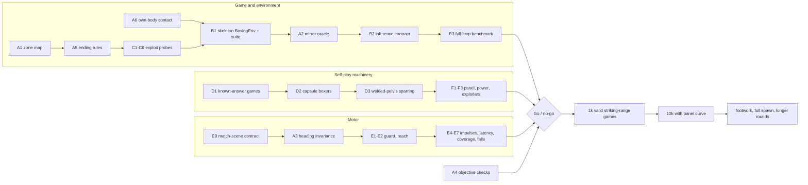

# Joxing: what remains to test before same-model self-play boxing can work

Reviewed: `neverhuman/Joxing` at commit `4ea115e` (v0.0.9 released, v0.0.10 D1 in progress), pinned MS-Human-700 `2d68695` and msgym `ad3aac1`, MuJoCo 3.8.0. Date: October 26, 2026.

Scope: the goal is one shared network that plays both corners of a two-athlete, 1,400-muscle MuJoCo match and gets stronger by playing itself and its history. This document lists what still has to be tested for that to work, in priority order, with concrete procedures and pass criteria. It adds to the repository's own plans (`GAME.md`, `IMPLEMENTATION.md` P1–P5, `STATE_HISTORY_SELF_PLAY_AUDIT.md`, `SELF_PLAY_HPC_PLAN.md`, `docs/references/self-play.md` §6–7) rather than repeating them. Where those plans already specify a test well, it is referenced, not rewritten.

---

## 1. Bottom line

1. **No two-player environment exists yet, so almost none of the self-play acceptance tests can run.** `src/` has the referee (`rules.py`), a dual composition scene (`scene.py`) and contact staging (`physics.py`), but no `BoxingEnv`, observation schema, history, opponent sampling, recurrent PPO, league or evaluation code. A search of `src/` for opponent, league, PPO, recurrent, GRU or LSTM finds only one docstring mention (`rules.py:55`). The single highest-value step is to build a minimal end-to-end match loop with placeholder controllers *now*, so the correctness suite can execute. That is test infrastructure, not competitive learning, so it does not conflict with the `AGENTS.md` gate.

2. **I found three defects that would corrupt self-play even with a perfect motor controller.** All three are cheap to test and fix before any learning:
   - **Straight punches to the face land on a non-scoring surface.** The native `skull` mesh is collidable and protrudes in front of the scoring head shell. In 79 of 153 frontal approach directions, an incoming glove touches `skull` first, and the scene labels it `native_non_scoring`. Every approach within ±20° of straight-on, from 20° below to 40° above horizontal, hits the skull first. As built, a clean jab to the face would score 0 points.
   - **The motor teacher's inputs depend on world heading and position.** The upstream observation feeds raw root `qpos`, world-axis `key_xpos` and an absolute walking reference. At the symmetric start, the teacher-style features differ between the two corners by up to 0.41 m. In each pelvis frame they are identical.
   - **The match scene disables every own-body contact and uses a different physics contract from the one the teacher was qualified under.** Arms can pass through the boxer's own head and torso. The scene runs `implicitfast` at 1 ms with tolerance 1e-10; the qualified teacher runs Euler with native lower-body self-contacts.

3. **The scene is exactly symmetric, and MuJoCo preserves that symmetry to round-off.** That gives you the strongest available end-to-end oracle for a shared-policy environment: identical policies from a mirrored start must produce mirrored observations, actions, contacts and scores. It also means identical deterministic policies produce mirror-image draws. Self-play needs independent per-corner stochasticity.

4. **Several rule details will become the strategy if left open.** Self-play optimizes whatever the referee pays for. Before training, test these with scripted controllers:
   - Slow "touch" scoring: 0.25 N·s at 0.5 m/s qualifies as a full head point.
   - Pecking rate.
   - Glove tie-ups that permanently disarm an opponent's glove.
   - Early-ending incentives: the leader dives or steps out.
   - The default spawn, which needs about a metre of footwork before any hit is possible.

5. **Prove the self-play machinery on positive controls in parallel with motor work.** First known-answer games, then cheap capsule boxers, then welded-pelvis 700-muscle sparring. When the motor gate finally passes, the body should be the only new variable. If the pipeline cannot make a capsule boxer beat a frozen panel, it will not make MS-Human-700 do it.

6. **The motor work needs boxing-specific tests, not only walking survival.** v0.0.10 asks whether a residual can extend the *walking* teacher. Self-play needs four things:
   - a heading-invariant, goal-conditioned decoder that holds a guard for a full round;
   - reaching and returning while standing;
   - absorbing punch-sized impulses;
   - reacting fast enough for defence to be learnable.

7. **CPU is enough for the first milestones.** I measured 726 raw dual-world physics steps/s per core (1 ms). A 10-second game therefore costs at least about 14 core-seconds of physics. At 16 workers, 1,000 games is roughly 15–22 minutes and 10,000 is roughly 2.5–3.5 hours. GPU physics is not on the critical path.

---

## 2. Where the project stands for self-play

| Layer | What exists | What self-play still needs |
|---|---|---|
| Two-athlete world | `scene.py`: two intact 700-muscle athletes, massless head/chest/abdomen/arm shells, 0.283 kg gloves, actuator ownership maps. Labelled a composition smoke model. | Fitted shells, correct zone/seam map, reviewed own-body contacts, guard-pose reset bank, a match-scene physics contract the motor layer is qualified in. |
| Contact evidence | `physics.py:step_contacts`: pre-solve geometry/velocity, post-solve wrench, quarantine on warnings/nonfinite. | Production clearance from *all* opponent shells, glove extension/retraction from geometry, zone attribution. |
| Referee | `rules.py:HitTracker` (one per glove), `potential`, `match_reward` (zero-sum, telescoping). Fixture-tested. | Match state machine (bell, falls, exits, fouls, simultaneous events) wired into an environment. |
| Motor | Frozen DynSyn walking teacher (`physical_motor.py`, 50 Hz, Euler 2 ms), 138-d residual SAC interface (`motor_residual.py`, D1), stance SAC (`stance_env.py`). No controller completes 20 s (v8: 0/40, collapse about 5 s). | Stance/guard/reach/step/recover skills, heading invariance, a latent interface for tactics, qualification in the match-scene physics. |
| Two-player environment | None | `BoxingEnv`, `ActorObservation`/`CriticState`, `TimedHistory`, `ReplaySnapshot`, simultaneous stepping. |
| Tactical learner | None; SB3 SAC for motor only | Recurrent PPO with exact latent likelihood, sequence masks, data from both corners. |
| League and evaluation | None | Immutable bundles, PFSP with a uniform floor, payoff matrix, frozen panel, exploiters. |

Valid boxing games played to date: **0**.

---

## 3. New evidence from read-only probes

All probes used MuJoCo 3.8.0 with one thread on a 2.8 GHz Xeon core. M1 and M3–M5 built the repository's own scene with `joxing.scene.build_scene(dt=0.001)`. M2 loaded only the pinned MJCF asset and added the same shell geometry `scene.py` declares. Nothing in the repository was modified. Method and commands are in Appendix A.

**M1 — Exact two-corner symmetry.**
- Corner B is corner A rotated 180° about vertical. Initial body-position error is 2.2e-16 m. Native `qpos` is bitwise identical between corners, because B's root is attached under a rotated frame.
- Over 1.5 s of zero-excitation collapse (both pelvises drop 0.45 m, with floor contacts throughout), the maximum symmetry error stayed at **2.3e-14 m**.
- No left/right muscle permutation is needed to swap corners. It is a pure rotation.

**M2 — The head scoring zone is shadowed by the native skull.**
- `Body_Torso_Simple.xml:976` declares `skull` as a collidable mesh (`contype=1 conaffinity=1`). `scene.py:47-49` re-assigns its collision bits so it collides with the opponent, and `scene.py:176-178` labels it `native_non_scoring`.
- Method: a 6.2 cm glove sphere was marched toward the head-shell centre from 153 directions across B's front hemisphere (azimuth −80…80°, elevation −40…40°). For each direction I recorded the first collidable geom touched:

```text
first contact: H = head shell (2 pts), N = native skull (0 pts), g = arm guard (0 pts)
el\az -80 -70 -60 -50 -40 -30 -20 -10   0  10  20  30  40  50  60  70  80
  40    N   N   N   N   N   N   N   N   N   N   N   N   N   N   N   N   N
  30    N   N   N   N   N   N   N   N   N   N   N   N   N   N   N   N   N
  20    H   H   N   N   N   N   N   N   N   N   N   N   N   N   N   H   H
  10    H   H   H   N   N   N   N   N   N   N   N   N   N   H   H   H   H
   0    H   H   H   H   N   N   N   N   N   N   N   N   N   H   H   H   H
 -10    H   H   H   H   H   N   N   N   N   N   N   N   H   H   H   H   H
 -20    H   H   H   H   H   H   N   N   N   N   N   H   H   H   H   H   H
 -30    g   g   H   H   H   H   H   H   H   H   H   H   H   H   H   g   g
 -40    g   g   g   H   H   H   H   H   H   H   H   H   H   H   g   g   g
```

  Totals: 64 head, 79 skull, 10 guard. The chest is clean: 63 torso, 90 arm guard with the arms hanging in the key pose.
- This is first-contact geometry in the neutral pose. A scripted physical punch should confirm it (test A1).
- `SPEC_REVIEW.md` describes `skull` as a visual geom. In the pinned model it is collidable.

**M3 — The motor teacher's observation is not corner- or heading-invariant.**
- `msgym/envs/locomotionFull_v1.py:163-198` builds features from raw `qpos`, which includes the root slides and hinges. It also uses `key_xpos = xpos[key] − xpos[pelvis]` in **world axes**, plus the absolute `qpos_ref`/`qpos_ref_future`.
- At the symmetric start, those world-axis key features differ between corners by up to **0.41 m**. In each athlete's pelvis frame they agree to 2e-16.
- As soon as a boxer turns to track the opponent, even corner A's features drift out of the distribution the teacher was trained on.

**M4 — The match scene is not the physics the motor layer was qualified in.**

| | Qualified teacher | Match scene |
|---|---|---|
| Integrator | Euler (`physical_motor.py:136-137` requires it) | `implicitfast` (`scene.py:32`) |
| Timestep | 2 ms (1 ms glove variant in v7) | 1 ms |
| Solver tolerance | native task settings | 1e-10 |
| Own-body contact | Native colliders collide with each other except the listed excludes (`Contact_Lowerbody.xml`) | All own-body pairs off (`scene.py:45-49`: A uses bits 2/5, B uses 4/3). Arms, shells and legs pass through their own body. |

  Motor gates passed in one contract do not carry over to the other automatically.

**M5 — The default spawn requires locomotion.**
- Pelvises start 1.6 m apart. In the key pose, the surface gap from A's right glove to B's head shell is **1.69 m**, and to B's chest 1.58 m.
- No legal hit is possible without stepping roughly 0.7–1.0 m. Footwork is the hardest unsolved motor skill.

**M6 — Cost of the two-athlete world.**
- Raw `mj_step` with identical options: **726 steps/s** for the dual scene versus **1,398 steps/s** for one native athlete. The second athlete makes each world step 1.9× as expensive.
- The repository's own xbabe1 dual diagnostic, which includes contact capture, reported 534 substeps/s (`STATUS.md`).
- A 10-second game at 1 ms is therefore at least 13.8 core-seconds of physics.

**M7 — Left/right mirroring is not free.**
- Limb muscles use `_r`/`_l` suffixes, trunk muscles use `_R`/`_L`, and many neck and back muscles mark only the left side (`trap_inf_T5` vs `trap_inf_T5_L`).
- 58 of the 212 `_r`/`_l` limb pairs also differ slightly in gain, bias or length range (maximum 0.003).
- Swapping corners needs no mirror (M1). Mirror-image data augmentation (orthodox vs southpaw) would need a validated permutation, and the athletes are not exactly mirror-symmetric.

---

## 4. Prioritized test plan

Test IDs are referenced in the sequencing and go/no-go sections. "Scripted" means a fixed controller or a constrained, labelled rig. None of these tests is a boxing-competence claim.

### Tier A — Defects to remove before any self-play learning

**A1. Head and torso zone coverage map.**
- *Why:* M2 shows the most common punch would score 0 points. Self-play will learn to avoid the face and hunt for seams (uppercuts under the skull, temples from the side).
- *How:*
  1. Extend the M2 march to guard and crouch poses and to head yaw/pitch of ±30°.
  2. Run scripted physical punches at 2–6 m/s through `step_contacts` and `HitTracker`, recording first-contact geom, awarded zone and points.
  3. Repeat for the torso against native `pelvis`/`sacrum` (the belt line).
  4. Decide the fix as a named geometry/rules variant. Either treat the native skull (and any other collidable head geometry) as a head scoring surface for the opponent, or exclude it from opponent collisions and enlarge the shell to enclose it.
- *Pass:*
  - At least 95% of approaches into the intended front/side head region award head points.
  - No legal-region approach is awarded by an unintended surface.
  - Every remaining seam is listed with its solid angle.

**A2. Corner-swap equivariance and the exact-mirror oracle.**
- *Why:* One network plays both corners. Any frame, ordering, ownership or score-sign bug gives one corner an advantage, or teaches the policy corner-specific behaviour. M1 makes this exactly checkable.
- *How:*
  1. **Unit test.** For random states `s` (not only symmetric ones), build `s' = swap(Rz(π)·s)`. Require:
     - `obs_A(s) == obs_B(s')` and `critic_A(s) == critic_B(s')`;
     - score difference and clock enter with the correct sign;
     - the action computed for a corner writes only that corner's `actuator_ids`.
  2. **Integration test.** From a mirrored reset, run the same deterministic bundle (random weights are fine) in both corners with the referee active. At every control step require:
     - body symmetry error below 1e-9 m;
     - `obs_A == obs_B` and `ctrl[A] == ctrl[B]`;
     - mirrored contact/event ledgers;
     - `reward_A + reward_B == 0`.
     Record the divergence horizon (first step above 1e-9) as a chaos diagnostic.
  3. **Statistical test.** With independent per-corner RNG streams, run 2,000 games of one policy against itself.
- *Pass:*
  - Unit and integration assertions hold.
  - In the statistical run, the 95% interval for P(A wins) − P(B wins) contains 0, and per-corner hit, zone and fall rates agree within their intervals.

**A3. Heading and translation invariance of the motor layer.**
- *Why:* M3. A teacher whose inputs depend on world yaw and absolute position cannot serve both corners, or a boxer who turns.
- *How:*
  1. For recorded decoder states, rotate the whole athlete about world z by θ ∈ {0°, 15°, 45°, 90°, 180°} and translate by up to ±1 m in xy.
  2. Rebuild observations and decode all 700 excitations.
  3. Run the same check inside the dual scene for corner B.
  4. Use a heading frame (yaw only, so gravity stays visible), not the full pelvis frame.
- *Pass:*
  - Excitations agree to at most 1e-6.
  - The canonicalised feature contract is a named variant that reproduces the current bundle exactly at θ = 0 with the current spawn.

**A4. Objective and discount consistency.**
- *Why:* `GAME.md` specifies γ = 1 with telescoping potential `0.25·tanh(Δ/4)` (`rules.py:255-265`). Existing learners use γ = 0.99 (`wave.py:62`, `stance_train.py:188`).
  - At 50 Hz, a 60 s round discounts the terminal win/loss by 0.99³⁰⁰⁰ ≈ 8×10⁻¹⁴. Even 0.999 gives 0.05.
  - A default discount would silently turn the objective into "maximise shaped score margin."
- *How:*
  - Assert that the learner's γ equals the shaping γ. Alternatively, use γ-consistent shaping, `r + γΦ(s′) − Φ(s)`.
  - For every ending, check that summed shaped reward equals the outcome: bell, fall, exit, disqualification, simultaneous loss, external truncation (which bootstraps from the true final observation) and collector cut (which continues the match).
  - Specify GAE λ in seconds, as `self-play.md` §6.6.4 proposes.
- *Pass:* Exact equality for every termination path, and a hard failure if a learner is constructed with mismatched γ.

**A5. Early-ending incentive table.**
- *Why:* Falls, exits and simultaneous losses are still "provisional" (`GAME.md`). Self-play will exploit whichever early ending is left open. The classic case is a leader who deliberately falls or steps out to freeze the score.
- *How:*
  1. For each ending path, script micro-scenarios: leader dives, leader exits, trailing boxer provokes a simultaneous fall, push-out, glove-floor brush.
  2. Compute the expected outcome for whoever triggers it.
  3. Choose rules, such as a self-caused fall or exit counting as a loss unless a foul is attributed.
  4. Version them.
- *Pass:* No corner can raise its expected outcome by triggering an ending itself.

**A6. Own-body contact.**
- *Why:* M4. With own-body contact off, a policy can tuck its forearm capsules *inside* its own head or torso. The opponent's glove then meets a 0-point guard surface first, an unphysical "armor" pose. Legs can also pass through each other while balancing.
- *How:*
  1. Measure own-body penetration depth in every rollout, scripted or learned.
  2. Add the reviewed own-body pairs planned in P1.2.
  3. Re-run A1 in guard poses.
- *Pass:*
  - Own-body penetration above 1 cm is flagged and blocks training until the reviewed own-body pairs are implemented.
  - No scoring path is blocked by a shell embedded in its own body.

### Tier B — A minimal two-player environment and its correctness suite

Build `BoxingEnv` with the parallel API in `self-play.md` §7.3 now, using placeholder controllers: a zero latent, constant excitation, or random 138-group commands. The motor gate should block *training*, not *testing the harness*.

**B1. Environment correctness.** These are the spec's tests (§6.8 items 1–6, P2), made executable on the skeleton:
- **Simultaneity.** Perturb A's action at tick *t*; B's decision at *t* must be unchanged.
- **Ownership.** Every actuator is written by exactly one corner.
- **Referee timing.** The referee runs every physics substep, a real ending terminates both corners, and the bell finalises only pre-bell evidence.
- **Replay.** Snapshot/restore mid-contact and mid-held-command must reproduce event IDs and scores.
- **Leakage.**
  - Critic-only fields cannot change actor outputs.
  - Opponent excitations, hidden state and bundle identity are absent from actor input.
  - The actor cannot tell whether it faces itself or a historical bundle.
- **Batching isolation.** When both corners of several worlds are batched in one forward pass, each corner's recurrent state stays in its own row.

**B2. One canonical inference contract for two corners.**
- v0.0.9 H0 failed because batch-2 differs from scalar by 7.15e-6 against a 1e-6 gate.
- For self-play, declare the batched path, `[A, B]` per world in fixed order, as *the* acting contract. Then test exact replay *within* that path.
- Scalar-versus-batch equality is unnecessary if the scalar path is never used for acting. The D1 notes already lean this way.

**B3. Full-loop benchmark of the skeleton.** Dual physics, contact capture, referee, observations, two-corner inference, resets and IPC, at 1/4/8/16 workers.
- Report the overhead ratio against the 726 steps/s raw baseline (M6), plus games per hour.
- This replaces extrapolation from single-athlete motor benchmarks.

### Tier C — Rule exploit probes with scripted controllers

Each probe either confirms the intended game or produces a versioned rules variant *before* self-play discovers it.

**C1. Minimum qualifying touch.** The thresholds are 0.25 N·s, approach and glove speed of 0.5 m/s, and face cosine of 0.5 (`rules.py:24-27`). The glove alone stopping from 0.88 m/s already delivers 0.25 N·s, and the attached forearm and hand add effective mass.
- *How:* Run scripted approaches at 0.3–4 m/s and record which score.
- *Decide:* Is a gentle touch meant to be worth the same 2 points as a committed punch? If not, raise the impulse or speed floor now. Self-play converges on the cheapest qualifying contact.

**C2. Maximum scoring rate.** Rearming needs 30 ms clear, at least 2 cm clearance and at least 3 cm retraction (`rules.py:21-23, 146-150`).
- *How:* Oscillate a glove against a stationary head with 3–6 cm amplitude at 2–12 Hz.
- *Report:* Points per second, and whether muscle limits or rules cap it.

**C3. Glove tie-up.**
- An encounter starts on *any* positive-force contact, including glove or forearm (`rules.py:130-133`). Rearming requires clearance from every opponent shell.
- A defender who keeps one glove resting on the attacker's glove therefore keeps that glove disarmed indefinitely.
- *How:* Script the tie-up and decide whether it is legal. A possible fix is a referee break after N seconds of guard-only contact, or excluding guard-only encounters from blocking rearm.

**C4. Push-out and clinch.** Script a sustained drive to the boundary. Fall and exit attribution must resolve per A5.

**C5. Simultaneous and boundary events.** Same-tick hits by both corners, hits on the final substep, and hits during a fall. Results must be order-independent: swap A/B and get the mirrored ledger.

**C6. Reachability and spawn curriculum.** Given M5, define a striking-range mini-game variant, for example 0.6–0.8 m pelvis separation, where an arm-only punch can reach.
- *Pass:* A scripted or CEM-found punch scores from the variant's spawn distribution, and does not from the default spawn without stepping.

### Tier D — Prove the self-play machinery on positive controls (run in parallel)

**D1. Known-answer games through the same league code.**
- A continuous rock-paper-scissors-style game: the league must approach the mixed equilibrium, while naive latest-versus-latest must cycle. The test confirms the league fixes cycling.
- A one-dimensional approach/strike/retreat game with a computable best response.
- Unit tests for PFSP: empty pool; all-zero and all-one win rates; sparse data; the uniform floor; fixed-seed reproducibility. `EXTERNAL_REVIEW` notes that `w(1-w)²` gives weight 0 at both ends.

**D2. Capsule boxers through the same `BoxingEnv`, referee and league.**
- Planar or free base, two-link torque arms, gloves, and the same shell roles and `HitTracker`. Only the body adapter differs, which also forces a clean body interface in the environment.
- *Pass:*
  - Frozen-panel score rises across at least 3 seeds within a few CPU hours.
  - Exploiter win rate against the champion falls over generations.
  - If this fails, the bug is in the pipeline, not the anatomy.

**D3. Welded-pelvis 700-muscle sparring (labelled assisted diagnostic).**
- Two MS-Human-700 athletes at striking range, with each pelvis welded or spring-held, gravity on and all muscles active.
- This extends the v0.0.2 fixed-pelvis strike rig to two reactive corners. It exercises real-muscle punching, guarding, timing, contact geometry, the referee, the tie-up rules and the league, without needing balance or footwork.
- Use a goal-conditioned upper-body skill decoder trained in the same rig; that also seeds the P3 decoder.
- Later, step down the assistance (weld, then spring, then none) as the motor layer qualifies.
- It can never pass a native gate, but it tests most of the tactical problem on the real arms.

**D4. Learning-dynamics monitors (make them standard dashboards).**
- **Training reward is uninformative.** A policy playing itself in a symmetric zero-sum game has expected return exactly 0, so the curve is flat by construction. Track frozen-panel score instead.
- **Critic sanity.** Check `V(o_A) + V(o_B) ≈ 0` when both corners run the current policy, and `V ≈ 0` at a symmetric start with equal score.
- **Strategy-collapse indicators.**
  - Transformed latent entropy.
  - Draw rate and 0–0 rate.
  - Fraction of games decided by points versus falls versus invalid.
  - Engagement distance.
  - Fraction of points from seams (A1).
- **Forgetting and cycling.** Keep a payoff matrix of the last K checkpoints and track exploiter win rate over time.

**D5. Using both corners as learner data.**
- When the opponent is the *current* learner bundle, both corners are on-policy samples.
- Test per-corner behaviour log-probabilities, hidden states, reward signs, and advantage normalisation over both.
- When the opponent is a frozen historical bundle, its transitions must be excluded from the PPO actor loss.

### Tier E — Motor tests that self-play actually needs

**E0. Motor contract in the match scene.** Before any tactical run, re-qualify the motor layer inside the *exact* match-scene physics: integrator, timestep, solver tolerance, collision bits, gloves and shells (M4).
- *How:* Put the opponent far away and compare against the single-athlete task on identical starts and commands.
- *Pass:* Either exact parity, or a named match-scene variant with its own survival and replay results.

**E1. Guard hold for a full round.** Zero tactical input, guard pose, 60 s (the round length, not 20 s), held-out starts.
- *Pass:* At least 95%, matching the P3 target.

**E2. Reach and return while standing.** Jab, cross and hook to targets 0.5–0.8 m away, then return to guard while the other hand holds guard.
- *Pass:* Under 5 cm glove error, no fall, at least 90% held-out success.

**E3. Footwork.** Step 0.2–0.4 m in 8 directions, pivot ±45°, stop stably. This is required only once the C6 striking-range curriculum gives way to the full spawn.

**E4. Absorbing punch-sized impulses.** Measure the impulse distribution actual punches deliver in D3 or C1 instead of assuming 2 or 4 N·s.
- *Pass:* Push recovery at the 90th percentile of that distribution, applied at head, chest and glove.

**E5. Reaction latency.**
- Measure the time from a latent change to the glove's peak velocity.
- Measure the time from contact onset to a guard response.
- Punches reach their target in roughly 150–300 ms. A decoder whose response uses up most of that window leaves no room to learn defence.
- Also reconcile the cadences: the plan has tactics at 50 Hz and the decoder at 100 Hz, while the qualified teacher runs at 50 Hz with 2 ms physics.

**E6. Latent coverage and first-signal rate.**
- What fraction of a striking-workspace grid can the glove reach within 300 ms under random or initial-policy latents?
- What is the initial policy's legal-hit rate against a passive opponent at striking range?
- *Pass:* A clearly non-zero hit rate.
- If the rate is about 0, early self-play games are 0–0 draws with no gradient. Fix it with curriculum (striking-range spawns, shorter clocks, a scripted-partner phase) before scaling.

**E7. Falls per game under sparring.** With scripted or D3-derived opponents, measure how many games are decided by falls.
- *Pass:* Under 10% of curriculum games fall-decided, so outcomes reflect boxing rather than balance noise.

**E8. Heading invariance.** This is A3, applied to the final decoder.

**On v0.0.10:** its question is whether a 138-d residual extends *walking* survival. That is useful, but even a pass leaves E1–E7 unanswered. The teacher's walking-reference input also keeps pushing it to walk. A useful next motor question is a static-reference or guard variant of the same residual, measured with E1, E2 and E4.

### Tier F — Evaluation that can see improvement

**F1. Panel discriminability.** Candidate panel members:
- "statue" (zero latent);
- random latent;
- a CEM-found single-punch bot;
- early checkpoints;
- specialist exploiters.

  Their payoffs against each other must differ measurably. Otherwise the panel cannot register improvement.

**F2. Statistical power.**
- Measure the standard deviation of the per-pair score (the mean of two corner-swapped games) on the first panel run, then size *n*.
- With SD ≈ 0.7, the planned 200 paired scenarios detect about +0.12 mean score (roughly +6 points of win rate) at 80% power with a one-sided 95% bound. A +0.1 effect needs about 300 pairs.
- Use a preregistered sequential rule if you will peek.

**F3. Exploitability proxy.** Train a fixed-budget best-response exploiter against each frozen champion and track its win rate across generations. It should trend down.

**F4. Ranking robustness.** Finalist ordering should survive validated dt and solver variants (`self-play.md` §6.8 item 9).

### Tier G — Scale (after B3)

**G1. Cost table from the measured full loop.** With raw physics alone (M6) and roughly 1.5× loop overhead (in line with the 63–70% physics/evidence share measured in v0.0.9 H1), on 16 one-thread workers:

| Valid 10 s games | Physics only | With ~1.5× overhead |
|---:|---:|---:|
| 1,000 | 0.24 h | 0.36 h |
| 10,000 | 2.4 h | 3.6 h |
| 100,000 | 24 h | 36 h |

  60-second rounds cost 6×. Replace these estimates with B3's measured numbers.

**G2. Referee convergence at 2 ms.** If scoring and impulse converge at 2 ms (the teacher's native step), physics cost halves.
- *Pass:* The scoring decision agrees with 1 ms and 0.5 ms references across the C1–C5 scenarios.

**G3. Solver settings.** The scene uses Newton, 100 iterations, tolerance 1e-10. Test whether 1e-8 or fewer iterations change impulses or awards. If not, that is a cheap speedup.

---

## 5. Sequencing

Three tracks can run concurrently with disjoint write paths and one integration owner, as `AGENTS.md` requires. They meet at the first native self-play run.



Ordering logic:
- The **G** and **S** tracks need no motor competence, so they should not wait for it.
- D3 is the bridge. It tests real-muscle tactics on the same code path that the native run will use.
- When E1–E7 pass, only the assistance changes.

---

## 6. Go/no-go checklist for the first native self-play run

Launch a striking-range curriculum run (C6 spawn, 5–10 s clock, γ = 1) only when all of these hold:

1. A1 zone map passes; remaining seams are documented and small.
2. A5 shows no profitable self-triggered ending, and the chosen rules are versioned.
3. A2 mirror oracle passes, and the corner-bias interval contains 0.
4. B1 leakage, ownership, simultaneity, replay and batching-isolation tests pass; B2 contract is declared.
5. D2 *and* D3 show frozen-panel improvement across at least 3 seeds with the identical league and learner code.
6. Motor layer: E0 parity (or named variant), A3 invariance, E1 ≥ 95%, E2 ≥ 90%, E4 at punch-sized impulses, E5 latency below roughly 150 ms (a proposed threshold to confirm against measured punch durations), E6 hit rate above 0.
7. E7: under 10% of games fall-decided in scripted sparring.
8. F1 panel is discriminable, and F2 sample size is set from measured variance.
9. A4 discount and termination identities pass.
10. B3 measured cost fits the run's wall, physics and disk caps.

Stop rules during the run:
- systematic action-correlated invalids;
- points from known seams rising;
- draw rate approaching 100%;
- panel score flat while self-play metrics look healthy (D4).

---

## 7. What to defer

- **Latency, jitter and dropped-packet queues.** Keep the zero-delay oracle until D2/D3 show learning. Then add delays as an ablation, as `STATE_HISTORY_SELF_PLAY_AUDIT.md` already proposes.
- **GPU physics.** It is not needed for 1k or 10k games (G1). The exact-model Warp parity failure can stay open.
- **60-second rounds, Elo-only reporting, injury mechanics, and 100k-game claims.** These come after the curriculum works.
- **Mirror-image augmentation.** Not needed for corner swapping (M1), and not safe without a validated muscle permutation (M7).

---

## Appendix A — Probe methods and raw numbers

The repository's pytest suite was not run here; dependency sync was blocked in this sandbox. The probes below use only MuJoCo 3.8.0 and NumPy.

**Scene probe (M1, M3–M6).** Built `joxing.scene.build_scene(dt=0.001, shells=True)`, set `initial_qpos`, and called `mj_forward`. Then:
- **Symmetry:** compared `Rz(π)·xpos[A_body]` with `xpos[B_body]` for every source body.
- **Teacher features:** computed msgym-style `key_xpos` for six key bodies in world axes and in each pelvis frame.
- **Collisions:** evaluated contype/conaffinity rules.
- **Passive run:** 1,500 steps with zero control, logging pelvis drop and symmetry error every 50 ms.
- **Timing:** 1,500 dual-scene steps versus 1,500 steps of a single native athlete compiled with `implicitfast` at 1 ms.

Key outputs:

```text
dims nq/nv/nu/na/neq/ngeom = 170/170/1400/1400/84/715
root joints (A): pelvis_tz, pelvis_ty, pelvis_tx (slides); pelvis_tilt, pelvis_list, pelvis_rotation (hinges)
collides: A glove vs own head = False, vs own chest = False, vs B head = True, vs B glove = True
pelvis A (-0.8,0,0.95) facing +x; pelvis B (0.8,0,0.95) facing -x
gap A right glove -> B head shell 1.688 m, -> B chest shell 1.577 m
initial C2 error 2.2e-16 m; max over 1.5 s passive 2.29e-14 m
pelvis drop (both): 0.02 m @0.3 s, 0.11 @0.4, 0.27 @0.5, 0.35 @0.6, 0.45 @1.5
teacher world-axis key_xpos A-B max |diff| 0.406 m; pelvis-frame 2.0e-16; native qpos A-B 0.0
raw mj_step/s (1 ms, implicitfast, Newton 100 it): dual 726.4, single native 1398.4
```

**Zone probe (M2).** Self-contained; loads only `third_party/ms-human-700/MS-Human-700.xml`.

<details><summary>Condensed procedure</summary>

```python
spec = mujoco.MjSpec.from_file(MS_HUMAN_700_XML)
# same shells as scene.py: head on head_neck (size .10/.125/.09 at [0,.12,0]),
# chest on thoracic12, abdomen on lumbar5, humerus/ulna capsules; plus a free 6.2 cm probe sphere
m = spec.compile(); d = mujoco.MjData(m); mj_resetDataKeyframe(m, d, 0); mj_forward(m, d)
fwd = pelvis local x (forward); lat = up x fwd
for az in -80..80 step 10, el in -40..40 step 10:
    dir = cos(el)*(cos(az)*fwd + sin(az)*lat) + sin(el)*up
    for s from 0.45 m down to -0.2 m step 4 mm:
        place probe at shell_centre + dir*s (write geom_xpos only)
        first collidable geom with mj_geomDistance(probe, g) <= 0 -> record role
```
</details>

```text
shell_head : head 64, native skull 79, arm guard 10  (153 approaches)
shell_chest: torso 63, arm guard 90                  (153 approaches, arms hanging in key pose)
```

**Arithmetic used above.**
- 0.99³⁰⁰⁰ = 8.0e-14; 0.999³⁰⁰⁰ = 0.050; 0.99⁵⁰⁰ = 0.0066.
- Pairs needed for 80% power with a one-sided 95% bound: n = ((1.645 + 0.842)·σ/δ)². With σ = 0.7: δ = 0.10 → 303, δ = 0.15 → 135, δ = 0.20 → 76.
- Glove-only stopping speed for 0.25 N·s: 0.25 / 0.283 = 0.88 m/s.

## Appendix B — File references

| Topic | Location |
|---|---|
| Rule constants, encounter start, rearm, shaping | `src/joxing/rules.py:16-29`, `130-133`, `146-150`, `255-265` |
| Scene physics options, collision bits, shells, spawn, surface roles | `src/joxing/scene.py:32`, `39-49`, `82-131`, `132-137`, `176-178` |
| Contact staging and quarantine | `src/joxing/physics.py:31-103` |
| Teacher integrator requirement | `src/joxing/physical_motor.py:136-137` |
| Motor learner discount | `src/joxing/wave.py:62`, `src/joxing/stance_train.py:188` |
| Teacher observation | `third_party/msgym/msgym/envs/locomotionFull_v1.py:163-198` |
| Collidable skull | `third_party/ms-human-700/Body_Primary/Body_Torso_Simple.xml:976` |
| Planned RL contracts | `docs/references/self-play.md` §6.5–6.8, §7.3–7.4; `docs/IMPLEMENTATION.md` P1–P5 |
