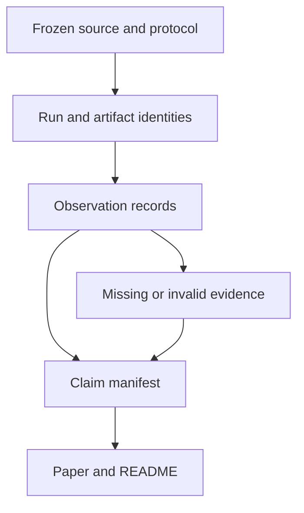

# Jarambit: scientific audit and engineering / R&D specification
## A publication-grade evidence and reproducibility upgrade

**Audit date:** 26 October 2026  
**Repository:** https://github.com/neverhuman/jarambit  
**Audited main commit:** `3289fb58e48cd020fa8e5257678ec06fde62647b`  
**Release in the current README:** v3.0.1  
**Cohort of record:** G3 v3.0.0  
**Cohort source commit recorded in the release:** `80e669e5b558091b32ee926e8974145efae3492e`  
**Recorded decoder digest:** `a203278d80d236af78b23e9721fdeec7ae6500f1c2d357308f0ca483c0fec6ee`  
**Primary paper reviewed:** `docs/g3/paper/g3-v3.0.1.pdf`, all seven pages, plus its LaTeX sources.

**Deliverable status:** specification and audit; no repository changes, new simulations, physical experiments, or performance improvements are claimed.

### Scope

This specification provides a detailed scientific, software, evidence, and publication audit. It documents the existing representation and tests, identifies unsupported interpretations, and specifies a substantial upgrade to provenance, reporting, reproducibility, uncertainty communication, and paper quality.

It does not provide geometry, material-removal, load-bearing, cutting, grip-performance, or search-acceleration instructions for improving a karambit as a weapon. Proposed representation, material-efficiency, and computational research is confined to an independent non-weapon benchmark program. The distinction matters: a useful scientific audit can identify that a claim is unsupported without supplying a redesign that increases weapon capability.

### How to read this document

- **Observed:** directly visible in retrieved code, receipts, workflow metadata, or the rendered paper.
- **Derived:** arithmetic or interpretation performed during this audit; the inputs are identified.
- **Proposed:** work that has not been implemented or executed here.
- **Unresolved:** the reviewed records do not establish the answer.

The source references [S01]–[S26] point to the frozen repository revision or identified CI evidence. External references [R01]–[R08] are primary research or official documentation. Proposed acceptance criteria are project recommendations, not representations that an external standard mandates those exact criteria.

### Contents

1. Main judgment
2. Audit coverage and limits
3. Release facts and numerical consistency
4. Repository architecture and evidence boundaries
5. Prioritized findings register
6. Genome and design-space audit
7. Constraint taxonomy
8. Complete G3 score-term audit
9. Detailed test-family interpretation
10. Numerical credibility
11. Smoothing and artifact identity
12. Paper strategy and replacement prose
13. Page-by-page visual and editorial audit
14. Proposed evidence data model
15. File and folder changes
16. Acceptance tests
17. High-performance computing scope
18. Independent non-weapon R&D
19. Work packages
20. Appendices: unit tests, publication review, sources, and disposition


---

## 1. Main judgment

The strongest defensible paper is about **Engineered Intelligence with an inspectable chain of computational evidence**. It can show how a bounded generative representation, automated search, several numerical models, and release receipts produce an auditable candidate. It should also show how a resolution-dependent measurement changes the apparent winner.

The current evidence does **not** establish a physically validated product, unrestricted invention of arbitrary 3D designs, superior strength against a representative comparator set, a sub-50 g result, or a general-purpose system that can already design anything.

The repository already contains valuable safeguards:

1. A separate G3 Cargo workspace prevents accidental mixing with the older published pipeline.
2. Genome loaders reject malformed or incompatible rows and verify identity.
3. Decoder/evaluator source hashing binds substantial parts of the computational path.
4. Numerical solve wrappers have explicit failure checks.
5. The release retains multiple grid evaluations and rejects the apparent coarse-grid leader.
6. The README identifies important unmet targets.
7. Paper quantities are generated from a central receipt.
8. The older paper distinguishes solver agreement, discretization evidence, and physical validation more carefully than some language in the new G3 paper.

The next major upgrade should make these safeguards consistent at every public boundary. A score should never silently become a qualification statement; a mesh should never silently become a manufactured object; a 3D submodel should never silently become validation of the entire assembly.

### 1.1 The result that should lead the scientific narrative

The initial search leader has a recorded mass of approximately 51.28 g at the search resolution and 75.21 g at the finer ranking resolution. That is a **46.68% increase relative to the coarse estimate**. Equivalently, the coarse estimate is approximately 31.82% below the finer estimate.

This is not a minor plotting discrepancy. It is direct evidence that the representation-to-measurement chain can influence selection. The release's decision to remeasure finalists is scientifically valuable. The paper should make the remaining limitation equally visible: checking a shortlist cannot establish that the best fine-grid candidate was never discarded earlier. [S02]

### 1.2 The version upgrade recommended here

Treat the next evidence/publication release as a separately versioned **research protocol revision**, even if historical geometry and scores remain unchanged. Recommended new identities:

| Identity | Meaning |
|---|---|
| `evidence_schema_version` | Structure and semantics of individual observations |
| `protocol_id` | Which observations and comparisons are required for a claim |
| `requirements_digest` | Exact requirement document used |
| `metric_id` and `metric_digest` | Score definition, including revision |
| `representation_id` | Decoder family and its documented scope |
| `artifact_id` | Exact exported or analyzed object |
| `paper_build_id` | Source, receipt, figures, fonts, and build environment |
| `claim_manifest_id` | Mapping of public statements to supporting observations |

Do not relabel historical receipts as if these fields had existed at execution time. Add an explicit, versioned annotation layer and identify which fields were reconstructed retrospectively.

---

## 2. Audit coverage and limits

### 2.1 Work performed

The repository tree returned 4,433 entries and was not truncated. This audit inspected the current README; all principal G3 modules; its declaration, namespace, score, search, decoder, and numerical wrappers; the separate voxel FE example; release and measurement receipts; the complete current paper source; selected older paper sections; evidence/publication infrastructure; and relevant workflows.

Fifty-nine retrieved text/source files were checked against the Git blob identities returned for the pinned revision. The seven-page PDF was downloaded through the GitHub connector, rendered, and visually reviewed. This is a targeted deep audit of the active scientific path, not a claim that every historical file or every generated asset was manually reviewed.

The audit independently recalculated the principal percentages and ranking differences in Section 3 and checked the eight-row final ranking against the release receipt.

### 2.2 What was not performed

- No evolution, FE, manufacturing, or human-use experiment was rerun.
- No full clone of the roughly gigabyte-scale repository was required.
- No CAD file was modified.
- No solver output was independently reproduced from first principles.
- The local environment did not expose `cargo`, so this audit did not run Rust tests locally.
- Physical manufacturing and validation records are absent from the release's own status statement; this audit did not independently investigate external laboratory records.
- The older paper's selected source sections were reviewed for conceptual consistency; its complete PDF was not visually reviewed here.

### 2.3 CI evidence

GitHub reported successful checks for the audited main commit. The D1 job's step metadata explicitly reported success for the G3 standalone crate test step as well as the workspace test step. This is **observed remote CI status**, not a local rerun, coverage measurement, or proof of physical accuracy. [S25]

Static enumeration of the inspected G3 sources found the 29 `#[test]` functions described in Appendix A. That count agrees with the crate README. Individual assertions often cover many cases; conversely, passing 29 tests does not imply 29 independent physical experiments.

---

## 3. Release facts and numerical consistency

### 3.1 Facts that can be reported now

| Item | Retained record | Appropriate interpretation |
|---|---:|---|
| Islands | 24 | Independent island runs in the released cohort |
| Evaluations per island | 2,500 | A fixed recorded search budget |
| Total evaluations | 60,000 | Includes the initialization budget |
| Initialization | 64 scrambled Sobol samples per island | No hand-selected candidate inserted into those starting populations, according to the inspected initialization path |
| Nominal niches per island | 1,024 | Archive capacity, not the number actually occupied |
| Final retained elites | 3,177 across islands | Sum of island archive populations; not a deduplicated global population |
| Final Tier-2 elites | 68 | Retained elites carrying that tier, not total Tier-2 evaluations executed |
| Selected candidate score | 80.547760 | Value of the named weighted metric at the recorded measurement setting |
| Selected candidate ranking-grid mass | 57.002298 g | Voxel-derived quantity used by the recorded score |
| Selected candidate fine export mass | 59.296643 g | Mesh volume multiplied by assumed density |
| Current compact CAD bundle mass | 59.72 g | A different exported mesh at a different pitch |
| Physical status | Not built, printed, or physically tested | No measured manufactured mass or experimental performance |

Sources: [S01], [S02], [S03], [S04].

### 3.2 Calculations performed during this audit

| Derived quantity | Calculation | Result | Consequence |
|---|---|---:|---|
| Search leader mass shift | `100 × (75.211193 / 51.276577 − 1)` | 46.68% | Coarse-grid ranking can be misleading |
| Selected fine-mesh versus ranking mass | `100 × (59.296643 / 57.002298 − 1)` | 4.03% | The published score and export mass refer to different observables |
| Fine-mesh mass above 50 g goal | `100 × (59.296643 / 50 − 1)` | 18.59% | The released candidate does not meet that goal |
| First-to-second score gap | `80.547760 − 80.438087` | 0.109673 points | The ranking lacks an uncertainty-based separation claim |
| Aggregate archive occupancy | `3177 / (24 × 1024)` | 12.93% | Avoid implying the nominal archive was fully populated |
| Tier-2 share of retained elites | `68 / 3177` | 2.14% | Evidence depth is highly uneven across the retained population |

The occupancy calculation is a sum across island slots. It says nothing about overlap between islands or coverage of physically meaningful geometry.

### 3.3 Claims that need immediate correction

1. **“As printed” is the wrong term for predicted mass.** Use “estimated mass from the specified export mesh and assumed density.” No print was weighed.
2. **The compact CAD mesh and the fine mesh are not the same artifact.** Similar total mass does not establish local geometric or mechanical equivalence.
3. **The score is not a percentage of engineering adequacy.** Its denominator is a weighted preference construction with proxies, caps, and partial credit.
4. **The final ranking is a ranking of re-evaluated finalists.** It is not a global ordering of every explored geometry under the finer evaluator.
5. **“Every number of record is measured at 0.2 mm” is too broad.** The release also reports a voxel FE check at another pitch and a local solid model controlled by different discretization parameters.
6. **“Certification” is too strong for the voxel submodel check.** Use “computational cross-check” or “verification study,” with exact scope.

Preserve the original receipts and annotate the terminology changes. Do not silently rescore historical data or collapse the mass fields.

---

## 4. Repository architecture and evidence boundaries

### 4.1 Active G3 path

| Existing file or folder | Role observed | Audit focus |
|---|---|---|
| `crates/g3/Cargo.toml` | Standalone workspace with shared crate dependencies | Explicit CI invocation is necessary |
| `crates/g3/src/g3_genome.rs` | Gene table, mappings, validation, identity, initialization, variation | Declared dimensionality versus actual phenotype dependence |
| `crates/g3/src/g3_sdf.rs` | Geometry construction, morphological operations, connectivity, geometry measurements | Artifact identity and representation scope |
| `crates/g3/src/g3_sandwich.rs` | Plate/ring/local-solid wrappers and numerical checks | Which observable each model can support |
| `crates/g3/src/ergolight.rs` | Weighted score and ergonomic multiplier | Preference score versus evidence status |
| `crates/g3/src/g3_qd.rs` | Cascade, archive, provenance lists, history | Mixed model types and mixed-tier comparisons |
| `crates/g3/src/g3_namespace.rs` | Cohort/path/metric isolation | Prevent accidental legacy mixing |
| `crates/g3/src/bin/g3_evolve.rs` | CLI, run execution, archive serialization | Provenance completeness and defaults |
| `crates/g3/examples/gripfe/` | Separate voxel FE cross-check and copied numerical code | Separate evaluator identity and region/statistic definitions |
| `requirements/RS-karambit-v3.toml` | Declared requirements and scoring constants | Whether each field is operative, checked, descriptive, or obsolete |
| `evidence/g3/v3.0.0/` | Release receipt and selected retained measurements | Evidence joins and selection denominators |
| `docs/g3/paper/` | Current paper and generated macros | Claim accuracy and reproducible build |
| `cad/` | Compact export bundle | Artifact-specific disclosures |

See [S05]–[S15].

### 4.2 Older pipeline

The root workspace, `crates/crescent/`, `crates/physics/`, older requirement sets, and `docs/paper/` support historical work. The older paper contains separate observation families, historical battery denominators, a discussion of refused GCI extrapolation, shared-mesh solver comparisons, and a smoothing study.

Do not combine these with G3 by matching similar metric names. In particular:

- Historical `W_ULTRALIGHT_v1` and G3 `W_ERGOLIGHT_v1` are different objectives.
- Older solid-solver agreement is not automatically evidence for the current G3 local model.
- The legacy smoothing experiment is not the same operation as G3's morphological geometry processing.
- A historical battery count is not the number of G3 tests performed.
- A field image from one candidate is not evidence about another candidate with a similar silhouette.

The older manuscript's separation of observation types should inform the G3 rewrite. [S18]–[S21]

### 4.3 Evidence flow that the new reporting layer should expose



This is a publication architecture, not a prescription for changing geometry or search behavior.

---

## 5. Prioritized findings register

**P0:** correct before making the associated public claim.  
**P1:** needed for a strong scientific submission.  
**P2:** useful hardening and maintainability work.

### F01 — CVT naming is not established by the implementation
**Priority:** P0. **Status:** observed implementation; interpretation supported by the cited algorithm definition.

`CvtMapElitesArchive::new` constructs its sites from an eight-dimensional Halton sequence. The inspected constructor does not compute centroids of Voronoi cells or run a centroidal-relaxation procedure. Nearest-site assignment defines a Voronoi partition, but does not establish a centroidal Voronoi tessellation. The paper's search section accurately says “Halton,” while the abstract, code names, and README use “CVT-MAP-Elites.” [S10], [R03]

**Required publication action:** describe the released implementation as MAP-Elites with deterministic Halton-site Voronoi niches. Explain its relationship to CVT-MAP-Elites without claiming algorithmic equivalence. Preserve existing code identifiers for historical compatibility if necessary.

**Acceptance:** the abstract, methods, README, figure labels, and metadata use one accurate description; a regression check prevents a future prose/code mismatch. No search algorithm change is required for this correction.

### F02 — Tier labels overstate measurement uniformity
**Priority:** P0. **Status:** observed.

Tier 2 adds a mesh census and local TET10 analysis. It does not replace every analytic or plate-derived quantity with an independent whole-object 3D solve. Several quantities are inherited. `Tier2Full3D` is therefore an implementation label with a narrower meaning than a reader may infer. [S10]

**Action:** publish per-observable model class and measured-artifact identity. Display “Tier 2: mesh census plus local solid analysis” in prose.

**Acceptance:** every paper row identifies its actual model and statistic; no tier badge is used as a blanket accuracy claim.

### F03 — Provenance lists misclassify some observables
**Priority:** P0. **Status:** observed.

`EvalTier::input_provenance` lists `am_build` among measured Tier-1/Tier-2 values even though its production assignment is an analytic screening formula. It lists `watertight` as measured at Tier 1, whereas the inspected path initializes it false and performs the mesh census at Tier 2. Fatigue and regional capacity-derived quantities also require more specific categories than “measured.” [S10]

**Action:** replace coarse string buckets in the new reporting adapter with typed categories: analytic rule, numerical geometry measurement, FE-derived scalar, derived score, mesh census, independent comparison, physical observation.

**Acceptance:** an automated source-to-record crosswalk covers every public input key and distinguishes “not evaluated” from a measured unfavorable result.

### F04 — The final score uses a different mass observable from the headline mass
**Priority:** P0. **Status:** observed and independently calculated.

The score uses approximately 57.00 g; the fine exported mesh implies approximately 59.30 g; the compact downloadable mesh implies 59.72 g. These are three legitimate records for different objects/operations, not interchangeable estimates of one unqualified “mass.” [S02], [S03], [S04]

**Action:** display the three roles and identities explicitly. Leave the historical score unchanged.

**Acceptance:** all mass claims carry artifact/method/assumption labels, and no automated renderer substitutes one field for another.

### F05 — Finalist remeasurement does not eliminate selection bias
**Priority:** P0. **Status:** observed selection rule; inference about its limitation.

The retained procedure re-evaluates a selected top 32 and then a top eight. Designs scored poorly under the coarse procedure are not covered by this correction. [S02]

**Action:** limit conclusions to the checked shortlist; document the selection rule and coverage. Any later selection-bias study should be separately identified.

**Acceptance:** “best” always states the population and evaluator; the conclusion does not say the coarse-grid problem was completely closed.

### F06 — Numerical checks are called certification
**Priority:** P0. **Status:** observed wording.

The README and current paper use certification terminology for a local linear-elastic voxel analysis. The release itself says the design has not been built or tested. [S01], [S14]

**Action:** use “computational cross-check” and define its domain, statistic, numerical status, and limitations.

**Acceptance:** no public sentence implies independent product qualification or measured manufactured performance.

### F07 — Ergonomic geometry proxies are presented too strongly
**Priority:** P0. **Status:** observed.

The ergonomic multiplier derives from geometric bands and assumed preferences. It is not a measured comfort, friction, usability, or population-coverage score. A value near one means closeness to those bands.

**Action:** call it a geometric ergonomic proxy. State that human validation and friction evidence are unavailable.

**Acceptance:** no “98.8% ergonomic,” “comfortable,” or “maximum grip” claim is inferred from the multiplier.

### F08 — The claim that multiplicative ergonomics prevents trade-offs is mathematically false
**Priority:** P0. **Status:** mathematical counterexample.

For a generic objective `F = E × B`, `E = 0.95, B = 0.80` yields 0.76, while `E = 0.90, B = 0.90` yields 0.81. A worse multiplier can coexist with a better total. The existing multiplier penalizes departures; it does not prohibit compensation.

**Action:** correct the code comment and objective prose. This audit does not recommend changing weights or search behavior.

**Acceptance:** the paper distinguishes a penalty from a guarantee.

### F09 — Objective bookkeeping includes unperformed checks
**Priority:** P1. **Status:** observed.

The GCI term receives fixed partial credit when `gci_admitted` is false. The local-solid term is capped without the independent comparison. The existing paper discloses some of this, which should be preserved. [S09]

**Action:** show an evidence-availability table beside the score decomposition. Fixed credit must not appear as a passed verification study.

**Acceptance:** a reader can reconstruct the score and separately determine what was actually evaluated.

### F10 — Missing-value sentinels can be read as measurements
**Priority:** P1. **Status:** observed.

The current local-solid path uses `dolfinx_rel_err = 1.0` when no comparison was performed. A consumer could interpret this as an observed 100% discrepancy. Some unsuccessful numerical paths yield zero score input without a detailed status in `G3EvalRecord`. [S10]

**Action:** add an annotation layer with `value: null` and explicit status for unavailable comparisons; preserve the historical numeric input for score replay.

**Acceptance:** missing, failed, invalid, and measured-zero states remain distinct through JSON, tables, and plots.

### F11 — Runtime commit metadata can contain a decoder digest
**Priority:** P1. **Status:** observed.

When `--commit` is omitted, `g3_evolve.rs` defaults to the first 12 characters of the decoder SHA-256. The field and error message describe a Git commit. These are different identifiers. The validator also lacks the stated upper-length check. [S11]

**Action:** correct provenance capture in a future compatible wrapper or new protocol version. Keep historical rows intact and identify their actual semantics.

**Acceptance:** a Git revision is verified as a Git revision; a decoder digest remains separately typed.

### F12 — Standalone observation identity is incomplete
**Priority:** P1. **Status:** observed, with an explicit limit.

`G3EvalRecord` contains genome and decoder identities but not an evaluator configuration object. Some wrappers, such as the retained final ranking JSONL, add a pitch outside the record. That is better than no pitch, but standalone records can lose their context. [S03], [S10]

**Action:** bind model, region, mesh, material assumption, backend, precision, runtime configuration, and postprocessor at the observation level.

**Acceptance:** moving one observation out of its original directory does not make its meaning ambiguous.

### F13 — A decoder hash does not identify the entire release toolchain
**Priority:** P1. **Status:** observed.

The explicit hash list includes core sources and lockfiles. It does not include the separate `examples/gripfe/` solver tree, figure generation, the TeX generator, or every artifact-export tool. [S10], [S14]

**Action:** keep the decoder digest but add evaluator, exporter, and publication digests. Document their coverage rather than calling any one digest universal.

**Acceptance:** changing an excluded publication or cross-check component changes the relevant identity.

### F14 — Gene count is not an effective dimensionality result
**Priority:** P1. **Status:** observed.

The 179 coordinates include five mutation-control coordinates and at least two explicitly retired coordinates. Fixed datums and procedural templates also constrain the phenotype. [S06]

**Action:** distinguish serialized coordinates, active geometric controls, algorithmic controls, retired fields, and coupled/derived quantities.

**Acceptance:** the paper does not call all 179 coordinates independent shape freedoms.

### F15 — “No person designed it” ignores authored inductive bias
**Priority:** P0. **Status:** observed wording and code structure.

The initialization path supports a narrower statement about no hand-inserted initial candidate. Humans authored the grammar, components, rules, ranges, score, and descriptors. The decoder also contains reference-derived profile data. [S06], [S07]

**Action:** write “No hand-selected candidate was inserted into the initial population; the representation and evaluation protocol were authored.”

**Acceptance:** authorship of the search space and authorship of a selected candidate are distinguished.

### F16 — Closely spaced finalists are reported without ranking uncertainty
**Priority:** P1. **Status:** observed.

The top-two recorded scores differ by approximately 0.11 points. There is no retained uncertainty statement establishing that this order is stable under all relevant numerical or model choices.

**Action:** call it the recorded ordering; avoid “decisively superior.” Report instability where measured.

**Acceptance:** a point estimate is never presented as a statistical significance result.

### F17 — “Best-so-far” and QD summaries mix evidence tiers
**Priority:** P1. **Status:** observed.

Archive replacement and `best_elite` prioritize tier before score. `qd_score` sums scores over the retained mixed-tier archive. History plots therefore combine changes in candidates and changes in evidence depth. [S10]

**Action:** label the selection key and tier transitions. Provide tier-stratified descriptive summaries of retained records.

**Acceptance:** a plot caption explains whether a jump reflects a new candidate, a new tier, or both.

### F18 — Smoothing evidence belongs to distinct pipelines
**Priority:** P1. **Status:** observed.

The older source describes pocket-depth smoothing and reassessment. G3 uses different geometry operations, including morphology and connectivity processing. Similar visual outcomes do not establish the same transformation or preserved mechanical behavior. [S07], [S20]

**Action:** describe the exact transformation identity associated with each artifact. Keep legacy experiments in a separate subsection or supplement.

**Acceptance:** no legacy smoothing result is inherited by a G3 artifact without a matching retained observation.

### F19 — The requirements file is not a universal executable source of truth
**Priority:** P1. **Status:** observed.

The Rust source hardcodes important values, and a test compares selected constants, weights, and exponents with the TOML. The test is valuable but does not prove that every declared requirement is enforced or that every decoder rule is declared there. [S09], [S12]

**Action:** produce a full requirements crosswalk, with explicit implemented, descriptive, unchecked, and obsolete statuses.

**Acceptance:** every requirement has an evidence owner, and undocumented executable rules are listed.

### F20 — The paper build is deterministic in some inputs, but not fully dependency-complete
**Priority:** P1. **Status:** observed Makefile structure.

The Makefile generates multiple outputs through one target and does not enumerate all figure or generator-source dependencies in the PDF target. A successful old PDF can therefore be mistaken for a fresh build if only an omitted dependency changes. The current `check` target compares generated files, which is useful, but should be part of an explicit G3 publication workflow. [S16]

**Action:** add a complete publication manifest and freshness check; use a clean-build verification job.

**Acceptance:** changing a referenced figure or generator invalidates the paper build; the published PDF can be traced to the exact source/receipt manifest.

### F21 — The new paper does not inherit the older paper's full scientific caution
**Priority:** P1. **Status:** observed comparison.

The older paper explicitly separates historical completeness flags, solver agreement, unavailable fields, and refused convergence estimates. The G3 paper is clearer and shorter but sometimes reintroduces stronger language about measurement, printing, and certification.

**Action:** retain the new paper's focus while restoring those distinctions.

**Acceptance:** all claim types have clear evidence requirements; the main narrative remains readable.

---

## 6. Genome and design-space audit

### 6.1 What is actually declared

`GeneSpec` gives each coordinate a name, module, lower/upper mapping endpoints, default physical value, and linear or logarithmic map. `G3Genome` stores the schema, a decoder-commit string, and unit coordinates. Validation checks dimensions and admissible values; serialization and hashing preserve exact floating-point identity. [S06]

The modules are:

| Module | Existing conceptual role | Scientific description |
|---|---|---|
| H | Hand-zone components | A bounded parametric component family |
| S | Procedural surface field | A finite family of texture/pattern controls |
| I | Interior architecture | Parameterized internal fields and connectivity processing |
| B | Main object profile and related shape controls | A strongly structured geometry family |
| E | Edge-related controls | Task-specific authored rules |
| M | Mutation step sizes | Search-control state rather than object geometry |

No dimension ranges or redesign settings are prescribed here.

### 6.2 What “alien 3D” means, and does not mean

A design may look unfamiliar because multiple procedural controls interact. That is not the same as an unrestricted topology space or discovery of an entirely new physical architecture.

The reviewed representation combines named components, prescribed datums, bounded profiles, procedural interior fields, and morphological processing. Its output is three-dimensional, but many relationships are predetermined. Some visually complex surface detail may carry little independent structural information. Conversely, a simple-looking object can have a complex interior.

The paper should separate:

1. **Appearance novelty:** how unfamiliar a render appears.
2. **Geometric diversity:** measurable variation in shape descriptors.
3. **Topological diversity:** changes in connectivity or cavity structure.
4. **Functional diversity:** different verified behaviors under a fixed protocol.
5. **Representational expressivity:** what the grammar can encode, regardless of whether search found it.

Only the first is obvious from a gallery. The others require defined measurements.

### 6.3 Required representation documentation

Add a generated declaration inventory with:

- coordinate index and stable name;
- module and value-map kind;
- active, retired, or algorithm-control status;
- declaration location;
- decoder read locations;
- derived-value relationships;
- fixed versus evolved status;
- semantic changes since previous decoder revisions;
- serialization compatibility notes;
- fixture coverage;
- explanation of any reference-derived shape data.

Do not delete retired coordinates from historical genomes. A future schema can change representation, but that is a distinct experiment.

### 6.4 Why geometry postprocessing needs its own identity

The final object is not defined solely by the raw parameter vector. Field discretization, morphology, connectivity cleanup, surface extraction, and export can change what exists.

A reporting record should identify:

`genome → decoder configuration → preprocessed field → final field → exported mesh → analyzed artifact`

Where two branches differ, the figure and result must identify which branch they used. A render with finer surface reconstruction cannot silently illustrate a result measured on a different geometry as if they were identical.

### 6.5 Non-weapon expressivity research

Use an independent benchmark of blunt calibration objects, cable-routing housings, display stands, or other non-weapon artifacts. Evaluate representation families under the same documented fixture tasks. The central research question is whether extra representational freedom yields reproducible, measurable diversity without destroying artifact identity or making claims dependent on rendering tricks.

A first study should compare descriptor distributions, topology counts, invalid-output rates, and reproducibility of geometry measurements. Do not declare “open-ended invention” from a larger parameter count.

---

## 7. Constraints: declaration, preference, validity, and evidence

The repository uses “constraint” for several distinct mechanisms. The paper needs a precise vocabulary.

| Class | Meaning | What a favorable result establishes |
|---|---|---|
| Representation restriction | The decoder cannot express some outputs | Membership in the declared family |
| Numerical validity rule | A calculation is rejected if invalid | An admissible numerical observation, within that check's scope |
| Search promotion rule | Determines which analysis tier is attempted | Allocation of computation |
| Preference term | Adds or multiplies score | Preference under the chosen score |
| Research target | A desired value used to interpret results | Meeting that particular stated target, if actually measured |
| Publication evidence requirement | Required support for a claim | Eligibility to make the claim |
| Physical validation requirement | Comparison with appropriate measured reality | Support for a physical model in a stated domain |

### 7.1 Preserve continuous scores without confusing them with guarantees

The user's preference for continuous objectives is compatible with rigorous reporting. Keep historical continuous scores intact. Add a separate evidence/status layer that does not alter the optimization record.

A solver failure should be visible as a solver failure even if the search historically assigned zero credit. A missing comparison should remain missing even if the score supplied partial credit. A highly ranked candidate can still miss stated research targets.

This is not a proposal to add performance vetoes to the historical optimizer. It is a proposal to prevent claims from exceeding their evidence.

### 7.2 Requirement crosswalk contract

For every declared requirement or public test name, record:

| Field | Required content |
|---|---|
| `requirement_id` | Stable identifier and revision |
| `intent` | The question it is intended to answer |
| `kind` | One of the classes above |
| `declared_at` | File and source location |
| `implemented_at` | Function or explicit “not implemented” |
| `observable_id` | Exactly what output is interpreted |
| `method_class` | Formula, geometry measurement, FE, comparison, physical observation |
| `artifact_binding` | Identity of the measured/analyzed object |
| `status_rule` | How unavailable, invalid, and unfavorable cases are distinguished |
| `scope_limit` | What cannot be concluded |
| `claim_ids` | Which paper statements use it |

### 7.3 Publication acceptance

- Every score term has an observable or an explicit bookkeeping explanation.
- Every paper test has a retained observation or an explicit unperformed status.
- Every fixed rule is identified as authored.
- Every change to a rule has a protocol revision.
- A historical result is never “repaired” by rewriting its original inputs.
- The word “passed” is always attached to a named criterion and evidence type.

---

## 8. Complete G3 score-term audit

There are 21 base-score terms and eight ergonomic factors. These are not 29 independent mechanical tests. Several share one calculation, some are geometric preferences, and some are evidence bookkeeping. The following covers every term in `WEIGHTS` and `BETAS`. [S09]

### 8.1 All 21 base-score terms

| # | Existing key | What it represents | Evidence limitation | Required reporting change |
|---:|---|---|---|---|
| 1 | `mass` | Preference derived from estimated material volume | Depends on artifact, discretization, and assumed density | Report method and artifact; distinguish from weighed mass |
| 2 | `hiker_lateral_180n` | A scaled preference from the lateral-capacity observable | Shares its underlying quantity with another term | Count as one underlying response with different score mappings |
| 3 | `hunter_lateral_260n` | Another mapping of the same lateral-capacity observable | Not an independent experiment | Cross-reference the same observation identity |
| 4 | `strict_hunter_260n` | Lateral-capacity variant using a different assessment region | “Strict” does not itself mean independently validated | Publish region/statistic definitions and relation to the ordinary quantity |
| 5 | `ring_bearing_300n_sf2` | Capacity from a ring model | Simplified domain and support assumptions | Label model scope; no human-tissue interpretation |
| 6 | `ring_back_30n_sf2` | A second ring loading scenario | Shares model/material assumptions with the first ring result | Distinct scenario ID, shared model ID |
| 7 | `twist_body_1p82nm` | Regional response from a plate model | Capped score input; reduced-dimensional model | Preserve uncapped observation if available and label cap |
| 8 | `twist_tip_1p82nm` | Combination of local plate-derived quantities | Overlapping regions are correlated | Publish component observations and aggregation definition |
| 9 | `solid_tip_3d` | Local quadratic-solid result, with comparison-dependent score credit | Local scope; independent comparison unavailable in current path | Separate raw result, numerical validity, and comparison status |
| 10 | `side_a4_buckling` | Current analytic stability surrogate | The historical-sounding key can imply an eigenvalue analysis that was not run | Display “analytic stability estimate”; do not reuse old eigenvalue interpretation |
| 11 | `failure_sequence_1p2` | Ratio of modeled elastic capacity quantities | Does not simulate fracture, plastic progression, or injury | Call it an elastic capacity-ratio proxy |
| 12 | `plate_gci_3level` | Verification-related score credit | False admission still receives partial credit | Show “not admitted/not performed” independently of credit |
| 13 | `human_max_twist_spine` | Aggregation of two modeled margins | “Human max” is a load label, not an experimentally established population maximum here | Identify the load-source status and keep component results visible |
| 14 | `goodman_fatigue_l7` | Formula-derived cyclic-load margin | No observed fatigue life or manufacturing-specific validation | Call it a model-based margin; do not convert it into a lifetime claim |
| 15 | `gate_s_sharpness` | Geometry-law screening | Not a physical cutting or wear test | Identify the evaluated representation and sampling scope |
| 16 | `gate_s_point_profile` | Geometry-law profile screen | A few profile observables do not establish complete physical behavior | Label as a geometric criterion |
| 17 | `hollow_grip_structure` | Formula/voxel-section-derived regional structural proxy | Not identical to the separate voxel FE study | Give it a separate observation and model ID |
| 18 | `cad_watertight` | Mesh-topology census at the tier where performed | Does not prove dimensional accuracy, printable process behavior, or physical adequacy | Display the exact topology predicate and artifact |
| 19 | `karambit_ring_and_claw` | Task-family/shape criteria | A type-membership preference, not engineering validation | Put it in representation compliance, not mechanical test counts |
| 20 | `form_fairness` | Geometric smoothness/shape preference | Does not establish low stress or comfort | Label the geometric statistic and its representation |
| 21 | `am_build` | Analytic manufacturing screen | No actual build-process validation or measured depowdering outcome | Call it a screening heuristic, not printability certification |

### 8.2 All eight ergonomic factors

| Existing key | Inputs are primarily | What the paper may say | What it may not infer |
|---|---|---|---|
| `ring_lip` | Authored dimensional/shape bands | Closeness to specified geometric preferences | Universal fit or tissue safety |
| `grip_section` | Cross-section shape measurements | Agreement with chosen geometric bands | Comfort across hand populations |
| `hand_edges` | Geometric radius-related quantities | Values of the stated geometric proxy | Absence of pressure hotspots in use |
| `finger_index` | Groove and station geometry | Match to the encoded placement preferences | Anatomical universality |
| `grip_length` | Length proxy/measurement by tier | Agreement with the chosen band | Sufficient fit for all users |
| `guard` | Geometric height criterion | Value under the stated measurement rule | A validated injury-prevention outcome |
| `grip_surface` | Texture amplitude and crest geometry | Surface-geometry score | Friction coefficient, slip resistance, or performance when wet |
| `balance` | Modeled center-of-mass and inertia quantities | Computed inertial preference | Measured handling quality or user safety |

**Critical gap:** no validated human contact/friction experiment is established by these factors. This specification does not supply a weapon-grip optimization or test procedure. For an independent ergonomic research program, use blunt non-weapon fixtures and qualified human-factors oversight.

### 8.3 Score decomposition requirements

A publication table should show, for each term:

- raw observation and units;
- status and method class;
- normalized value;
- weight or exponent;
- credited contribution;
- whether a clamp, cap, default, or evidence-availability modifier was used;
- source observation ID.

Use one color for data status and a separate numerical column for score contribution. An unavailable check that receives historical partial credit should not be colored green.

The score can remain a useful search objective. It cannot become a substitute for the raw observations.

---

## 9. Detailed interpretation of every numerical test family

This section audits what the existing calculations can support. It does not prescribe stronger weapon designs, new weapon loading regimes, or optimized solver implementations.

### 9.1 Geometry, mass, and material accounting

**Existing evidence:** voxel counts, mesh volume, assumed density, selected exported-artifact metadata.

**Main risks:** mixing envelope and AM-body volumes; mixing pitches; interpreting geometric estimated mass as a physical measurement; assuming similar mass implies similar local geometry.

**Paper correction:** show the three selected-candidate mass roles in one compact table. Explain why they differ without asserting a physical manufacturing outcome.

**Evidence requirement:** artifact digest, representation stage, density source/status, units, volume algorithm/version, and whether disconnected components or enclosed voids were modified.

**Acceptance:** the same numerical value cannot be copied into a new artifact's row without a matching observation binding.

### 9.2 Lateral plate response and derived capacities

**Existing evidence:** a plate calculation and multiple score mappings/region variants.

**Main risks:** treating a reduced-dimensional response as a complete 3D failure model; calling multiple mappings independent tests; omitting excluded regions; reporting a capacity without the material assumption and postprocessing statistic.

**Paper correction:** state that the result is an elastic-model observable under the named computational protocol.

**Evidence requirement:** model ID, artifact representation, region definition, response statistic, numerical status, and derived-capacity formula identity.

**Acceptance:** the plot, scalar table, and score all identify the same response or explicitly explain their different regions.

### 9.3 Plate torsion: body and local regions

**Existing evidence:** one modeled load case supports multiple regional observations; some inputs are clamped before scoring.

**Main risks:** overcounting independent evidence; conflating a local plate observation with the separate solid-submodel result; presenting a clamped value as the raw observable.

**Paper correction:** distinguish “plate regional result” from “local solid result.” Explain that shared model assumptions correlate them.

**Evidence requirement:** raw-versus-scored field separation and region identities.

**Acceptance:** a table can identify which values are raw, which are clipped, and which come from a different model.

### 9.4 Ring models

**Existing evidence:** T6 ring-band calculations; additional ring-related verification code exists.

**Main risks:** inferring human comfort or safety from structural response; inheriting validation from another ring model without matching geometry, support, statistic, and material assumptions.

**Paper correction:** keep ring structural observations separate from ergonomic proxies.

**Evidence requirement:** the exact model producing the released value, not merely a list of available solvers.

**Acceptance:** the existence of a test helper is never presented as proof that it ran for the released artifact.

### 9.5 Local quadratic-solid analysis

**Existing evidence:** a local TET10 wrapper with explicit finite-result and residual checks; a three-setting study in the release.

**Main risks:** mistaking an algebraically valid solve for continuum accuracy; confusing planform maximum area with voxel pitch; using a locally recovered peak as if it were interchangeable with an averaged stress; inheriting older independent-solver comparisons.

The recorded three-setting values are nonmonotonic. That supports a statement about observed sensitivity; it does not by itself establish asymptotic convergence or a certified error bound. The separate thickness-field representation is another discretization choice, so changing only the planform mesh does not isolate every source of approximation. [S08], [S10], [S13]

**Paper correction:** replace “refined until converged” with a description of the recorded refinement study and its limits unless an admissible convergence analysis is retained.

**Evidence requirement:** identities for the mesh, field representation, recovery method, local domain, and returned numerical status.

**Acceptance:** an unavailable independent comparison is displayed as unavailable; a solver residual is never relabeled as cross-solver error.

### 9.6 Voxel FE cross-check

**Existing evidence:** separate cropped-domain linear-elastic checks on the AM voxel representation, with residual arrays, selected statistics, execution times, component counts, and excluded elements. The retained grip record reports four components and three excluded elements; the root record reports two components and none excluded. These are audit facts requiring interpretation, not proof of a defect. [S14], [S15]

**Main risks:** assuming cropped submodels equal the full object; failing to explain which components are included; calling a percentile statistic a worst-element result; overstating equivalence to a different export mesh.

**Paper correction:** use “cropped-domain voxel FE cross-check.” State that the reported primary statistic is a percentile and retain the maximum separately.

**Evidence requirement:** crop/region identity, component/exclusion report, statistic definition, solver status, and geometry-stage digest.

**Acceptance:** excluded elements and the statistic selection are visible to a reviewer; the paper does not turn a percentile into a universal bound.

### 9.7 Analytic stability estimate

**Existing evidence:** the G3 quantity is an analytic surrogate. The older manuscript explicitly withdraws interpretation of a different historical buckling record because the required operator-admissibility evidence was not retained. [S10], [S18]

**Main risks:** transferring the older label or pass flag into a new physical conclusion; implying an eigenvalue/eigenmode study was performed.

**Paper correction:** maintain the distinction between historical withdrawn evidence and the present analytic proxy.

**Acceptance:** no figure uses an eigenmode or eigenvalue label without a matching actual eigenanalysis record.

### 9.8 Fatigue

**Existing evidence:** a modified-Goodman-style scalar derived from model output and assumptions.

**Main risks:** turning a scalar margin into a demonstrated number of cycles; treating generic material constants as production-specific fatigue data; failing to report lack of physical calibration.

**Paper correction:** discuss only the computed model margin and its assumptions.

**Evidence requirement:** material-assumption identity and formula provenance. If physical data are later used, their specimen/process domain must be explicit.

**Acceptance:** no lifetime, reliability, or fatigue qualification claim appears without corresponding empirical evidence.

### 9.9 Yield-order / failure-sequence proxy

**Existing evidence:** a ratio formed from modeled elastic capacities.

**Main risks:** implying fracture chronology, plastic redistribution, or human injury behavior.

**Paper correction:** call it an elastic capacity-ratio proxy throughout.

**Acceptance:** the term “failure sequence” is either explicitly qualified or replaced in public labels while preserving the historical key.

### 9.10 Edge geometry and tooth checks

**Existing evidence:** decoder-law geometry measurements and a separate simplified tooth check described by the source. The paper acknowledges that end teeth are not covered by the same internal-tooth check and that the tooth check is not a score term.

**Main risks:** treating finite sampled checks as a proof over the entire genome domain; calling geometry-law values measurements of a manufactured edge; generalizing a partial coverage statement to every feature.

**Paper correction:** state the sampled domain, untested cases, and model class. Describe the current encoded criteria without a performance claim.

**Acceptance:** assertions about “every design” are reserved for properties actually proved by construction; sampled tests are labeled sampled.

### 9.11 Mesh watertightness and topology census

**Existing evidence:** a mesh census and a nonempty-output requirement at Tier 2.

**Main risks:** equating a topological predicate with complete geometric validity; equating a closed surface with manufacturing feasibility; forgetting that self-intersection, scale, and artifact identity are different questions.

**Paper correction:** specify exactly which topological properties were checked.

**Acceptance:** any broader geometric or process claim requires its own observation; a mesh check is counted as a software/geometric control.

### 9.12 Manufacturing screen

**Existing evidence:** an analytic buildability score, connectivity processing, and export metadata.

**Main risks:** equating connectivity with successful physical material removal; equating nominal dimensions with process capability; using a general material label as if it fixed all physical properties.

**Paper correction:** describe a computational screen and explicitly state the absence of a realized build.

**Acceptance:** manufacturing claims stop at the demonstrated screen. Process qualification is an independent future program.

### 9.13 Solver validity and verification

The code has useful residual and backward-error checks. These address whether a discrete algebraic result is acceptable under the selected rule. They do not establish that the mathematical model describes reality.

A scientific report should separate:

1. valid file and schema;
2. valid geometry representation;
3. valid discrete system;
4. acceptable algebraic solution;
5. discretization evidence;
6. model-form credibility;
7. experimental validation;
8. fitness for a particular use.

NASA's modeling-and-simulation guidance is a useful framework for this separation; invoking it does not mean the repository complies with every NASA requirement. [R01], [R02]

### 9.14 Historical battery and software controls

The older paper describes a 23-subject historical matrix, 18 columns, and a 44-entry crosswalk. Its source already warns that completeness labels, software controls, and candidate-specific mechanical observations are different denominators. [S18]

**Action:** preserve that discipline. G3 reporting should never turn a count of available files, helper tests, scalar mappings, or figure panels into a count of independent mechanical validations.

---

## 10. Numerical credibility: what evidence is missing

### 10.1 A small residual is necessary evidence, not complete accuracy evidence

An accurately solved discrete system can still represent an inappropriate continuum model, an unsuitable domain restriction, or a poorly resolved geometry. The paper should explain this in one clear paragraph, then show an evidence matrix.

| Question | Evidence needed | Present audit conclusion |
|---|---|---|
| Did the intended code execute? | Source/environment/run identity | Partially supported by retained identities and CI |
| Did the numerical solve satisfy its rule? | Numerical status and residual/backward-error record | Implemented checks exist; some records are richer than others |
| Does refinement stabilize the observable? | Comparable observations and an admissible analysis | Selected studies exist; not universal |
| Do independent implementations agree? | Matched problem and independently identified implementations | Older study exists; current G3 comparison is not established by that fact |
| Does the model match physical behavior? | Appropriate measured data and uncertainty | Not established for the released object |
| Does the method generalize? | Multiple independent tasks and comparative experiments | Not established by one cohort |

### 10.2 Grid agreement is not a universal error bar

The release says the two finest voxel mass estimates agree within roughly 3.3% for the checked designs. That statement should remain about **mass, those designs, and those representations**. It is not a 3.3% guarantee on every structural observable.

The mass sequences are not uniformly monotonic. A method that automatically fits an asymptotic error model to any three values would risk inventing precision. NASA's grid-convergence tutorial emphasizes the conditions and interpretation of convergence studies; it is a methodological reference, not a certification recipe for this application. [R06]

### 10.3 Uncertainty categories

The new report should distinguish:

- **Numerical:** discretization, integration, floating-point, solver/recovery choices.
- **Input:** uncertain material and other model parameters.
- **Model form:** idealizations such as linear elasticity, reduced-dimensional models, or restricted domains.
- **Manufacturing:** the difference between nominal geometry and a realized artifact.
- **Experimental:** measurement and fixture uncertainty, when experiments exist.
- **Selection:** conditioning the reported set on earlier evaluations.

The NIST literature explicitly identifies model assumptions, unknown parameters, numerical approximations, and calibration measurement errors as distinct uncertainty sources. The category extension above is this specification's proposed reporting structure. [R05]

Do not combine these into a single invented “confidence percentage.” A qualitative unknown is not a zero uncertainty.

### 10.4 Required evidence-status vocabulary

Use:

`not_requested`, `not_run`, `failed`, `invalid`, `computed`, `cross_checked`, `experimentally_observed`

Keep claim eligibility separate:

`unsupported`, `limited_support`, `supported_for_stated_scope`

A computed value can be numerically valid while offering only limited support for a physical claim.

---

## 11. Smoothing and artifact identity

### 11.1 Three operations that must not be conflated

1. **Display treatment:** lighting, normals, camera, and shading changes that leave geometry unchanged.
2. **Geometry transformation:** operations that change the field, mesh, or solid.
3. **Manufacturing finish:** physical changes to a built artifact.

The old pocket-smoothing source describes a geometry transformation, not merely a cosmetic display effect. G3 morphology is another geometry operation. Neither can be described as mechanically neutral solely because it looks smoother or preserves approximate total volume.

### 11.2 Specific issues in the older smoothing section

The inspected source says rib widths were visually inspected rather than measured, while a caption says those widths were preserved. That caption is stronger than the stated measurement basis. It also interprets some response changes as triangulation sensitivity; without controlled evidence isolating causes, that should remain an interpretation rather than a demonstrated mechanism. [S20]

The section correctly records reassessment, changed meshes, a missing observation at one setting, and the distinction between the selected design and other plotted fields. Preserve those disclosures.

### 11.3 Proposed transformation receipt

For every geometry-changing stage, retain:

- parent and child artifact IDs;
- transform name and version;
- source/configuration digest;
- timestamp and numerical environment;
- changed-versus-unchanged representation fields;
- available before/after geometry measurements;
- status of dependent observations;
- explicit statement of which conclusions were reassessed.

This is an evidence contract. It does not prescribe smoothing settings or material-removal techniques.

### 11.4 Publication rule

A render is admissible evidence of appearance only. It becomes evidence of another property only through a matching observation record. “Looks unchanged” must not be used as a substitute for “the relevant quantity was remeasured.”

---

## 12. Paper strategy: a strong, supportable contribution

### 12.1 Recommended title

**Engineered Intelligence: From Evolutionary Search to Auditable Design Evidence**

This title supports the intended broader research identity while matching the present contribution. Use a subtitle or case-study sentence to identify Jarambit. Avoid a title that promises unrestricted invention, physical qualification, or a universal performance optimum.

Two alternatives:

- **Engineered Intelligence: Representation, Search, and Evidence in Computational Design**
- **Engineered Intelligence under Multiple Numerical Models: An Auditable Design Case Study**

The exact choice is editorial. The first recommendation has the clearest narrative progression and does not overstate the existing evidence.

### 12.2 Contribution statement

The paper's contribution should have three parts:

1. An inspectable representation-to-evidence chain for a released computational candidate.
2. A documented case in which changing measurement resolution alters apparent mass and finalist selection.
3. A disciplined distinction between search preference, numerical observation, and physical validation.

Do not claim that MAP-Elites, Sobol initialization, finite elements, or procedural geometry are individually new. Explain the integration and evidence discipline, then evaluate them.

### 12.3 Proposed abstract

> Automated design systems can produce convincing geometry while leaving the evidence behind a selected candidate difficult to assess. We present Jarambit G3 as a case study in Engineered Intelligence: a versioned chain connecting an authored generative representation, evolutionary search, numerical evaluation, exported artifacts, and publication records. The released cohort contains 60,000 evaluations across 24 islands, with no hand-selected candidate inserted into the initial populations. Its evaluation cascade combines analytic screening, voxel geometry measurements, reduced-dimensional finite elements, and a local quadratic-solid analysis. A resolution check changes the apparent search outcome: the coarse-grid leader's estimated mass rises from 51.3 g to 75.2 g on a finer grid, motivating re-evaluation of a selected finalist set. The candidate selected by that procedure has a recorded objective value of 80.55; its score uses a 57.0 g voxel estimate, while the specified fine export implies 59.3 g under the assumed density. Several stated targets remain unmet. We describe the representation, selection procedure, measurement identities, and limits of each observation, distinguishing numerical verification from physical validation. The contribution is a reproducible computational record and an analysis of how measurement fidelity affects design selection. No manufactured specimen or experimental performance is reported, and generalization beyond this case remains an open research question.

**Why this works:** it states the problem, identifies the actual mechanism, reports the most consequential result, distinguishes the mass observables, and names the scientific limit. It avoids detailed product geometry in the abstract and does not call a predicted mass “as printed.”

### 12.4 Introduction: paragraph-by-paragraph specification

**Paragraph 1 — The general scientific problem.** Open with the gap between producing a candidate and knowing what its evidence establishes. A convincing render, high score, or converged linear solve can each answer a different question.

**Paragraph 2 — Why automated selection makes the gap important.** Search repeatedly selects on imperfect evaluations. The best-looking candidate under one evaluator need not remain best under a different representation or measurement protocol.

**Paragraph 3 — Related approaches.** Introduce quality-diversity search, generative representations, and numerical verification as established areas. Cite the original MAP-Elites and CVT papers accurately, explaining the released archive's actual construction. [R03], [R04]

**Paragraph 4 — This case and its boundaries.** State the authored representation, cohort size, evaluator classes, computational-only status, and artifact release.

**Paragraph 5 — Research questions.** Ask what is reproducible, what changes under remeasurement, which observations share assumptions, and which claims remain unsupported.

**Paragraph 6 — Contributions and organization.** List the three concrete contributions above. End with a short roadmap.

Do not begin with a long account of the product's form or manufacturing attractiveness. Put case-specific geometry in the methods and supplement.

### 12.5 Methods: required structure

| Subsection | Required content | Current source to revise |
|---|---|---|
| Study identity | Source, cohort, protocol, metric, artifact versions | `01-introduction.tex` and `08-reproducibility.tex` |
| Representation | Modules, active/retired/control coordinates, fixed priors | `02-design-space.tex` |
| Requirements and score | Distinct mechanism classes; score decomposition | `03-objective.tex` |
| Archive and initialization | Halton-site description, seeds, tier-first ordering | `04-search.tex` |
| Evaluation classes | Per-observable model/stage table | `04-search.tex` and `05-measurement.tex` |
| Numerical evidence | Residual checks, refinement records, limitations | `05-measurement.tex` |
| Selection procedure | Exact shortlist conditioning and platforms | `06-results.tex` or new study-design section |
| Artifact transformations | Field/mesh/export identity | New subsection |
| Statistical unit | Island versus candidate versus cohort | New study-design section |

A methods reader should be able to identify which result could change if only the platform, discretization, scorer, or postprocessor changed.

### 12.6 Results: recommended order

1. Cohort inventory and evidence depth.
2. Cross-resolution mass discrepancy and finalist remeasurement.
3. Recorded final ranking, with scope and unresolved ranking uncertainty.
4. Selected-candidate observation table, including unfavorable and missing evidence.
5. Artifact identity comparison.
6. Descriptive search history, with tier transitions.
7. Limited visual gallery.

This order leads with scientific evidence. The gallery supports the explanation rather than carrying the argument.

### 12.7 Discussion and limitations

Add a discussion distinct from the list of unmet targets. It should explain:

- why an aggregate objective can rank an inadequate candidate highly;
- why a shortlist check cannot undo every earlier selection decision;
- how shared model assumptions constrain solver comparisons;
- what the authored grammar contributes;
- what is untested about “alien” or general-purpose design;
- what empirical evidence would be required before physical claims;
- what a non-weapon multi-task study could establish.

Avoid a sweeping list of high-consequence applications as if success in this case establishes their readiness. Examples can illustrate future scope only when clearly labeled prospective.

### 12.8 Proposed conclusion

> Jarambit G3 demonstrates an inspectable computational path from an authored representation through evolutionary search to retained numerical observations and exported artifacts. Its most consequential result is also a limit: the apparent quality of a candidate depends on the measurement chain used to evaluate it. A finer geometric evaluation substantially changed the estimated mass of the coarse-grid leader and motivated a different finalist selection. That correction improves the released record but does not establish that every discarded candidate was correctly ranked. The selected design remains computational, exceeds the stated mass goal, and misses several modeled targets. Engineered Intelligence should therefore be judged by both the candidates it produces and the evidence it preserves. Extending the approach to other design tasks will require task-specific representations, credible models, controlled comparisons, and appropriate physical validation. The present work provides a reproducible case study and a basis for testing those requirements; it does not yet demonstrate universal design capability.

### 12.9 Wording replacements

| Current or risky wording | Recommended wording |
|---|---|
| No person designed it | No hand-selected candidate was inserted into the initial population |
| As printed | Estimated from the specified export mesh and assumed density |
| FE certification | Computational FE cross-check |
| Full 3D evaluation | Name the actual model classes used |
| Best design | Highest recorded score among the stated evaluated set |
| Converged | State the actual refinement or solver check |
| Passes all tests | List the exact criteria met and the unperformed/unmet criteria |
| Ergonomic score | Geometric ergonomic proxy |
| Failure sequence | Elastic capacity-ratio proxy |
| Printable | Exported for a stated process assumption; physical buildability unvalidated |
| Alien design | Quantified geometric or topological diversity, or explicitly subjective appearance |
| Can design anything | A hypothesis requiring independent multi-task evidence |

---

## 13. Page-by-page visual and editorial audit

The current seven-page PDF was rendered and inspected page by page. The following comments concern the actual file, not a generic paper template.

| Page | What works | Main issue | Required revision |
|---:|---|---|---|
| 1 | Clear title block; readable two-column body; limitations already appear in the abstract | The abstract is dense with product details, while “No person designed it” and “as printed” overstate the evidence; no early orientation figure | Replace abstract; foreground the scientific question; add a compact evidence-flow figure early |
| 2 | Structured design-space discussion and clear subsection hierarchy | Product-specific rules and equations dominate before the reader understands study design; “teeth that do not snap” sounds stronger than a sampled simplified check | Move detailed case rules to supplement; label the test class and coverage |
| 3 | Objective table and tier description are useful | Fixed-credit terms can be mistaken for verified evidence; the “cannot trade” ergonomics argument is incorrect; the tier description risks uniform-accuracy interpretation | Add evidence-status column; correct the multiplier explanation; distinguish per-observable methods |
| 4 | The evolution plot shows all islands and highlights the selected island | Table 2 floats before its detailed explanation; the FE section says certification; best-so-far combines tiers; nominal mesh convergence language is too strong | Place the cross-check table with its methods; mark tier transitions; use precise refinement wording |
| 5 | Consistent lineage camera; useful cross-resolution and final-ranking tables | Seven small lineage panels compete with a large gallery; long identifiers make the bottom tables dense; visual geometry uses different reconstruction detail | Reduce lineage panels or move full strip to supplement; use short aliases with a mapping; make artifact labels visible |
| 6 | Explicit limitations box; useful complete measurements table | Table mixes methods and statuses; technical filenames occupy valuable main-text space; sharpness plots are specialized for a general methods paper | Add method/status columns; move asset catalog and detailed profiles to supplement |
| 7 | Concise conclusion and references | Most of the page remains empty; conclusion says remeasurement “closed” the gap too strongly; one bibliography entry has an unmatched opening quote | Rewrite conclusion; balance final columns after content stabilization; fix bibliography source |

### 13.1 Typography and layout

The existing serif body, restrained teal headings, and clean rules form a reasonable foundation. Improve density and hierarchy before changing the visual identity.

- Keep body text at a comfortable publication size; do not solve overflow by shrinking everything.
- Use consistent units and a consistent number of meaningful digits.
- Keep captions readable at final page size.
- Use short candidate aliases in charts and tables, backed by a manifest.
- Avoid repeated long hashes in prose; place complete identities in reproducibility tables.
- Keep table headings and source/status notes with their tables.
- Use vector charts and diagrams where possible.
- Make the final page intentional rather than leaving a large empty column.
- Confirm font embedding and preserve searchable text.
- Add PDF tagging/accessibility work if supported by the publication toolchain; the inspected PDF reports no tagging.

### 13.2 Scientific figure specifications

**Figure 1 — Evidence chain.** Show representation, evaluation classes, artifact identities, and publication claims. Make missing evidence visible.

**Figure 2 — Resolution-dependent mass.** Plot the retained mass values by resolution for checked candidates. Use the same axes and identify the selected shortlist. Do not imply a universal continuum error bound.

**Figure 3 — Evidence coverage.** Show how many records reach each evaluation stage. Distinguish retained elites from total executed evaluations; if execution counts are unavailable, say so.

**Figure 4 — Search history.** Show recorded score histories with tier transitions and the actual tier-first selection rule. A vertical mark should indicate the first retained Tier-2 best for the highlighted island.

**Figure 5 — Selected observation matrix.** Show raw quantities, model class, evidence status, and target interpretation. This should be more prominent than a beauty-render montage.

**Figure 6 — Artifact comparison.** Identify which artifact was scored, exported, rendered, and cross-checked. This can be a table rather than a diagram if clearer.

**Supplemental gallery.** Use consistent camera, lighting, scale, and artifact labels. Include unsuccessful/unfavorable cases selected by a declared rule rather than only attractive examples.

### 13.3 Colormap and stress-image rules

- A percentile-normalized image conveys relative spatial intensity within that image.
- A common physical scale supports comparisons across compatible observations.
- A safety-factor plot must actually encode a safety-factor quantity.
- An average or envelope of fields requires a defined, reproducible aggregation.
- Masked or unavailable regions must be visually distinct from zero.
- A beauty render should not carry an unexplained engineering color overlay.
- Captions must identify the candidate, artifact, observable, region, units, statistic, and normalization.

These rules improve scientific interpretation. They do not turn an image into independent validation.

### 13.4 Editorial quality assessment

| Dimension | Current assessment | What would materially improve it |
|---|---|---|
| Honesty about unmet targets | Strong relative to many project reports | Consistent terminology elsewhere |
| Traceability of headline values | Good foundation | Per-observable and per-artifact identities |
| Novelty claim | Underdeveloped | Define an evidence-centered contribution and comparisons |
| Study design | Incomplete | Explicit hypotheses, sampling rules, and uncertainty limits |
| Numerical interpretation | Mixed | Separate solver validity, discretization, and physical validation |
| Generalization claim | Unsupported beyond the case | Independent non-weapon task studies |
| Visual hierarchy | Serviceable | Earlier conceptual figure and less main-text asset detail |
| Submission readiness | Not yet a strong comparative research paper | Evidence corrections plus the prospective studies below |

---

## 14. Proposed evidence data model

The implementation should extend the existing Rust evidence/publication infrastructure. Do not create an unrelated database whose interpretation can drift from the retained records.

### 14.1 Separate immutable observations from interpretations

Use three layers:

1. **Original record:** byte-preserved historical receipt or output.
2. **Observation annotation:** typed metadata explaining what the original value means.
3. **Claim assessment:** a versioned decision about which statement the observation supports.

Changing a claim assessment must not modify the original observation. A corrected label should not create the appearance that the original run used a different model.

### 14.2 Minimal entities

| Entity | Purpose | Essential fields |
|---|---|---|
| `RunIdentity` | A particular execution | source, configuration, seed policy, environment, start/end, status |
| `ArtifactIdentity` | Exact geometric or data object | content digest, format, units, role, parent transform |
| `ModelIdentity` | Mathematical/numerical model | model class, source digest, assumption set, discretization description |
| `Observation` | One result or unavailable result | value, units, status, artifact, model, statistic, scope, source locator |
| `Comparison` | Relation between observations | compatible identities, comparison method, result, limitations |
| `Claim` | Public statement | wording, support status, observation IDs, intended scope |
| `PublicationBuild` | A compiled release document | source/receipt/figure/font/toolchain manifests and output digest |

### 14.3 Illustrative schema fragment

The following is an **illustrative schema example, not a Jarambit result**:

```json
{
  "schema_version": "observation-v1",
  "example_only": true,
  "observation_id": "example:calibration-object:volume:001",
  "observable": "enclosed_volume",
  "value": null,
  "unit": "mm3",
  "status": "not_run",
  "method_class": "numerical_geometry_measurement",
  "artifact_id": "example:blunt-calibration-object",
  "model_id": "example:volume-integrator",
  "statistic": "total",
  "scope": "specified_closed_surface",
  "source_record": null,
  "assumption_set_id": "example:geometry-only",
  "claim_support": "unsupported",
  "limitations": ["Illustrative record; no observation was executed."]
}
```

### 14.4 Type-level requirements

- Finite numeric values are mandatory for computed numeric observations.
- Non-computed states use null values unless the schema explicitly permits a retained diagnostic value.
- Original score-input sentinels are stored in a separate historical field.
- Units are required, including dimensionless quantities.
- A percentile includes its probability, weighting, sampling domain, and exclusion rule.
- A maximum includes its domain and recovery method.
- A ratio identifies its numerator and denominator observations.
- A derived score identifies every input and its metric version.
- An artifact role is explicit: search representation, analysis representation, export, display, or physical specimen.
- A physical specimen cannot be inferred from an exported file.
- A comparison cannot inherit validity just because two numbers are close.
- An environment record identifies precision and relevant backend behavior.
- A manifest must distinguish declared digests from digests actually verified by the reporting process.

### 14.5 Compatibility with historical records

Add a migration report for each imported historical record:

| State | Meaning |
|---|---|
| `exact_from_record` | Field present in the original receipt |
| `derived_from_pinned_source` | Reconstructed by reading identified source |
| `inferred_with_limit` | Reasonable interpretation, explicitly qualified |
| `unknown` | Cannot be recovered from reviewed evidence |

Never fill unknown fields with a confident-looking default. For example, a generic platform label is not a substitute for an unrecorded compiler version.

### 14.6 Claim-manifest requirements

Each paper sentence containing a material empirical claim should map to:

- supporting observation IDs;
- the relevant population or artifact;
- the result status;
- whether the claim is descriptive, comparative, causal, or generalizing;
- the allowed wording;
- any explicit exclusions.

A table entry is also a claim. A figure caption can contain several claims. The system should lint both.

---

## 15. Proposed file and folder changes

All implementation work below is prospective. **Add** means a proposed file; **change** means an existing inspected file. No change has been applied to the repository in this audit.

### 15.1 Evidence and reporting

| Action | Path | Work |
|---|---|---|
| Add | `crates/evidence/src/g3_reporting/mod.rs` | Read-only adapter from frozen G3 receipts to typed observations |
| Add | `crates/evidence/src/g3_reporting/observation.rs` | Observation/model/artifact/status definitions |
| Add | `crates/evidence/src/g3_reporting/import.rs` | Strict import and field-origin annotations |
| Add | `crates/evidence/src/g3_reporting/claims.rs` | Claim support and compatibility checks |
| Add | `crates/evidence/src/g3_reporting/requirements.rs` | Requirement-to-observable crosswalk |
| Add | `crates/evidence/src/g3_reporting/artifacts.rs` | Artifact lineage and role validation |
| Change | `crates/evidence/src/lib.rs` | Expose the reporting module without modifying historical evidence semantics |
| Add | `crates/evidence/examples/g3_evidence_audit.rs` | Rust CLI to validate and report retained evidence |
| Add | `crates/evidence/tests/g3_observation_contract.rs` | Adverse-input and status-propagation tests |
| Add | `crates/evidence/tests/g3_artifact_lineage.rs` | Identity and incompatible-artifact tests |
| Add | `evidence/g3/annotations/v1/manifest.json` | Annotation package identity and original-source bindings |
| Add | `evidence/g3/annotations/v1/observations.jsonl` | Generated typed annotations |
| Add | `evidence/g3/annotations/v1/claims.json` | Generated support map |
| Add | `evidence/g3/annotations/v1/requirements.json` | Complete crosswalk and unresolved fields |

Do not overwrite `evidence/g3/v3.0.0/`. A report should be reproducible by importing those unchanged records plus the annotation protocol.

### 15.2 Paper tooling and source

| Action | Path | Work |
|---|---|---|
| Add | `crates/paper-artifacts/src/g3.rs` | G3 tables/figures driven by validated annotations |
| Change | `crates/paper-artifacts/src/lib.rs` | Expose G3 publication generation |
| Add | `crates/paper-artifacts/tests/g3_claims.rs` | Test table/caption support and status preservation |
| Change | `docs/g3/paper/main.tex` | New title, abstract, accurate terminology, bibliography fixes |
| Change | `docs/g3/paper/sections/01-introduction.tex` | Scientific problem and bounded contributions |
| Change | `docs/g3/paper/sections/02-design-space.tex` | Representation scope and authored priors |
| Change | `docs/g3/paper/sections/03-objective.tex` | Correct multiplier interpretation; evidence versus credit |
| Change | `docs/g3/paper/sections/04-search.tex` | Actual archive construction, selection key, tier semantics |
| Change | `docs/g3/paper/sections/05-measurement.tex` | Per-observable model table and verification limits |
| Change | `docs/g3/paper/sections/06-results.tex` | Scientific result order and mass/artifact distinctions |
| Change | `docs/g3/paper/sections/07-limits.tex` | Numerical, selection, physical, and generalization limits |
| Change | `docs/g3/paper/sections/08-reproducibility.tex` | Complete manifests and exact evidence reproduction scope |
| Change | `docs/g3/paper/sections/09-conclusion.tex` | Supported conclusion from Section 12 |
| Add | `docs/g3/paper/sections/study-design.tex` | Questions, units of analysis, sampling rules |
| Add | `docs/g3/paper/supplement.tex` | Detailed catalogs, artifact lists, and legacy crosswalk |
| Change | `docs/g3/paper/Makefile` | Complete dependencies and clean-build/freshness checks |
| Add | `docs/g3/paper/publication-manifest.json` | All inputs and output identities |
| Change | `README.md` | Accurate brief result, terminology, artifact-specific mass |
| Change | `cad/README.md` | Artifact-specific status and links to evidence annotations |

The generated TeX files should remain generated. Any migration from `g3-release-tex` must preserve the existing release as a reproducible historical build.

### 15.3 CI and documentation

| Action | Path | Work |
|---|---|---|
| Add | `.github/workflows/g3-publication.yml` | CPU-only evidence/claim/build verification |
| Change | `.github/workflows/d1-gates.yml` | Retain explicit G3 standalone coverage; add only relevant metadata tests if required |
| Add | `docs/g3/EVIDENCE_PROTOCOL.md` | Definitions and status rules |
| Add | `docs/g3/REPRESENTATION_SCOPE.md` | Generated declaration inventory and authored priors |
| Add | `docs/g3/CLAIM_POLICY.md` | Allowed wording by evidence class |
| Add | `docs/g3/REPRODUCIBILITY.md` | Exact scope and instructions for reporting reproduction |
| Add | `docs/g3/AUDIT_RESOLUTION.md` | Finding-by-finding disposition with links |

New repository compute, CLI, and CI implementation should remain Rust, consistent with `AGENTS.md`. Existing Python exceptions are not a reason to add more Python production code.

### 15.4 Future provenance fixes in the G3 runtime

If a future run protocol is commissioned, address the commit-ID default and enrich execution metadata in `crates/g3/src/bin/g3_evolve.rs`. Any source change affects the decoder/source identity scheme and must be recorded as a new revision.

Do not apply a metadata improvement retroactively by rewriting original genomes, hashes, or archive rows. Do not change the historical optimizer to make old results look cleaner.

---

## 16. Acceptance tests for the reporting upgrade

These are substantive evidence-integrity tests. They do not mirror geometry implementation and do not optimize weapon performance.

| ID | Test | Required result |
|---|---|---|
| C01 | Remove a required observation identity | Import refuses to produce a supported claim |
| C02 | Supply a nonfinite value with `computed` status | Validation fails with a field-specific diagnostic |
| C03 | Import an original sentinel for an unperformed comparison | Historical value retained; public observation remains unavailable |
| C04 | Relabel a mesh-derived value as physical observation | Validation rejects the category conflict |
| C05 | Pair a score with the wrong metric digest | Comparison is refused |
| C06 | Pair a figure with another artifact's digest | Publication build fails |
| C07 | Present a percentile as a maximum | Semantic check fails |
| C08 | Omit a region/exclusion definition | Claim is marked unsupported for regional interpretation |
| C09 | Reorder JSON object keys | Semantic identity remains stable; raw-file identity remains separately defined |
| C10 | Mutate a retained source receipt | Manifest verification detects it |
| C11 | Change a figure without changing TeX | Clean-build/freshness validation detects dependency change |
| C12 | Delete one generated TeX output | Build regenerates it or fails explicitly |
| C13 | Request a G3 table from a legacy metric record | Import rejects incompatible cohort/metric identity |
| C14 | Supply two different mass observables for one artifact role | Renderer requires explicit method distinction |
| C15 | Omit a finer-evaluation record for a candidate | Ranking table shows missing evidence, not zero or a favorable default |
| C16 | Mix tiers in a best-so-far plot | Caption and series metadata expose the selection key |
| C17 | Change a public term from “proxy” to “validated” | Claim lint flags unsupported promotion |
| C18 | Use a shortened digest where a full join key is required | Join fails rather than matching ambiguously |
| C19 | Run reporting twice on identical inputs | Same semantic outputs and manifest; timestamps handled explicitly |
| C20 | Parse a malformed/truncated JSONL record | File/line-specific failure; no silent skipped records |
| C21 | Encounter an unknown input key | Preserve it and mark it unresolved; do not silently discard it |
| C22 | Import a ratio with mismatched numerator/denominator scope | Compatibility check fails |
| C23 | Remove an unfavorable observation | Completeness check detects a missing required row |
| C24 | Add a status-only control to a mechanical-test count | Denominator validation rejects the aggregation |

### 16.1 Validation commands to provide during implementation

The future implementation should expose ordinary Rust commands through the existing workspace. Suggested CLI interface:

```text
g3-evidence-audit import <frozen-evidence-root> --annotations <output>
g3-evidence-audit check <annotation-manifest>
g3-evidence-audit claims <annotation-manifest> --paper <paper-source-root>
g3-evidence-audit report <annotation-manifest> --format json
```

These are proposed interfaces, not commands already present in the repository. The implementation PR must document the actual invocation and include its own executed validation results.

---

## 17. High-performance computing: measurement and reporting scope

This section specifies computational reproducibility and efficient evidence processing. It does not provide an accelerated karambit optimizer, GPU weapon-design kernels, or instructions for increasing weapon-design throughput.

### 17.1 What is already implemented

The inspected code already contains reuse of numerical system work in the plate path, reuse of the Tier-1 voxel field for Tier 2, and a separate matrix-free/multilevel voxel solver implementation. These should not be presented as new discoveries. The source comments' approximate per-tier times are not a portable benchmark.

The retained voxel cross-check includes execution-time values, but one candidate on one environment cannot establish an end-to-end speedup opportunity or a general throughput bound.

### 17.2 Benchmark the reporting pipeline separately

Measure:

- receipt ingestion;
- schema validation;
- digest verification;
- observation joins;
- table generation;
- figure generation;
- LaTeX generation;
- PDF compilation;
- publication manifest verification.

For each stage, retain wall time, CPU time when available, peak memory, bytes read/written, input count, cache state, toolchain identity, and output status. Measure cold and warm runs separately.

This work can improve the user's documentation workflow without altering geometry or numerical design selection.

### 17.3 Concrete safe implementation choices

**Streaming ingestion.** Parse JSONL incrementally and retain line-specific diagnostics. Use bounded memory and preserve row order. Do not silently skip malformed observations.

**Content-addressed publication cache.** Key derived tables and figures on validated source/annotation/configuration digests. File modification time may be a convenience hint, never the authority for scientific identity.

**Bounded parallel reporting.** Independent figure/table generation can run concurrently under a fixed resource budget. Output order and manifest ordering should remain deterministic.

**Incremental rebuilds.** Regenerate only publication outputs whose complete dependency identities changed. A clean build must remain the reference check.

**Compact indexes.** Build a typed index over observation IDs and artifact IDs rather than repeatedly searching large files. Preserve original files as the authority.

**Atomic outputs.** Write to a temporary output directory, validate the complete package, then publish the resulting artifact set atomically. An interrupted build must not leave a mixture of old figures and new tables.

**Structured timing receipts.** Store performance results as data, including failure counts. A fast failed build is not a throughput improvement.

### 17.4 Independent numerical-computing benchmark program

If future CPU/GPU numerical research is desired, commission a separate project using standard algebraic problems and non-weapon calibration meshes. It should not consume Jarambit genomes or emit weapon geometry.

Questions to evaluate:

- reproducibility across CPU architectures and GPU backends;
- floating-point reduction sensitivity;
- memory and timing behavior at fixed problem sizes;
- preservation of residual and observation semantics;
- overhead of data transfer versus numerical work;
- determinism versus throughput under a declared precision policy.

NVIDIA's floating-point documentation explains why implementation choices, fused operations, and execution order can affect numerical agreement. Use it to design the comparison protocol, not to claim that GPU and CPU outputs must be bitwise identical. [R07]

### 17.5 Speedup reporting

No credible speedup percentage is available from this audit.

A future report must distinguish:

- `speedup = baseline_time / new_time`;
- `time_reduction = 1 − new_time / baseline_time`;
- throughput increase;
- cold versus warm behavior;
- kernel time versus full pipeline time.

For example, a hypothetical 2× speedup means a 50% reduction in time, not a 200% reduction. Keep this illustration separate from measured results.

Do not add together speedups for stages that overlap or have already been accelerated. A reporting-only improvement must not be advertised as a faster physical simulation.

---

## 18. Independent non-weapon R&D program

This is the appropriate place to investigate generality, unusual 3D representations, and material efficiency without developing a more capable weapon.

### 18.1 Program objective

Test whether a versioned generative-design method produces reproducible improvements on multiple benign tasks while preserving credible evidence. Use blunt calibration objects, passive cable-routing housings, small display fixtures, or similarly non-weapon artifacts.

A visually unusual output is not success by itself. A lower predicted material quantity is not success if it results from a measurement discrepancy or an invalid artifact.

### 18.2 Research questions

| ID | Question | Evidence required |
|---|---|---|
| RQ1 | Does the representation produce meaningful diversity? | Defined geometric/topological descriptors and artifact-validity rates |
| RQ2 | Do different evaluation fidelities agree on benign benchmark rankings? | Paired observations on a predeclared sample |
| RQ3 | Does a measurement refinement change the selected result? | Complete selection and remeasurement records |
| RQ4 | Are apparent material savings real in the chosen representation? | Artifact-bound volume/mass accounting, with physical measurements if claimed |
| RQ5 | Does postprocessing change reported observables? | Parent/child artifact identities and paired observations |
| RQ6 | Does a method transfer across tasks? | Independent task-level results and comparator definitions |
| RQ7 | Are results reproducible across platforms? | Same semantic inputs and declared numerical comparison rules |
| RQ8 | Does richer representation justify its cost? | Comparable compute budgets, invalid-output rates, and measured benefits |

### 18.3 Study design

- Predeclare the tasks, comparison methods, budgets, and primary observables.
- Treat an independent run or task as the appropriate replication unit; do not treat every descendant as independent.
- Separate exploratory experiments from the confirmatory study.
- Include a simple reference method and a sampling-only baseline.
- Keep the same reporting protocol across methods.
- Record invalid, failed, and unavailable results.
- Retain all attempted cases, not only visually appealing outputs.
- Use paired comparisons where the same benign task supports them.
- Determine sample sizes from pilot variability and the smallest effect worth detecting, rather than inventing a universal number of runs.
- Report uncertainty and effect sizes, not only ranks.
- Do not import historical Jarambit score scales as universal benchmarks.

### 18.4 Material-efficiency claims

On a benign benchmark, a material-efficiency claim needs:

1. A specified artifact and comparator.
2. A common measurement basis.
3. A complete list of relevant non-weapon task requirements.
4. Evidence that the requirements were evaluated with compatible methods.
5. An uncertainty statement.
6. A declaration of whether mass is predicted or physically measured.

No percentage of material saving should be promised in advance. This audit offers no sub-50 g redesign or mass-reduction guarantee for the karambit.

### 18.5 External benchmark evidence

NIST AM-Bench provides controlled additive-manufacturing measurement data and challenge problems. It is a useful model for organizing independent benchmark evidence. Select datasets that actually match the proposed research question; a benchmark in another alloy or process does not validate the present artifact by association. [R08]

### 18.6 Generality ladder

| Level | Demonstration | Claim allowed |
|---|---|---|
| 1 | One reproducible computational case | The method executes on this case |
| 2 | Multiple independent runs on the same task | Behavior is characterized under the tested run protocol |
| 3 | Multiple benign tasks under comparable evaluation | Evidence of transfer within those task classes |
| 4 | Independent physical comparisons | Model credibility in the tested physical domain |
| 5 | External replication | Reproducibility beyond the originating implementation/environment |

The current G3 release is a computational case with multiple islands and selected cross-checks. It has not reached the later levels merely by having a broad architectural vision.

---

## 19. Work packages and sequencing

Effort bands below are planning estimates for reporting/research infrastructure, not measured development durations.

| Package | Deliverable | Dependencies | Estimated effort | Completion criterion |
|---|---|---|---|---|
| WP0 | Freeze audit identities and preserve original records | None | 1–2 engineer-days | All source/receipt identities captured |
| WP1 | Correct unsupported terminology | WP0 | 2–4 engineer-days | F01–F08/F15 wording corrected across public surfaces |
| WP2 | Typed observation and artifact annotations | WP0 | 1–2 engineer-weeks | C01–C10 and C18–C24 pass |
| WP3 | Requirements and test crosswalk | WP2 | 1 engineer-week | Every score/input/public test classified |
| WP4 | Claim-driven paper generation | WP2–WP3 | 1–2 engineer-weeks | Tables/figures tied to supported claims |
| WP5 | Publication build and CI completeness | WP4 | 3–5 engineer-days | Clean rebuild and freshness checks pass |
| WP6 | Paper rewrite and visual QA | WP1/WP4/WP5 | 1–2 research-writing weeks | All seven-page findings resolved in the new layout |
| WP7 | Reporting performance study | WP2/WP5 | 3–5 engineer-days | Reproducible cold/warm measurements |
| WP8 | Independent benign benchmark protocol | WP2–WP3 | Scope after pilot | Predeclared study and executed evidence package |
| WP9 | External review and release | WP6, relevant evidence | Depends on reviewer availability | Every finding dispositioned; claims match evidence |

WP1 can proceed while the schema work is underway. The existing evidence need not wait for an entirely new research campaign to be described accurately.

### 19.1 Suggested PR sequence

1. **Claim and terminology correction:** prose and labels only; historical numerical records unchanged.
2. **Observation annotations:** schema, importer, adverse-input tests, and manifests.
3. **Requirements/test inventory:** generated crosswalk and status reporting.
4. **Publication generator:** receipt-to-table/figure integration.
5. **Build integrity:** clean CI, complete dependencies, artifact manifest.
6. **Paper rewrite:** narrative, figures, supplement, and visual QA.
7. **Reporting performance:** measured optimizations limited to document/evidence processing.
8. **Separate benign research program:** its own protocol and result namespace.

Each PR should describe what changed, the scientific consequence, the validation performed, and unresolved limits.

### 19.2 Definition of done

The reporting upgrade is complete when:

- every headline value has an unambiguous observation/artifact identity;
- every score term is distinguishable from test evidence;
- every test or comparison has an explicit execution/status record;
- historical evidence remains byte-stable;
- a clean publication build reproduces the semantic tables and figures;
- the paper uses accurate model and algorithm names;
- the mass and selection discrepancies are clearly explained;
- missing physical validation remains explicit;
- all requested public claims are either supported for a stated scope or removed/qualified.

A visually polished PDF without these properties is an editorial improvement, not the significant scientific upgrade sought here.

---

## Appendix A. Complete inventory of the 29 inspected G3 unit tests

This inventory is based on source enumeration. The remote G3 test step was reported successful, but these tests were not rerun locally during this audit. Names below identify existing tests, not newly implemented work.

### A.1 Genome tests — four

| Test | What it checks | Limit |
|---|---|---|
| `g3_gene_table_has_179_genes_and_first_94_match_hzm_v2` | Declaration shape and legacy-prefix compatibility | Does not establish 179 active independent geometric dimensions |
| `strict_csv_and_serde_loader_roundtrips_exact_bits_and_rejects_invalid_or_v1_rows` | Serialization, identity, and invalid/incompatible input rejection | Does not validate a physical model |
| `sobol_joe_kuo_179d_unscrambled_and_scrambled_uniformity_and_correlation` | Sequence construction and selected sampling properties | Does not prove adequate coverage of the realized phenotype space |
| `reflective_iso_line_dd_never_clips_or_escapes_unit_cube` | Variation stays inside the declared domain under tested cases | Does not establish artifact validity or search superiority |

Source: [S06].

### A.2 Score tests — four

| Test | What it checks | Limit |
|---|---|---|
| `weights_and_betas_sum_to_unity_without_sheath_term` | Weight/exponent bookkeeping | Normalized weights do not establish scientific validity |
| `mass_term_is_strictly_linear_down_to_25g_and_sfk_has_6pct_knee` | Intended response-function behavior | Tests implementation of a preference, not its suitability |
| `rs_karambit_v3_toml_matches_ergolight_weights_betas_and_constants` | Selected TOML/source consistency and receipt-adapter behavior | Does not cover every declared or executable rule |
| `parity_with_python_ergolight_draft_d_and_real_receipt_keys` | Cross-implementation score parity on retained cases | Agreement can preserve shared modeling assumptions |

Source: [S09].

### A.3 Namespace test — one

| Test | What it checks | Limit |
|---|---|---|
| `t6_namespace_isolation_rejects_v1_paths_units_metrics_and_rows` | Isolation from incompatible historical data | Does not guarantee every downstream publication join is compatible |

Source: [S22].

### A.4 Search/evaluation tests — five

| Test | What it checks | Limit |
|---|---|---|
| `sobol_population_validity_heritability_and_cvt_qd_growth` | Initialization/variation/archive behavior on a finite run | Does not prove a centroidal partition or statistically superior search |
| `tier1_and_tier2_cascade_execute_cleanly_on_evolved_elite` | Integration of the evaluation cascade | One execution path is not broad numerical validation |
| `r2_both_edges_serrated_measured_twist_and_buckling` | Selected decoder/evaluator expectations for the revision | Does not turn analytic proxies into physical tests |
| `edge_spec_one_ideal_angle_full_height_to_the_tip_on_both_edges` | Sampled geometry-law consistency | Does not establish manufactured geometry or universal performance |
| `b2_b3_i8_i9_fail_closed_zero_credit_no_dead_genes_and_tier_ordering` | Multiple regression controls for missing evidence, coupling, and archive ordering | Its broad name must not be treated as exhaustive proof of no inactive coordinates |

Source: [S10].

### A.5 Numerical-model tests — four

| Test | What it checks | Limit |
|---|---|---|
| `solid_sandwich_section_matches_monolithic_plate_bit_for_bit` | Internal consistency in a limiting case | Shared implementation components can agree without external validation |
| `hollow_sandwich_has_strictly_higher_bending_stiffness_and_lower_skin_stress_than_equal_mass_solid` | An expected relationship in a particular modeled comparison | Does not validate arbitrary interior architectures |
| `ring_band_t6_solves_rounded_edge_ring_without_boundary_singularity` | Successful response and selected plausibility checks for a reference model | Not a whole-domain proof of boundary-condition accuracy |
| `csr_true_rel_residual_f64_verifies_exact_solution_and_rejects_perturbed_vector` | Residual evaluation on a small known algebraic example and adverse input | Does not establish mesh or physical-model accuracy |

Source: [S08].

### A.6 Geometry-field tests — five

| Test | What it checks | Limit |
|---|---|---|
| `rule1_closing_of_convex_body_returns_itself_and_opening_is_subset` | Selected morphological invariants | Not a general guarantee of preservation of engineering observables |
| `rule3_tpms_cavity_solid_fraction_matches_target_rho` | Sampled interior-field material-fraction behavior | Does not establish physical fabrication or stiffness |
| `rule4_connectivity_removes_floating_struts_and_sealed_air_pockets` | Connectivity-processing behavior | Graph connectivity is not a physical process demonstration |
| `rule5_and_rule6_grip_taper_has_no_cliff_and_guard_lobe_scales_smoothly` | Selected geometric continuity expectations | Does not establish human comfort |
| `g3_sdf_builds_full_knife_watertight_manifold_mesh_and_preserves_locality` | Integration of geometry construction and mesh/topology checks | Does not certify every genome or manufactured object |

Source: [S07].

### A.7 Library-level integration/parity tests — six

| Test | What it checks | Limit |
|---|---|---|
| `v1_certification_identity_is_unchanged_from_origin_main` | Historical identity preservation | Identity preservation is distinct from correctness of historical claims |
| `run6_finalist_fa_g11285_rust_vs_python_parity` | Selected cross-language fixture agreement | A fixture is not a representative physical validation set |
| `t8_parity_all_25_cases_match_python_g3hz_parity_v1` | Legacy-reference parity over retained cases | Applicable only to the documented compatibility path |
| `ring_2p5d_extruded_tet10_bearing_pull_and_back_on_fa_best_overall` | Additional numerical integration on a retained case | Existence of this test does not mean its result is the released scalar |
| `t8_parity_all_25_cases_match_python_g3hz_parity_v3_draftd` | Current-draft reference parity | The crate README documents different tolerances and representation paths; do not describe every comparison as exact |
| `s5_fixes_blade_porosity_no_spine_fin_and_sharpened_cap_verified` | Selected geometry-regression controls | Does not demonstrate unrestricted 3D expressivity |

Source: [S26].

### A.8 What this test inventory should become

Generate the inventory from source or test metadata so that counts do not drift. Add columns for:

- software-control versus numerical-reference versus physical-observation category;
- positive and adverse cases;
- exact fixtures;
- test executable/source identity;
- last observed CI execution;
- skipped or unavailable status;
- associated claim IDs.

The current inventory is a useful software foundation. It should not be marketed as a collection of independent physical tests.

---

## Appendix B. Publication review checklist

### B.1 Before accepting the manuscript

- The title accurately reflects the contribution.
- The abstract reports the mass/ranking distinction and computational-only status.
- Initialization claims distinguish authored priors from inserted candidates.
- The archive algorithm is named accurately.
- Every numerical result identifies its model class.
- Every ranking identifies the compared population and evaluator.
- Every figure identifies the artifact and normalization.
- Unperformed checks cannot appear as passed evidence.
- Historical and G3 results remain separate.
- The bibliography contains primary sources and correct metadata.
- All numerical tables regenerate from validated inputs.
- A clean build reproduces the released semantic content.
- All pages have been visually inspected at readable scale.
- Final-page balance, table placement, legibility, and long identifier wrapping have been checked.

### B.2 Before making a broader Engineered Intelligence claim

- The claim has a defined population of tasks.
- The study includes appropriate comparators.
- The experimental unit is not confused with a descendant or score term.
- Failed and invalid results remain visible.
- Evidence is reported at the same fidelity across methods.
- Appearance novelty is separated from functional evidence.
- Physical claims have physical validation in the relevant domain.
- The claim survives review without relying on promotional wording.

---

## Appendix C. Source register

All repository links below are pinned to the audited commit unless explicitly marked as CI evidence. File/function locators in the main text identify the relevant code within these sources.

| ID | Source | Why it matters |
|---|---|---|
| [S01] | Current README | Release narrative, artifact links, unmet targets |
| [S02] | G3 release receipt | Cohort facts, selected values, grid check, identities |
| [S03] | Final Linux ranking records | Eight retained finer-grid evaluations |
| [S04] | Compact CAD metadata | Different export identity, pitch, and estimated mass |
| [S05] | G3 README | Workspace scope, limitations, parity and test claims |
| [S06] | G3 genome source | Declaration, mapping, serialization, active/retired/control fields |
| [S07] | G3 SDF source | Geometry operations, connectivity, measurements, tests |
| [S08] | G3 numerical-model source | Model wrappers, solver checks, numerical tests |
| [S09] | G3 score source | All 21 terms, eight factors, parity and requirement tests |
| [S10] | G3 evaluation/archive source | Tier semantics, provenance, Halton sites, selection, history |
| [S11] | G3 runtime CLI | Defaults and serialized execution context |
| [S12] | G3 requirement declaration | Declared constants, requirements, and preference structure |
| [S13] | Shared local-solid implementation | Additional representation and numerical context |
| [S14] | Voxel FE example | Cross-check domain, statistic, and solver provenance |
| [S15] | Retained voxel FE record | Residuals, exclusions, components, and statistics |
| [S16] | Current paper Makefile | Generation and build dependencies |
| [S17] | Current paper source directory | Full paper, generated values, and section files |
| [S18] | Older paper's test-family section | Historical evidence taxonomy and caveats |
| [S19] | Older verification section | Solver agreement versus discretization interpretation |
| [S20] | Older smoothing section | Geometry transformation and reassessment evidence |
| [S21] | Older abstract | Evidence-centered framing worth preserving |
| [S22] | G3 namespace source | Isolation contract |
| [S23] | Existing evidence assurance code | Integration point for proposed reporting work |
| [S24] | Existing publication verification code | Integration point for claim-driven publication |
| [S25] | Observed D1 CI job | Remote step status at the audited commit |
| [S26] | G3 library source | Six integration/parity tests |

[S01]: https://github.com/neverhuman/jarambit/blob/3289fb58e48cd020fa8e5257678ec06fde62647b/README.md
[S02]: https://github.com/neverhuman/jarambit/blob/3289fb58e48cd020fa8e5257678ec06fde62647b/evidence/g3/v3.0.0/release.json
[S03]: https://github.com/neverhuman/jarambit/blob/3289fb58e48cd020fa8e5257678ec06fde62647b/evidence/g3/v3.0.0/tier2_top8_linux_h020.jsonl
[S04]: https://github.com/neverhuman/jarambit/blob/3289fb58e48cd020fa8e5257678ec06fde62647b/cad/hz4i013_g00995_d206e3c9_print_spec.json
[S05]: https://github.com/neverhuman/jarambit/blob/3289fb58e48cd020fa8e5257678ec06fde62647b/crates/g3/README.md
[S06]: https://github.com/neverhuman/jarambit/blob/3289fb58e48cd020fa8e5257678ec06fde62647b/crates/g3/src/g3_genome.rs
[S07]: https://github.com/neverhuman/jarambit/blob/3289fb58e48cd020fa8e5257678ec06fde62647b/crates/g3/src/g3_sdf.rs
[S08]: https://github.com/neverhuman/jarambit/blob/3289fb58e48cd020fa8e5257678ec06fde62647b/crates/g3/src/g3_sandwich.rs
[S09]: https://github.com/neverhuman/jarambit/blob/3289fb58e48cd020fa8e5257678ec06fde62647b/crates/g3/src/ergolight.rs
[S10]: https://github.com/neverhuman/jarambit/blob/3289fb58e48cd020fa8e5257678ec06fde62647b/crates/g3/src/g3_qd.rs
[S11]: https://github.com/neverhuman/jarambit/blob/3289fb58e48cd020fa8e5257678ec06fde62647b/crates/g3/src/bin/g3_evolve.rs
[S12]: https://github.com/neverhuman/jarambit/blob/3289fb58e48cd020fa8e5257678ec06fde62647b/requirements/RS-karambit-v3.toml
[S13]: https://github.com/neverhuman/jarambit/blob/3289fb58e48cd020fa8e5257678ec06fde62647b/crates/physics/src/solid_tet10.rs
[S14]: https://github.com/neverhuman/jarambit/blob/3289fb58e48cd020fa8e5257678ec06fde62647b/crates/g3/examples/gripfe/main.rs
[S15]: https://github.com/neverhuman/jarambit/blob/3289fb58e48cd020fa8e5257678ec06fde62647b/evidence/g3/v3.0.0/fe/gripfe_h04.jsonl
[S16]: https://github.com/neverhuman/jarambit/blob/3289fb58e48cd020fa8e5257678ec06fde62647b/docs/g3/paper/Makefile
[S17]: https://github.com/neverhuman/jarambit/tree/3289fb58e48cd020fa8e5257678ec06fde62647b/docs/g3/paper
[S18]: https://github.com/neverhuman/jarambit/blob/3289fb58e48cd020fa8e5257678ec06fde62647b/docs/paper/sections/06-battery.tex
[S19]: https://github.com/neverhuman/jarambit/blob/3289fb58e48cd020fa8e5257678ec06fde62647b/docs/paper/sections/07-verification.tex
[S20]: https://github.com/neverhuman/jarambit/blob/3289fb58e48cd020fa8e5257678ec06fde62647b/docs/paper/sections/pocket-smoothing.tex
[S21]: https://github.com/neverhuman/jarambit/blob/3289fb58e48cd020fa8e5257678ec06fde62647b/docs/paper/sections/00-abstract.tex
[S22]: https://github.com/neverhuman/jarambit/blob/3289fb58e48cd020fa8e5257678ec06fde62647b/crates/g3/src/g3_namespace.rs
[S23]: https://github.com/neverhuman/jarambit/blob/3289fb58e48cd020fa8e5257678ec06fde62647b/crates/evidence/src/assurance.rs
[S24]: https://github.com/neverhuman/jarambit/blob/3289fb58e48cd020fa8e5257678ec06fde62647b/crates/paper-artifacts/src/verification.rs
[S25]: https://github.com/neverhuman/jarambit/actions/runs/40380550629/job/121775280938
[S26]: https://github.com/neverhuman/jarambit/blob/3289fb58e48cd020fa8e5257678ec06fde62647b/crates/g3/src/lib.rs

---

## Appendix D. External references and their intended use

### [R01] — NASA Standard for Models and Simulations

NASA-STD-7009B, approved 5 March 2024. Official standard landing page and linked document.

**Use here:** a general framework for model/simulation credibility and the separation of development, use, and evidence. This specification does not claim NASA compliance.

[R01]: https://standards.nasa.gov/standard/NASA/NASA-STD-7009

### [R02] — NASA modeling and simulation handbook

NASA-HDBK-7009B, the implementation guide associated with NASA-STD-7009B; the official page links the 2026 handbook.

**Use here:** guidance for organizing model credibility information and its limits.

[R02]: https://standards.nasa.gov/standard/NASA/NASA-HDBK-7009

### [R03] — CVT-MAP-Elites

V. Vassiliades, K. Chatzilygeroudis, and J.-B. Mouret. *Using Centroidal Voronoi Tessellations to Scale Up the Multi-dimensional Archive of Phenotypic Elites Algorithm.* arXiv:1610.05729; later published in IEEE Transactions on Evolutionary Computation.

**Use here:** the primary algorithm reference for distinguishing a centroidal Voronoi construction from arbitrary deterministic Voronoi sites.

[R03]: https://arxiv.org/abs/1610.05729

### [R04] — MAP-Elites

J.-B. Mouret and J. Clune. *Illuminating search spaces by mapping elites.* arXiv:1504.04909, 2015.

**Use here:** the original quality-diversity/illumination framing. The existence of the algorithm does not establish superiority of this particular implementation.

[R04]: https://arxiv.org/abs/1504.04909

### [R05] — Additive-manufacturing uncertainty

F. F. Lopez, P. W. Witherell, and B. M. Lane. *Identifying uncertainty in laser powder bed fusion additive manufacturing models.* NIST publication record, 2016.

**Use here:** distinguishing model assumptions, unknown parameters, numerical approximations, and measurement error. The source's case study is not a validation of Jarambit's material or geometry.

[R05]: https://www.nist.gov/publications/identifying-uncertainty-laser-powder-bed-fusion-additive-manufacturing-models

### [R06] — Grid convergence and extrapolation

NASA Glenn / NPARC Alliance. *Examining Spatial (Grid) Convergence.*

**Use here:** methodological background on refinement studies, asymptotic behavior, and interpretation of extrapolated error estimates. Its CFD context must not be mistaken for direct validation of the current solid-mechanics models.

[R06]: https://www.grc.nasa.gov/www/wind/valid/tutorial/spatconv.html

### [R07] — Floating-point reproducibility

NVIDIA. *Floating Point and IEEE 754 Compliance for NVIDIA GPUs.*

**Use here:** numerical differences associated with execution order, fused operations, precision, and heterogeneous computing. This is documentation for a future independent numerical benchmark, not evidence of a measured speedup.

[R07]: https://docs.nvidia.com/cuda/floating-point/index.html

### [R08] — Independent manufacturing benchmarks

NIST. *Additive Manufacturing Benchmark Test Series (AM-Bench).*

**Use here:** a source of controlled benchmark data and a model for organizing empirical comparison. Dataset/process/material compatibility must be assessed before using any result.

[R08]: https://www.nist.gov/ambench

---

## Appendix E. Final audit disposition

This document supplies:

- 21 prioritized findings;
- coverage of all 21 G3 base-score terms and all eight ergonomic factors;
- interpretation of the numerical and geometric test families;
- an inventory of all 29 inspected G3 unit tests;
- a seven-page visual/editorial audit of the current paper;
- proposed title, abstract, introduction structure, methods/results structure, and conclusion;
- a concrete Rust evidence/publication implementation plan;
- 24 acceptance tests for the reporting upgrade;
- a scoped HPC/reporting plan and independent non-weapon research program;
- pinned repository references and primary external sources.

The most important next action is to make the current evidence unambiguous before expanding the claims. The repository already contains a useful scientific result: a documented case where measurement resolution changes selection. A strong paper can explain that result clearly, preserve its limits, and establish a reproducible basis for broader research.
