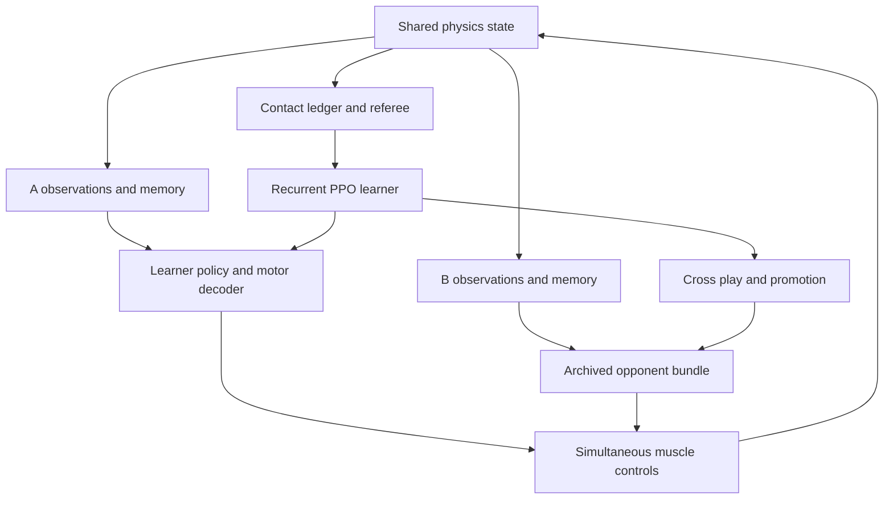

# MS-Human-700 Boxing Self Play Engineering Specification

**Audience:** Simulation and reinforcement learning engineering team  
**Date:** October 26, 2026  
**Specification version:** 1.0  
**Implementation target:** a development fork of `LNSGroup/msgym` consuming pinned `LNSGroup/MS-Human-700` assets  
**Initial application:** a simulated two-player, location-scored boxing game with muscle-driven movement, attributable contact forces, and measurable self-play improvement

## 1 Engineering decision

Build one physically coupled MuJoCo world containing two complete MS-Human-700 instances. Add a deliberate external collision envelope and gloves, an authoritative event-based referee, a motion-trained muscle controller, and a recurrent tactical policy trained against immutable historical opponents. Establish a CPU reference before moving the complete environment to batched GPU execution.

Use the full 700-muscle anatomy as the target embodiment. Keep the upstream model files pinned and make boxing adaptations in a generated scene, so every modification has a manifest and can be inspected. Extend the companion `msgym` package rather than placing Python training infrastructure inside the anatomy-only repository. Preserve original locomotion and manipulation experiments as baselines.

The first meaningful milestone is a reproducible, instrumented two-human scene that records the correct glove-to-opponent contact and awards one score for one legal impact. A trained sparring policy follows only after that contract works. The last milestone is statistically supported improvement against opponents that were not used for the latest training decisions.

### 1.1 What success means

The completed initial system must:

1. Simulate two independently actuated human models in one world, with 700 muscle excitations per player and no artificial assistance during evaluated play.
2. Track body and glove motion, inter-player contact ownership, event location, force history, impulse, score and rule decisions.
3. Support legal blocks: a glove hitting an opposing forearm must be physically blocked and must not score as a torso hit unless a direct qualifying torso contact also occurs.
4. Assign configurable region weights through one versioned referee implementation.
5. Learn movement competence, then tactical competition, with a documented gradient objective and reproducible opponent population.
6. Produce a replayable match and an evaluation report demonstrating improvement under a fixed model, rulebook and testing budget.
7. Report simulated mechanical quantities with their model and calibration provenance. Quantitative agreement with real glove impacts requires separate calibration data.

This version is a virtual sport with explicit rules. It does not attempt physiological injury or knockout prediction. Detailed deformable tissue, ropes, vision-only perception and calibrated fatigue are later model variants. Loss of balance can be a game-ending event under the selected rules without claiming a biological knockout.

### 1.2 Evidence and proposal convention

Statements marked **verified baseline** describe the inspected source or executable checks listed below. Statements marked **initial design**, numerical trial values, file additions, configuration keys and future commands are implementation requirements or experiments. They are not features already delivered by the upstream repositories.

The small executable checks establish model composition and contact-accounting conventions. They do not establish stable boxing movement, real-world impact accuracy, successful GPU execution, or training throughput. No claim of those outcomes is made here.

## 2 Pinned baseline and repository findings

### 2.1 Source and runtime identities

| Component | Pinned identity | Role |
|---|---|---|
| MS-Human-700 | `2d686957aefd5739cf4d2859a6acfd94c8f84400` | Anatomy, muscles, tendons, geometry and coupling constraints |
| msgym | `ad3aac166dab3577d7d16b4a03faccef94c7aac7` | Existing Gymnasium environments and DynSyn-SAC integration |
| MuJoCo CPU used for checks | `3.8.0` | Model compilation, composition and isolated impulse fixture |
| Python baseline | 3.12 | Matches the companion package's declared minimum |
| GPU backend | Select and lock after the feature/parity spike | No GPU version or throughput has been validated in these checks |

Both remote branch heads were checked again while preparing this specification and still matched the pinned commits. Source links: [model revision](https://github.com/LNSGroup/MS-Human-700/tree/2d686957aefd5739cf4d2859a6acfd94c8f84400), [companion revision](https://github.com/LNSGroup/msgym/tree/ad3aac166dab3577d7d16b4a03faccef94c7aac7), [package requirements](https://github.com/LNSGroup/msgym/blob/ad3aac166dab3577d7d16b4a03faccef94c7aac7/pyproject.toml).

### 2.2 Verified model dimensions

| Quantity | One supplied full human | Two namespaced humans in one world |
|---|---:|---:|
| Bodies including the shared world | 81 | 161 |
| Position coordinates `nq` | 85 | 170 |
| Velocity coordinates `nv` | 85 | 170 |
| Actuator controls `nu` | 700 | 1,400 |
| Activation states `na` | 700 | 1,400 |
| Tendons | 700 | 1,400 |
| Equality constraints | 42 | 84 |
| Geometries including one floor | 349 | 697 |
| Total modeled mass before gloves | 60.216523 kg | 120.433046 kg |

The supplied primary model has 19 collision-enabled geometries including its floor, no explicit sensors, and a measured default timestep of 0.002 seconds. Its supplied option block leaves the integrator at the engine default; the boxing reference will explicitly select and validate its integrator. Its root consists of three slide and three hinge coordinates under a rotated pelvis frame; it is not a quaternion free joint. Do not interpret 85 coordinates as 85 independent anatomical degrees of freedom. Source: [main MJCF](https://github.com/LNSGroup/MS-Human-700/blob/2d686957aefd5739cf4d2859a6acfd94c8f84400/MS-Human-700.xml).

The two-copy compilation compared all actuator dynamics types, gain types, bias types, dynamics parameters, gain parameters, bias parameters and control ranges by semantic muscle name. Every maximum absolute difference was zero for both instances. Joint damping also matched by joint name. These are useful composition invariants; the boxing adaptation must add explicit checks for every other preserved property, including joint limits, tendon routes and inertias.

### 2.3 Changes the repository actually needs

| Existing component | Observed condition | Required adaptation |
|---|---|---|
| Bone and wrap defaults | Noncolliding unless overridden | Keep anatomical visual meshes and wrap infrastructure separate from the external contact shell |
| Primary arms and hands | No active external collision geometries | Add arm, forearm and glove collision surfaces |
| Chest and abdomen | No complete external contact envelope | Add fitted trunk surfaces attached to appropriate moving segments |
| Primary hands | Simplified rigid hand bodies with finger meshes | Fit glove geometry to `hand_r` and `hand_l`; independent finger actuation is unnecessary initially |
| Shoulder and wrist coordinates | Polynomial equality couplings | Preserve named couplings and test range/reach feasibility |
| Spine | Many anatomical segment joints are commented out | Preserve the actual reduced coordinate model; inspect feasibility of guard, torso rotation and recovery before changing anatomy |
| Full locomotion environment | Reference-pose observations, reward and termination | Reuse only for motor baselines; implement a separate competition environment |
| Motion archive | One shipped walking trajectory | Add licensed noncyclic boxing and balance data with native-model retargeting |
| Training | DynSyn-SAC and CPU subprocess workers | Add a competitive learner, opponent population and optional Warp backend |

Primary code evidence: [right arm](https://github.com/LNSGroup/MS-Human-700/blob/2d686957aefd5739cf4d2859a6acfd94c8f84400/Body_Primary/Body_Arm_r.xml), [left arm](https://github.com/LNSGroup/MS-Human-700/blob/2d686957aefd5739cf4d2859a6acfd94c8f84400/Body_Primary/Body_Arm_l.xml), [torso](https://github.com/LNSGroup/MS-Human-700/blob/2d686957aefd5739cf4d2859a6acfd94c8f84400/Body_Primary/Body_Torso_Simple.xml), [upper-body equalities](https://github.com/LNSGroup/MS-Human-700/blob/2d686957aefd5739cf4d2859a6acfd94c8f84400/Equality/Equality_Upperbody.xml), [full-body environment](https://github.com/LNSGroup/msgym/blob/ad3aac166dab3577d7d16b4a03faccef94c7aac7/msgym/envs/locomotionFull_v1.py).

### 2.4 Contact-accounting executable check

An isolated one-kilogram free sphere contacted a fixed sphere with zero gravity and no other external force. The check used 400 steps of 0.0005 seconds and the `implicitfast` integrator. Accumulating the signed world-frame contact force gave an impulse of `[-2.2494231917471588, 0, 0]` N·s. The free sphere's momentum change was `[-2.2494231917471605, 0, 0]` kg·m/s. Maximum absolute disagreement was approximately `1.78e-15` in this fixture.

The same check confirmed that `geom_xpos` immediately after `mj_step` matched the pre-integration sphere position, while the newly integrated `qpos` could already differ by 1 mm. Therefore the event classifier must use the contact frame and matching pre-integration body transforms before a subsequent forward/kinematics refresh. A precise force with a mismatched body transform can still award the wrong region.

This check validates the sign, rotation and time-stage convention for that fixture. Its model force peak is not a glove calibration target. The complete reproduction script appears in an appendix.

## 3 Canonical game and version contracts

### 3.1 Initial game definition

The initial design is a 60-second, two-player scoring round with identical model morphology and glove parameters. A pre-round settling period is excluded from play and cannot generate points. Once the referee enters `LIVE`, both actions advance simultaneously and the clock is authoritative in integer physics steps.

| Rule | Initial design |
|---|---|
| Duration | 60 seconds of live simulation |
| Arena | 5 m by 5 m virtual area on a larger physical floor |
| Start | Mirrored, collision-free guard poses facing one another; sample separation from a validated range |
| Legal effectors | Left and right glove striking faces |
| Torso points | 1 for a qualified front/side torso event |
| Head points | 2 for a qualified front/side head event |
| Guard contacts | 0; physical blocking remains active |
| Excluded contacts | 0 hit points; deterministic foul rules can warn, separate or disqualify |
| Impact strength | Qualification and telemetry; no unbounded force reward |
| Round winner | Referee disqualification or validated fall/exit outcome takes precedence; otherwise higher points at the bell, with exact ties drawn |
| Learning utility | Terminal +1 win, -1 loss, 0 draw |
| Evaluation discount | Gamma 1 over the finite round |

These weights define the proposed virtual sport. They are not an official boxing judging system or an anatomical damage scale. Configuration can support other weights, but each new rulebook is a separate benchmark track.

Subject to the foul-adjudication gate below, the proposed terminal fall rule for v0 is: a non-foot body support contact persisting beyond a short calibrated grace interval is a loss; simultaneous qualifying falls are a draw. Isolated glove-floor brushes must not trigger it automatically. Use a body-category whitelist, minimum support force and persistence rather than only head height. Publish the selected thresholds in the rules configuration. A later scored-reset or count-based rule is a separate variant, because it changes the optimal strategy.

The virtual arena boundary must also have a deterministic rule. Subject to the same adjudication gate, a complete exit of the defined foot-support region beyond the configured line for a persistence interval is a loss, with simultaneous exits a draw. Define the region from the horizontal projections of both sole proxies, including flight phases; do not make the player immune to boundary rules merely by lifting both feet. This is a deliberately simple game rule; if boundary losses dominate the learned strategy, replace this with an explicit penalty/reset rule in a new version or implement physical barriers. Do not quietly add an approach-to-center reward to conceal a rules problem.

Resolve simultaneous score events in a physics interval before resolving that interval's round-ending rule. At the clock boundary, include only qualifying evidence sampled in the live interval. Finalize pending contact qualification using evidence already collected; never simulate extra post-bell motion to decide the result. Specify whether an event qualifies when its onset is before the bell but its impulse threshold is reached after it: v0 rejects that score because qualification did not occur during play.

### 3.2 Authoritative versions

An evaluation match identity consists of `model_hash`, `physics_hash`, `rules_hash`, `actor_observation_hash` and two policy bundle hashes, both frozen for the entire match including separation. `scene_hash` is the serialized schema name for `model_hash`; they identify the same generated scene content. A training match also fixes the opponent bundle, but may install a new learner at a rollout boundary under the recurrent-state reconstruction contract. Such a match records a timestamped segment-level learner-bundle timeline instead of attributing all actions to one learner hash. The model hash includes collision envelopes and glove inertia. The physics hash includes timestep, solver, contact material parameters and backend/build. The rules hash includes zone definitions, event-state-machine constants and fall/boundary semantics.

Retain semantic identifiers such as `boxer_a`, `left_glove`, `torso_front` and `head_side_left`. Runtime integer geom indices are implementation details. Every logged contact must be traceable to both.

Changes to collision geometry, contact compliance or scoring thresholds require the affected validation suite and a new version. Old performance data remains useful under its own version; it must not be pooled as if all policies played an identical game.

### 3.3 Required calibration outputs

Some parameters cannot honestly be inferred from the repository: glove foam compliance, effective outer-body shape, valid-impact thresholds and force-to-real-measurement agreement. Implement their calibration as explicit work with persisted outputs, not hidden tuning.

`contact_calibration.json` must contain parameter values with units, fixture definitions, fitting/evaluation split, residual errors, tested velocity range and engine configuration. `referee_calibration.json` must contain labeled positive/negative contact episodes, operating thresholds, false-positive/false-negative counts, boundary cases and replay IDs. An initial simulation-only calibration can define a consistent game; mark its provenance `simulation_rule_calibration` rather than `physical_measurement_calibration`.

Development smoke tests may use documented fixture constants. Promotion and benchmarking require a resolved calibrated configuration; a string such as `REQUIRES_CALIBRATION` must fail the production schema validator. This requirement makes unknown physical inputs visible while allowing scene construction and motor training to proceed in parallel.

### 3.4 Fouls and referee separation

Zero hit points for kicks, tackles or shoves does not prevent those actions from winning through a fall or boundary exit. Canonical v0 therefore includes a versioned mechanical foul classifier and makes fall/exit decisions provisional until its pending evidence has been evaluated. This classifier defines a virtual sport; it does not infer human intent.

Use a reviewed contact-pair matrix to distinguish legal glove strikes, ordinary blocks/parries, incidental body contact and prohibited active strikes. Cover every non-glove actor surface by default, including head, trunk, pelvis, shoulder, upper arm, forearm, elbow, thigh, knee, shin and foot. Every collidable registry surface must resolve to a referee category; an unknown category fails production validation. Exemptions are pair-specific. A forearm classified as guard against an incoming glove is not exempt when it actively strikes a torso. A prohibited impact requires both its own accumulated contact impulse above a calibrated threshold and pre-contact advancement by its owner along the contact normal. For a normal from actor i toward j, measure `c_i=max(0, dot(v_i_at_contact,n))` and `c_j=max(0,-dot(v_j_at_contact,n))` in the fixed arena frame. Apply the declared onset-speed gate to each actor separately; both can commit a foul. A stationary receiving surface is not automatically the initiator. Glove/forearm blocks against an incoming glove are explicitly exempt from an automatic non-glove strike foul. Use dedicated elbow regions so a forearm shield and an elbow strike do not share a blanket label.

Detect persistent drives separately using sustained cross-actor pressure, forward pelvis advancement, and opponent displacement over a configured interval. This rule includes prolonged glove pushing. A contact-pressure threshold alone must not penalize a stationary defender. Store per-actor advancement histories, active pressure time and foul evidence with stable event IDs; one foul event increments its counter once. All force, motion and duration thresholds must be calibrated against legal footwork, parries, body contact, shoves, kicks, trips and tackles. They are game predicates with measured classification errors, not a causal or injury model.

Resolve the interruption in this deterministic order, using only evidence accumulated up to its first verified substep boundary:

1. Finalize legal hit windows and foul evidence once; update the public foul/warning ledger. The first two adjudicated fouls request separation; a third disqualifies the offender. Simultaneous disqualifications draw; a single disqualification is a terminal loss and takes precedence over a fall/exit result.
2. If nobody is disqualified, adjudicate provisional falls/exits. A qualifying foul by the **would-be winner** within the public review interval cancels that actor's fall/exit victory. A foul by the **would-be loser** does not erase its own pending loss. If both actors fall/exit and a relevant foul exists, separate without awarding a fall/exit result; otherwise the specified simultaneous-fall/exit rule draws. These are public temporal/ownership rules, not a claim of complete physical causation.
3. A surviving valid fall/exit result ends the match. If the bell has also occurred and no such result survives, decide by the committed point totals. Never advance extra post-interruption physics to qualify a pending foul or hit.
4. Otherwise, honor required separation and resume the same round. Preserve all previously committed legal points. A mutual stationary clinch beyond the calibrated duration requests separation and a persistent warning for each player; three such warnings count as one foul each. Apply the same disqualification precedence after warning conversion.

Referee separation enters a non-live `SEPARATE_SETTLE` phase. The reference environment executes this autonomous administrative transition inside `step` before returning the next actionable observation. Tactical inference is paused and both tactical recurrent memories are frozen. Preserve scores, foul/warning counts, policy identities, match identity and event-sequence counters. Close pending contact candidates, record an explicit discontinuity, move to an approved separated reset-bank pose and initialize consistent muscle activation. Use a separately versioned, deterministic frozen stance controller during settling; the tactical latent cannot command this phase.

Clear or rebase transient glove/target-onset history, strike retraction history, pelvis-advancement/drive history, finite-difference heading history and delayed kinematic samples so teleportation cannot become a giant strike or foul. Initialize decoder state, low-level action filters, rate-limit state and held excitation from the approved settling state; reset held latent to the declared neutral initializer. Rebuild delay queues from the resumed visible state with explicit validity/age masks. Reset motor/strategy phase counters together at resume and compute fresh simultaneous tactical decisions, followed by both decoders. Initialize the scorer through its non-scoring settle/rearm state; do not pretend the glove physically retracted during teleportation.

The live clock pauses during administration; world time and replay continue. The proposed settling timeout is 2 seconds of world simulation, with the separately specified minimum settling period. Failure to regain a valid state by that bound is an invalid-environment incident, not a sporting loss. Publish the separation/discontinuity flag in the next actor observation. Record both elapsed live time and elapsed world time. The initiating live action and its subsequent outcome remain one learner transition with value/trace continuity; administration adds no tactical action sample. Device implementations that retain administrative bookkeeping rows set actor-loss, entropy and actor-memory-update masks to zero on those rows and must recover the same collapsed transition for the reference PPO objective. This is neither an episode termination nor a GAE trace cut. Dynamic assistance or pose overrides remain prohibited while `LIVE`.

Before enabling fall/exit wins, the referee must pass kick, tackle, delayed-trip, shove, passive-pin, guard-parry and clinch-spam fixtures, including below-threshold sweeps. If it cannot, keep that outcome mode disabled and evaluate a separately hashed score-and-foul variant with neutral fall/exit separation. Do not describe an unresolved classifier as solved by a motion prior. The production rule configuration must select one validated mode; neither a smoke run nor an ambiguous fallback enters canonical league ratings.

## 4 System decomposition and scene construction

### 4.1 Execution graph



The anatomy defines force production and motion. The environment defines permitted observations and transitions. The referee alone converts physical contact to score. The learner improves policy parameters. The league defines the training opponent distribution. Evaluation measures performance without changing the tested policy or physics.

### 4.2 Scene-builder algorithm

1. Resolve the exact upstream XML and verify its pinned asset manifest.
2. Parse two separate `MjSpec` instances. Keep them alive until attachment and compilation finish.
3. Create one parent world and floor. Attach each child's `pelvis` subtree to a separate spawn frame using `A_` or `B_` prefixes. Attaching the pelvis avoids copying two floors.
4. Use a world-Z yaw in the spawn frame for facing direction. Preserve the source pelvis quaternion and its six scalar coordinates. Do not treat the first qpos entries as ordinary world x/y/z or overwrite them with a quaternion.
5. Add the approved outer-body proxies, glove bodies/inertia, semantic markers and material settings. Retain tendon-wrapping objects. Replace redundant active bone-contact surfaces where the external shell now owns contact.
6. Preserve and audit actuator references, spatial tendon routes, equality constraints, limit parameters and passive joint properties. Regenerate source keyframes using named joint/state maps after composition instead of assuming concatenated reset arrays remain correct.
7. Compile. Resolve semantic index maps from names. Verify actuator ownership and all configured scoring geometries.
8. Initialize both actors in validated guard states, run forward dynamics, inspect penetrations and constraints, and settle under a frozen controller before starting the round.
9. Save generated MJCF, the resolved scene manifest and inspection renders. Training and evaluation must reference that immutable scene version.

Model attachment is supported by the [MuJoCo model-editing API](https://mujoco.readthedocs.io/en/3.8.0/programming/modeledit.html). A tested baseline composition is provided in the appendix. The full boxing builder still needs the collider, initialization and rule work specified here.

### 4.3 Anatomical anchors and shell fitting

Use named source bodies, not a generic humanoid skeleton map:

| External feature | Source anchor | Construction requirement |
|---|---|---|
| Right/left gloves | `hand_r`, `hand_l` | Fit a closed-glove proxy and explicit striking-face frame to each rigid hand |
| Forearms | `ulna_r/l`, with radius/wrist landmarks for fitting | Account for pronation/supination; avoid duplicate full forearm shells on overlapping radius and ulna bodies |
| Upper arms | `humerus_r/l` | Capsule endpoints from native shoulder/elbow geometry |
| Shoulders | `scapula_r/l` and proximal arm frame | Cover gaps while allowing the authored shoulder coupling |
| Chest | Rigid thoracic chain / `sternum` frame | Fit one or a few surfaces without introducing artificial thoracic mass |
| Lower trunk | Lumbar chain near `lumbar5` | Preserve separation at the actual movable spine joints |
| Head | `head_neck` | Fit outer head surface and mark front/side/back in an anatomical frame |
| Pelvis | `pelvis` | External shell where required; no score on lower regions in v0 |
| Feet | `calcn_r/l`, `toes_r/l` | Retain and inspect existing floor-contact proxies |

The torso contains active joint groups at `L5_S1_*`, `T12_L1_*` and `T1_head_neck_*`; many intervening vertebral joints are commented out in the primary model. Do not fit one rigid envelope across a movable articulation, and do not assume every visible vertebra bends independently. Reference: [native torso structure](https://github.com/LNSGroup/MS-Human-700/blob/2d686957aefd5739cf4d2859a6acfd94c8f84400/Body_Primary/Body_Torso_Simple.xml).

Build an anatomical frame for each shell from identified landmarks. Store its local transform explicitly in `collision_envelope.yaml`. Fit outer sizes from a reviewed body-surface template or documented design dimensions; skeletal mesh bounds alone do not determine flesh thickness. Inspect front, back, both sides, top and three-quarter views in neutral, guard, reach and rotated-trunk poses. Include an automated grid of probe contacts to detect holes and unintended overlaps.

An initial glove design can use a low-complexity rounded convex shape with an explicit mass and principal inertia. For an ellipsoid with semi-axes a, b, c and mass m, its principal moments are m(b²+c²)/5, m(a²+c²)/5 and m(a²+b²)/5. Rotate these into the intended inertial frame correctly. If a massless collision geom represents existing tissue, preserve the source body inertia; if a glove adds mass, account for it once. These are geometry and mass-accounting rules, not fitted glove-material properties.

### 4.4 Initialization and morphology policy

Start with equal morphology, equal glove parameters and paired mirror states. Preserve native joint limits while obtaining a feasible guard through inverse kinematics plus muscle-driven settling. Validate that both gloves can reach all intended target regions, that a guard can physically protect them, and that the ankles/hips can support sidesteps and turns. If these tasks fail because of authored range or coupling restrictions, record the limitation before changing the model; publish changes as a separate anatomy variant with motion and force validation.

Do not reset by teleporting overlapping bodies into a convenient boxing pose and relying on the contact solver to eject them. Reset tests must reject initial penetrations above the declared tolerance. Select stable starting states from a validated reset bank including qpos, qvel and muscle activation; store how each state was produced. Randomization then samples small, feasible perturbations around that bank and settles before `LIVE`.

Add body-size or strength variation only after equal-body play is reliable. Scaling lengths, mass, inertia, muscle force and tendon operating ranges independently can create mechanically inconsistent athletes. Morphology variation needs its own scaling contract and must be visible to the appropriate controller input, while hidden opponent physiology remains unobserved by the actor.

## 5 Physics contacts and scoring

**Integration target:** `msgym/boxing/`. This section specifies a proposed implementation, not completed or validated boxing physics. Canonical v0 uses a 60-second round, integer hit points of `1` for torso and `2` for head, and the separate match objective of win `+1`, loss `-1`, draw `0`. There is no floor-impact reward, damage reward, or force-proportional point multiplier. A qualifying direct glove–target contact can score after guard contact within the same initial impact window. The glove–defender encounter can score only once.

**Audited model:** `LNSGroup/MS-Human-700`, commit `2d686957aefd5739cf4d2859a6acfd94c8f84400`. Pin this revision and the tested MuJoCo version in the experiment manifest. The pinned CPU documentation establishes API semantics; an accelerated backend must be separately versioned and checked against the exact generated scene.

### 5.1 Why a dedicated boxing collision model is necessary

The primary model disables collision in both its `bone` and `wrap` defaults. It selectively restores collision on the pelvis, sacrum, and skull. Its primary arms each contain 107 geoms—32 bone and 75 wrap—with neither skin geoms nor collision-mask overrides. Its torso has 52 bone and 18 wrap geoms and no skin envelope. Each leg already has seven skin capsule geoms. These findings come from parsing the XML while excluding comments. Thus the existing arms cannot punch or block physically, and most torso anatomy is not a usable contact target. Merely duplicating the model and adding a distance reward would leave fundamental interactions absent. [P1](https://github.com/LNSGroup/MS-Human-700/blob/2d686957aefd5739cf4d2859a6acfd94c8f84400/MS-Human-700.xml) [P2](https://github.com/LNSGroup/MS-Human-700/blob/2d686957aefd5739cf4d2859a6acfd94c8f84400/Body_Primary/Body_Torso_Simple.xml) [P3](https://github.com/LNSGroup/MS-Human-700/blob/2d686957aefd5739cf4d2859a6acfd94c8f84400/Body_Primary/Body_Arm_r.xml) [P4](https://github.com/LNSGroup/MS-Human-700/blob/2d686957aefd5739cf4d2859a6acfd94c8f84400/Body_Primary/Body_Leg_Foot_r.xml)

The primary model's fingers are visual meshes within a simplified hand body, not a complete articulated finger system. Use `hand_r` and `hand_l` as glove attachment parents. Do not import the manipulation model's hand contact exclusions into the primary model: their body names and anatomical decomposition differ. Preserve muscle routing, wrap objects, joint constraints, and the chosen root-coordinate representation during the initial build. Changing those simultaneously with contacts would make failures difficult to attribute. [P3](https://github.com/LNSGroup/MS-Human-700/blob/2d686957aefd5739cf4d2859a6acfd94c8f84400/Body_Primary/Body_Arm_r.xml) [P5](https://github.com/LNSGroup/MS-Human-700/blob/2d686957aefd5739cf4d2859a6acfd94c8f84400/Contact/Contact_Upperbody.xml) [P6](https://github.com/LNSGroup/MS-Human-700/blob/2d686957aefd5739cf4d2859a6acfd94c8f84400/Tendon/Tendon_Arm_r.xml)

#### 5.1.1 Files and responsibilities

| Proposed file | Responsibility |
|---|---|
| `msgym/boxing/physics/scene_builder.py` | Compose two namespaced actors and the arena; emit resolved model plus registry. |
| `msgym/boxing/physics/envelopes.py` | Attach approved external shell geometries and glove bodies. |
| `msgym/boxing/physics/materials.py` | Resolve physical contact parameters and material-pair overrides. |
| `msgym/boxing/physics/scene_manifest.py` | Immutable geom/body ownership, surface role, and region mapping. |
| `msgym/boxing/physics/backends/cpu.py` | Reference stepping and contact extraction with explicit stage semantics. |
| `msgym/boxing/physics/backends/warp.py` | Device implementation of the same public contact contract. |
| `msgym/boxing/physics/health.py` | Numerical validity, overflow, and motion-resolution checks. |
| `msgym/boxing/rules/events.py` | Per-glove event state machine and idempotent score records. |
| `msgym/boxing/rules/regions.py` | Non-overlapping semantic regions and boundary conventions. |
| `msgym/boxing/fixtures/` | Deterministic physical fixtures and recorded states/actions. |
| `tests/boxing/test_contact_contract.py` | Backend, ownership, coordinate-frame, and event invariants. |

### 5.2 External surfaces, masses, and collision eligibility

#### 5.2.1 Keep separate anatomical, collision, and scoring representations

Maintain three explicit representations:

1. **Anatomical dynamics:** the original bodies, inertias, joints, equalities, muscle actuators, tendon paths, and wrapping surfaces.
2. **External physical surfaces:** a compact set of capsules, spheres, ellipsoids, or small convex pieces attached to appropriate moving bodies. These generate contact forces.
3. **Semantic scoring regions:** functions of the physical contact point in a target body frame. These generate labels, never additional forces.

Begin with head, neck, upper/lower trunk, shoulders, upper arms, forearms, gloves, pelvis, thighs, shins, and feet. Non-scoring surfaces must still collide. An illegal region cannot be made physically transparent. The guard must stop a glove before it reaches the trunk; a glove must not pass through its own forearm or torso.

Choose shell geometry by inspecting its world-space envelope across a pose suite: standing, guard, maximal arm reach, flexed elbows, rotated trunk, defensive crouch, and a fall. Fit proxies to an explicitly documented external body approximation. Bone meshes alone do not establish skin thickness or athlete girth. Parameters inferred visually must be labeled estimates and treated as uncertainty in validation.

Use several overlapping primitives only where their combined envelope is intentional. Excessively overlapping pieces can create redundant contacts and change stiffness. Prefer a few smooth pieces per anatomical segment; inspect the actual collision surface rather than only the rendered mesh. MuJoCo's ordinary mesh collisions use convex hulls, so concave visual geometry is not a reliable description of the collision surface. [P7](https://mujoco.readthedocs.io/en/3.8.0/computation/index.html)

#### 5.2.2 Mass and inertia contract

Shell geometry must not silently add tissue mass to bodies whose original inertias already represent that mass. Give collision-only geoms zero mass and retain explicit original body inertias. Verify the compiled mass, center of mass, and spatial inertia, rather than relying on an XML `mass="0"` setting as proof that composition preserved them.

Model each glove as an additional rigid child of its hand with an explicit positive glove mass, center of mass, and valid inertia tensor. Its shell geoms have zero mass because the glove body's inertial definition owns the mass. The existing hand mass remains. Alternatively, combine glove and hand inertias mathematically, including the parallel-axis term, but choose only one method. Adding both a glove-body inertia and equivalent hand-inertia increment is an error.

For a body with original mass `m`, adding a mass `mg` at displacement `r` changes its inertia by `Ig + mg * ((r·r)I - rrᵀ)` after expressing both inertias in a common frame. The new center of mass must also be computed; simply adding diagonal inertias is generally wrong. A rigid child is easier to audit.

Acceptance checks compare the no-glove assembled actor to the original compiled actor and then compare the glove-equipped actor to the expected mass increment. Use tight numerical tolerances appropriate to the compiled precision. Randomization must update all affected derived model constants or recompile an equivalent model. Never randomize `body_mass` alone while assuming all cached quantities are refreshed.

Leave wrapping geometries and tendon sites intact. A wrap object is infrastructure for muscle moment arms, not flesh. Turning it into a collider would introduce non-anatomical surfaces and could alter the motion policy's optimum. [P1](https://github.com/LNSGroup/MS-Human-700/blob/2d686957aefd5739cf4d2859a6acfd94c8f84400/MS-Human-700.xml) [P6](https://github.com/LNSGroup/MS-Human-700/blob/2d686957aefd5739cf4d2859a6acfd94c8f84400/Tendon/Tendon_Arm_r.xml)

#### 5.2.3 A collision-mask scheme with the correct OR semantics

MuJoCo admits a dynamically selected geom pair when

`(contype1 & conaffinity2) != 0 OR (contype2 & conaffinity1) != 0`,

subject to its other filters. Permission is not a mutual AND handshake. Therefore setting only one geom's `conaffinity` to zero does not guarantee that it cannot collide. Set both masks to zero for disabled anatomy/wrap geoms. Explicit contact pairs require separate auditing because they can bypass normal mask filtering. [P7](https://mujoco.readthedocs.io/en/3.8.0/computation/index.html)

Use these initial ownership bits:

| Class | Bit | `contype` | `conaffinity` |
|---|---:|---:|---:|
| Arena/environment | 1 | 1 | 2 + 4 = 6 |
| Boxer A external surface | 2 | 2 | 1 + 4 = 5 |
| Boxer B external surface | 4 | 4 | 1 + 2 = 3 |
| Visual anatomy / wrap | 0 | 0 | 0 |

This allows A–B, A–environment, and B–environment contacts while suppressing automatic A–A and B–B contacts. Restore necessary self-contact through an explicit, reviewed pair list generated from the external-surface registry. Include non-adjacent segments that can physically meet; exclude adjacent overlapping shells around a joint where contact would be artificial. Explicitly cover glove–own-head, glove–own-trunk, forearm–own-trunk, left/right arm interactions, and left/right legs where applicable. The final environment must not omit self-contact simply to improve throughput.

Do not depend on an `<exclude>` to cancel an explicitly authored `<pair>`. The builder must reject conflicting declarations and duplicate pairs before compilation. Preserve original relevant lower-body exclusions only after remapping their names and checking compatibility with the new external shells. Assert the intended collision matrix using actual engine queries over fixtures, not only a Python recreation of mask arithmetic.

Material-pair overrides belong in one generated table. Distinguish glove–target, glove–guard, glove–glove, sole–floor, and other body contacts. If relying on MuJoCo's geom parameter combination rules, log the effective contact parameters observed in fixtures. If using explicit pairs for calibrated combinations, make the override precedence unambiguous. The visible color of a region must never determine its physics.

### 5.3 Registry and data contracts

Every compiled physical geom resolves to an immutable record:

```python
GeomRecord = {
    "geom_id": int,
    "stable_name": str,             # e.g. A/glove_right/shell_0
    "actor_id": int | None,         # 0, 1, or environment
    "segment": str,
    "surface_role": str,            # glove, guard, target, non_scoring, floor
    "material_id": str,
    "body_id": int,
    "body_local_region_map": str | None,
    "glove_id": int | None,
}
```

The registry is rebuilt after compilation; integer geom IDs are not assumed stable across model changes. A hash of its semantic content travels with checkpoints and replays. Names must map one-to-one, every collidable geom must be registered, and all actuator/tendon/site references must resolve within the correct actor namespace.

The backend emits a fixed-capacity batch of `ContactSample` values per physics substep:

```python
ContactSample = {
    "world_id": int, "episode_id": int, "substep_id": int,
    "t_eval": float, "dt": float,
    "geom1": int, "geom2": int,
    "active_constraint": bool,
    "position_world": float[3],
    "frame_contact_from_world": float[3, 3],
    "wrench_contact": float[6],     # force xyz, then torque xyz
    "distance": float,
    "velocity1_at_contact": float[3],
    "velocity2_at_contact": float[3],
    "body1_pose_at_eval": Pose,
    "body2_pose_at_eval": Pose,
}
```

`active_constraint` excludes contacts that merely exist in a detection buffer but exert no solved contact force. Sampling must preserve every relevant contact or an exact equivalent reduction. Truncation, buffer saturation, NaN values, or ownership lookup failure invalidates the sample and triggers the fault pathway; they cannot silently become “no contact.” Contact array indices are temporary and must not be used as persistent hit IDs. [P8](https://mujoco.readthedocs.io/en/3.8.0/APIreference/APIfunctions.html#mj-contactforce) [P9](https://mujoco.readthedocs.io/en/3.8.0/XMLreference.html#sensor-contact)

### 5.4 Force transforms and sampling at the correct simulation stage

#### 5.4.1 Coordinate definitions

On CPU, `mj_contactForce(model, data, contact_index, wrench)` returns force followed by torque in the contact frame. Its first axis is the normal; the other axes span the tangent plane. The positive force convention is from `geom1` toward `geom2`. [P7](https://mujoco.readthedocs.io/en/3.8.0/computation/index.html) [P8](https://mujoco.readthedocs.io/en/3.8.0/APIreference/APIfunctions.html#mj-contactforce)

Let `C = contact.frame.reshape(3, 3)`, whose rows express the contact axes in world coordinates. Then

`F_world_on_geom2 = C.T @ wrench[0:3]` and

`T_world_on_geom2_at_contact = C.T @ wrench[3:6]`.

The wrench on geom1 has the opposite sign. For a designated recipient use `s = +1` when it is geom2, `-1` when it is geom1. Its torque about a world reference point `o` is

`T_o = s * (C.T @ wrench[3:6]) + cross(p_contact - o, s * F_world_on_geom2)`.

Validate this with rotated-frame fixtures and the same fixture with geom naming/order reversed. A six-dimensional contact wrench and MuJoCo's other spatial vectors do not necessarily share the same field-order convention; the adapter must not reinterpret arbitrary six-element engine arrays as this contract.

For glove `g` and target `t`, construct `n_g_to_t` by orienting the contact normal from glove to target. The pre-solve approach speed is

`v_approach = dot(v_glove_at_p - v_target_at_p, n_g_to_t)`.

Positive approach means closing. Include rotational point velocity, `v_com + omega × (p - com)`, or use the appropriate body-point Jacobian. COM velocity alone is insufficient for rotating gloves and bodies.

#### 5.4.2 The post-step timestamp trap

For the supported single-step integrators, MuJoCo computes derived geometry and forces and then advances the state. Consequently after `mj_step`, `qpos` and time have advanced, while cached contact geometry and body transforms describe the force-evaluation state before integration. Mixing the cached contact point with freshly recomputed end-state body poses mislabels regions and normals. Calling `mj_forward` before extracting the contact force overwrites the just-completed step's contact information. The official stepping documentation explicitly describes this stage distinction. [P10](https://mujoco.readthedocs.io/en/3.8.0/programming/simulation.html)

Reference implementation:

```python
# Reference adapter initially supports a pinned implicitfast implementation.
# RK4 and any newer integrator require a separately verified sampling contract.
for substep_id in range(substeps_per_motor):  # 10 at 1 ms physics / 100 Hz motor
    t_eval = data.time
    mujoco.mj_step1(model, data)
    pre = capture_contact_geometry_body_poses_and_point_velocities(model, data)
    data.ctrl[:] = held_muscle_command
    mujoco.mj_step2(model, data)
    solved = capture_contact_wrenches_before_any_forward_refresh(model, data, pre)
    health = validate_substep(model, data, pre, solved, expected_time=t_eval + dt)
    if not health.valid:
        fault_handler.quarantine_current_episode(health)
        break
    events.consume(solved, timestamp=t_eval, dt=dt)
```

`pre` is a copy or otherwise immutable staged device buffer. Assert that the contact identities used for the solve correspond to the captured geometry. If the backend internally refreshes observations, insert contact extraction before that refresh. The GPU implementation must reproduce this ordering in its graph; a bulk `step(n_substeps)` call returning only the final contact array is insufficient.

At a motor-policy boundary, refresh position/velocity-derived observations to the integrated state using the verified backend stage API; do not publish a mixture of new generalized coordinates and old world transforms. Motor commands update at 100 Hz; strategy commands update at 50 Hz, every two motor ticks. A reference implementation may initially recompute stages for clarity. Optimize redundant work only after the stage-consistency test passes. Disable unintended control callbacks so that the explicit adapter is the sole command writer. Disable sleeping in v0: MuJoCo 3.8 documents additional latent derived state for sleeping islands, which breaks the compact integration-state replay assumption. Enabling sleep later requires a separately verified state and sampling contract. [P10](https://mujoco.readthedocs.io/en/3.8.0/programming/simulation.html)

#### 5.4.3 Event aggregation

For event `e`, integrate all contributing manifold contacts at each physics substep:

`J_normal[e] += dt * sum(max(F_normal[c], 0) for c in event_contacts)`

`J_vector[e] += dt * sum(F_world_on_recipient[c] for c in event_contacts)`.

The scalar normal impulse is not the norm of the vector impulse when normals differ. Save both. Compute event peak normal force as the maximum over time of the **summed simultaneous normal forces**, not the sum of each contact's separate maximum. Average normal force is event normal impulse divided by its defined active-contact duration. Retain both elapsed event duration and active-contact duration, since a hysteresis gap need not contain force.

Maintain separate impulse channels: all physical encounter impulse, guard-contact impulse, non-scoring-contact impulse, and eligible **direct glove–target impulse by scoring zone**. Only the last channel is used to qualify a score. A glove's force on a guard, or the guard's transmitted force on a torso, is not a direct glove–torso contact and cannot be attributed to that target. Continuing to press after the initial impact window may increase telemetry impulse, but cannot increase score. Physical forces always remain active regardless of whether the score event has closed.

### 5.5 A deterministic, idempotent hit-event state machine

The scorer owns one state machine per glove per environment. It observes measured motion and contacts; a policy cannot declare that a hit occurred. One hand can have one active event at a time. Left/right hands are independent, so a legitimate simultaneous two-hand event is representable. The implementation is a pure function of previous scorer state, current staged samples, and a versioned rule configuration.

#### 5.5.1 States

| State | Meaning and transitions |
|---|---|
| `RESET_SETTLE` | No scoring. Wait for reset geometry to be clear and the initial support state to pass health checks. Then enter `READY`. |
| `READY` | Glove is separated from opponent by the configured clearance and has completed the previous recovery requirement. First active opponent contact creates an event and enters `CANDIDATE`. |
| `CANDIDATE` | Accumulate eligible direct target impulses during the encounter's original 50 ms impact window. Guard contacts are logged but never veto later qualifying target contact. Finalize on confirmed direct-impact release, the window deadline, confirmed full withdrawal, or a valid game terminal boundary, as defined below. |
| `LOCKED` | The event has a final outcome, including zero-score outcomes. All continuing/near-continuing contacts remain the same event. No further score is possible. |
| `RECOVERING` | Opponent contact has ended, but clearance/retraction history is not yet sufficient. Renewed contact returns to `LOCKED` under the existing event. On adequate separation and recovery, clear the event and enter `READY`. |

The encounter clock and target-onset history begin at the first force-producing active contact, even if its force is below the higher hysteresis threshold used for a stable contact-presence flag. Thus a detector threshold cannot shift the window forward or erase the true pre-impact velocity. During `CANDIDATE`, each substep contributes once. Contact records are grouped by stable glove identity and recipient, not by region or contact index. Deduplicate only exact duplicate delivery of the same substep/sample; distinct simultaneous manifold points represent separate physical force contributions and must be summed.

Every finalized record carries `(run_id, world_id, episode_id, glove_id, event_sequence)`. An append-only scoreboard accepts that key exactly once. Replaying the same record or retrying an interrupted logging operation cannot increment the score twice. Store the last consumed substep in scorer state, and serialize it in episode replay/checkpoint snapshots.

#### 5.5.2 Direct contact, blocking, and release semantics

Guard-only contact earns zero points. A guard brush does not immunize a later target contact. If the glove subsequently makes direct, qualifying contact with a legal target before the original encounter window closes, accumulate that target's own contact impulse and allow one score. A shoulder, forearm, glove, or spatial gap physically determines whether that direct contact happens; the scorer must not infer a target impact from force transmitted through another body.

Record `guard_then_scored` when an earlier guard contact is followed by a qualifying direct target contact. Simultaneous guard and target contacts can also score if their direct target impulse independently qualifies; label this `guard_and_target_scored` when substep sampling cannot establish order. These labels describe telemetry, not additional rewards or scoring vetoes. Earlier non-scoring surface contact likewise does not veto a later eligible direct target contact during the same window.

The initial window starts at the encounter's first opponent-contact onset and is never restarted by a new region, guard touch, or stronger force sample. Its proposed maximum duration is 50 ms. Finalize at the earliest of the window deadline, the round bell or another valid game terminal boundary, confirmed full withdrawal, or **confirmed release of a direct target impact after that target impact has begun**. Confirm direct-impact release using the short contact-gap hysteresis. A guard-only candidate stays eligible through the original window unless full withdrawal or game termination occurs; ending it solely when a tiny guard brush releases would recreate the veto this rule is designed to avoid.

Full withdrawal means the strict separation-and-retraction recovery conditions below are satisfied. This release convention is part of canonical v0 and must be identical in both backends. Finalization locks the whole encounter; it does not permit a second score if contact continues on another region. A guard-only encounter still in contact after 50 ms is spent: later target contact during that held push cannot score until full clearance and retraction rearm the glove.

At the bell or another valid game terminal boundary, finalize integer points from evidence accumulated before that boundary. Let `t_stop` be the earliest such boundary; no sample or impulse interval after `t_stop` may contribute. Use integer physics ticks for known clock boundaries, or shorten a final step to the known remaining interval if required. Define state-dependent game termination at the first verified substep boundary rather than inventing an unmeasured continuous event time. Numerical failure is not a valid game terminal boundary and instead follows the quarantine protocol. Never advance additional physics to complete a pending score window after a match has ended.

An opponent guard contact on one glove does not affect the other glove's independent scoring event. Self-contact and glove–floor contact never produce opponent hit points. They remain physical events and can contribute to ordinary balance/fall logic.

#### 5.5.3 A score requires all direct-target gates

Require: healthy physics; opponent ownership; a direct glove–target geom pair; an enabled target region; designated glove striking face; qualifying target-contact onset approach; sufficient eligible impulse in the initial window; and measured active strike motion. There is no first-surface eligibility gate.

For each target zone, capture onset kinematics at its **first actual direct glove–target contact**, using that target's contact-point velocity and the glove velocity from the same pre-solve stage. Do not reuse the preceding glove–guard closing speed, the target's COM velocity, or velocity after the collision has already decelerated the glove. Keep low-force onset history even before a contact-presence threshold is crossed. Latch zone-onset eligibility and then integrate its subsequent eligible direct contact force; reapplying the minimum approach-speed test after deceleration would discard the impulse being measured.

Measured active strike motion prevents a stationary guard from farming punch points when the opponent moves into it. Use glove displacement relative to the striker's trunk/shoulder plus forward-oriented motion history preceding that target onset. This is a sports-rule choice that must be reviewed on legitimate body-driven punches; it is not a physical law. Absolute hand speed alone can be supplied by opponent motion or a fall. A policy-supplied attack flag cannot authorize a score.

Striking-face eligibility combines geometric glove-face membership and the outward striking axis relative to `n_g_to_t`. Palm/back/side contact remains physical but does not add eligible target impulse. Once zone-onset kinematics qualify, include direct face contacts in that zone throughout the window; each contributing contact still has to be physically active and on the authorized striking face. A new zone must qualify using its own onset. All thresholds live in one rules configuration and are tested with positive and negative fixtures; they are not injury or damage criteria.

#### 5.5.4 Multiple target regions without multiple rewards

Regions must partition the physical legal surface with deterministic half-open boundary rules. Transform each contact point using the recipient body pose at `t_eval`. Never compute region labels from the actor's current screen coordinates or a later pose.

Accumulate eligible direct target normal impulses `J_z` by zone during the initial window. At finalization choose the zone with the greatest accumulated eligible impulse, not the greatest point value. Resolve equal impulses by lower point value first, then stable zone ID. The deterministic ordering is `(-J_z, points_z, zone_id)`.

The selected zone must independently satisfy `J_z >= J_min`; do not pool multiple sub-threshold zones to manufacture a qualifying hit. If it does, award exactly `1` for a torso zone or exactly `2` for a head zone. Otherwise award `0`. Integer points do not scale with force or impulse above the qualifying threshold. For example, head impulse `0.30 N s` and torso impulse `0.45 N s`, both eligible with `J_min = 0.25 N s`, selects torso and awards `1`. Equal eligible head/torso impulses select torso by the lower-weight tie rule.

Keep the complete zone distribution and chosen-zone identity for audit. Distinct contact points on the same zone contribute to its summed physical impulse, while the encounter still produces one score record. Region seams must not create additional physical surfaces. Floating-point near-ties must be exposed in parity diagnostics; tests away from ties must agree, and the manifest must record accumulator precision and tie policy.

#### 5.5.5 Chatter, pushing, and recovery

Use distinct enter/exit thresholds, a minimum clear interval, a geometric separation requirement, and measured retraction relative to the previous strike extension. A cooldown timer alone is insufficient: a glove can remain pressed against a torso and collect points every cooldown. Conversely, one missed contact sample must not rearm it.

The impact window closes permanently for the event. Sustained contact cannot add points or restart that window. Rearming requires all of: continuous low-force separation for the minimum clear interval, at least the clearance distance from **every** opponent physical shell, and sufficient glove retraction relative to the previous encounter's maximum extension in the striker frame. Moving from guard to head, dragging between zones, or waiting out a timer while touching cannot rearm the glove. Zero-score encounters use the same recovery contract. Scorer clearing is permitted only through an explicit episode transition or authorized referee separation. Within-match separation preserves match IDs and event-sequence counters, discards/rebases onset and motion histories, and reenters non-scoring settle/rearm; time rollback or an engine autoreset must be detected as a fault, never used to rearm scoring within a live round.

### 5.6 Temporal resolution and missed fast contacts

`nativeccd` in MuJoCo names **convex collision detection**, not a guarantee of swept continuous-time collision detection. Enabling it does not establish that a fast glove cannot pass entirely through a thin target between simulation samples. The official computation chapter uses that terminology and describes the convex routines. [P7](https://mujoco.readthedocs.io/en/3.8.0/computation/index.html)

The candidate starting timestep is **1 ms**, compared with the verified upstream default as a baseline. Treat 1 ms as an experiment setting, not validated impact accuracy. Sweep 2 ms, 1 ms, 0.5 ms, and finer resolution only where a remaining failure requires it. Keep policy cadence constant while changing substeps, and express all scorer windows in seconds rather than frames.

Create fast-pass fixtures spanning the observed glove/target relative speed, approach angles, and smallest shell feature sizes. Include moving targets and rapidly rotating gloves. Detect a path that crosses the target envelope without any force-producing contact. A conservative swept-bounds monitor can flag suspicious steps: expand candidate trajectories by rotational reach and compare swept glove bounds with opposing surface bounds. An alarm triggers finer-step replay or invalidation; it does not fabricate an impulse or award a geometric hit.

Bound relative motion per step as an engineering diagnostic compared with the smallest relevant contact length scale. This heuristic does not prove no tunneling. The proof obligation is the fixture suite plus measured stress coverage. Increasing contact margins is not an acceptable undocumented fix: it changes effective reach and when forces start.

### 5.7 Calibration and acceptance gates

#### 5.7.0 Candidate configuration for the first implementation

The following values make an initial implementation executable. They are proposed game/solver settings to be replaced or confirmed by fixture results, not validated human-impact constants. A published run must store the actual resolved values, not merely the defaults. Keep event rules identical across training and evaluation.

| Setting | Initial candidate | Required interpretation |
|---|---:|---|
| Physics timestep | `0.001 s` | Compare with `0.002 s` and `0.0005 s` in convergence fixtures. |
| Motor control interval | `0.010 s` | 100 Hz; hold the muscle command across 10 candidate physics substeps. |
| Strategy control interval | `0.020 s` | 50 Hz; two motor updates per strategy decision. |
| Integrator | `implicitfast` | Supported only after the staged sampling fixture passes. |
| Initial impact window | `0.050 s` | Never restart within the glove–defender encounter. |
| Contact-presence enter force | `1.0 N` summed per glove/opponent | Hysteresis flag only; encounter clock and onset history begin at the first force-producing active contact. |
| Contact-presence exit force | `0.25 N` | Hysteresis threshold; geometric clearance is additionally required for rearming. |
| Brief contact gap | `0.008 s` | Preserve event identity across brief chatter; never issue a second event within the gap. |
| Minimum clear interval | `0.030 s` | Continuous low-force separation before rearming. |
| Glove clearance from all opponent shells | `0.020 m` | Measured geometric clearance, not a contact-array-empty test. |
| Recovery retraction | `0.030 m` | Relative to the event's maximum glove extension in the striker frame. |
| Pre-contact motion-history window | `0.100 s` | Stores poses and velocities for strike qualification. |
| Minimum target-onset closing speed | `0.5 m/s` | Use the actual direct target's pre-solve contact-point velocity, not prior guard contact speed. |
| Minimum active glove speed relative to trunk | `0.5 m/s` | Initial stationary-guard rejection gate; review body-driven punches. |
| Qualifying normal impulse | `0.25 N s` | Candidate only; refit to intended touch-versus-hit game semantics and contact noise. |
| Torso / head event points | `1 / 2` | Integer values after selected-zone qualification; no force multiplier. |
| Striking-axis cosine gate | `0.5` | Must also pass the geometric striking-face membership test. |
| Reset non-scoring settle interval | `0.100 s` minimum | May need longer; only exit when geometry and health checks pass. |

The scorer's force thresholds are for stable contact-presence detection, not for removing low-force samples from physical impulse telemetry. Target-onset history starts at actual direct contact and is retained across threshold crossing, so the velocity gate does not accidentally use an already-decelerated glove. Canonical score is `0` unless the dominant eligible target zone reaches `J_min`, then exactly that zone's integer point value. Additional impulse and peak force remain telemetry only.

Do not pick solver iterations, `solref`, `solimp`, or friction from this table: those require the model/material fixtures. Begin from an explicit recorded engine configuration, refine solver accuracy until contact quantities converge, and only then lower computational cost. The build is not approved for training merely because these candidate event defaults are populated.

#### 5.7.1 Separate numerical validation from empirical calibration

Numerical validation asks whether the implementation consistently solves its chosen model. Empirical calibration asks whether that model matches an instrumented glove/target experiment. Both are necessary before reporting forces as experimentally accurate; neither follows from an anatomically detailed rendering.

Start with calibration fixtures that isolate mechanics: a translating rigid striker and free target; a gloved striker and instrumented supported target; oblique contact; a compliant glove against a guard proxy; and a foot/ground load case. Measure mass/inertia, force-time curve, contact duration, rebound, and displacement where relevant. Fit a small physical parameter set; keep separate hold-out speeds, angles, and target compliance. Do not fit only peak force or compensate wrong mass with artificial stiffness.

If real data are unavailable, publish the fixtures as simulation consistency checks and label forces “model predictions.” Sensitivity bands can express assumed uncertainty, but domain randomization cannot convert an uncalibrated model into a calibrated one.

#### 5.7.2 Required fixtures and assertions

| Test | Required result |
|---|---|
| Namespaced actor equivalence | No cross-actor tendon/equality reference; pre-glove inertias preserved. |
| Ownership mask table | A–B and actor–floor contact work; disabled wrap/anatomy stays disabled. |
| Self collision suite | Required glove/forearm/trunk and limb pairs resist passage. |
| Rotated impact / reversed geom order | Recipient force, approach sign, and region label remain equivalent. |
| Momentum fixture | Integrated world contact impulse agrees with free-target momentum change within numerical tolerance. |
| Multiple manifold points | Summed force is preserved; exactly one score record. |
| Boundary contact | Dominant eligible impulse selects one integer score; ties prefer lower points, then zone ID. |
| Guard-only contact | Physical block and zero score; no transferred guard force is counted as target impulse. |
| Guard then direct trunk within window | Own direct-target onset and impulse can qualify; one point and `guard_then_scored`. |
| Guard and direct head simultaneously | Only direct eligible head impulse can qualify; two points if selected, no guard veto. |
| Tiny guard brush then target | Candidate survives brush release within its original window; score depends on the later direct target. |
| Guard force large, target impulse small | Zero if the selected direct target zone stays below threshold, regardless of guard force. |
| Direct target at or after window/bell | Only pre-deadline eligible impulse counts; post-deadline contact cannot score or reopen. |
| Push, rub, chatter, stationary guard | No repeated-point farming; correct recovery behavior. |
| Glove–floor / self hit | Zero opponent points. |
| Post-step pose fixture | Moving/rotating target labels match the force-evaluation frame. |
| Replay duplicate | Repeated event delivery does not change scoreboard. |
| Timestep and solver refinement | Impulses and scoring classifications converge. |
| Fast pass and rotation sweep | No unreported traversal in the validated operating envelope. |
| CPU/GPU parity | Same event identities/classifications and comparable impulse traces. |
| Capacity exhaustion / invalid state | Explicit fault; no silently dropped samples or fabricated outcome. |

Proposed initial numerical gates are less than 5% relative event-impulse difference on non-degenerate deterministic impact fixtures when halving the timestep, less than 10% peak-force difference if peak force will be reported, and identical scoring decisions for fixtures deliberately placed away from rule thresholds. These are proposed engineering tolerances, not demonstrated results or universal biomechanics standards. Near-threshold fixtures should report sensitivity rather than force artificial agreement. For empirical calibration choose tolerances from instrument uncertainty and application requirements before fitting.

Also track constraint residuals, penetrations, solver convergence diagnostics, worst contact/constraint counts, warning counters, and nonfinite states. Stable-looking animation is not an acceptance criterion. Set buffer capacities with measured stress-test headroom, and fail explicitly if the monitored capacity is reached.

### 5.8 Failure handling without an abort exploit

Distinguish legal game termination from numerical failure. A fall may be an explicit sporting loss if the GameSpec says so. A NaN, solver breakdown, unexpected engine reset, buffer overflow, or unresolved contact-stage mismatch is an invalid simulation, not a win, loss, or draw.

On a numerical failure, stop the affected world, preserve the last valid state and action history, quarantine its competitive training trajectory, and create a reproducible fault record. Do not bootstrap a terminal zero value from the fault. Do not award the opponent a win unless a valid earlier game terminal state had already been independently committed.

Quarantining invalid training data is necessary but insufficient: an agent could learn to avoid losing by steering toward simulator failure, and censoring all failed rollouts biases the remaining data. Track fault incidence per policy, pairing, and state distribution. A checkpoint that repeatedly generates faults cannot be promoted or rated as an improved player. Evaluation reports must include attempted matches, completed matches, and invalid matches; win rate over only successful runs is not enough.

Replay the same checkpointed state/actions with the validated reference backend and finer numerical settings. If a trustworthy physical outcome can be recovered under an approved fallback protocol, record that result and use it consistently. If it cannot, block the affected policy promotion and fix the environment failure. Avoid inventing causal blame when two actors jointly produced an unstable state. Explicit actor-domain violations, such as emitting NaN actions, may invalidate that policy separately, but that is an action-contract failure rather than inferred contact physics.

This cannot be solved by a clever scalar penalty alone. The environment must be sufficiently reliable that numerical failure is rare, observable, reproducible, and excluded from the set of strategies that can pass the acceptance gate.

## 6 Motor learning and reinforcement learning

### 6.1 Scope and executable contracts

This section specifies a proposed extension under `msgym/boxing/{motion,rl,eval}/`. It targets the actual full-body model, including its 700 muscle excitations and activation dynamics. It does not replace the anatomy with a torque-driven humanoid. Parameters labeled **initial proposal** require measurement and ablation; none are claimed to be validated boxing hyperparameters.

The inspected sources are MS-Human-700 commit `2d686957aefd5739cf4d2859a6acfd94c8f84400` and msgym commit `ad3aac166dab3577d7d16b4a03faccef94c7aac7`. The full-body locomotion class is useful implementation material, but its reference tracking, cyclic trajectory assumptions, observation schema, reward, and termination logic are not a boxing environment. In particular, the root in the primary XML consists of six named scalar slide/hinge coordinates under a rotated pelvis body, not a conventional free-joint quaternion. All mappings must be generated from the compiled model, not assumed from a familiar humanoid layout. [R1](https://github.com/LNSGroup/MS-Human-700/blob/2d686957aefd5739cf4d2859a6acfd94c8f84400/MS-Human-700.xml) [R2](https://github.com/LNSGroup/msgym/blob/ad3aac166dab3577d7d16b4a03faccef94c7aac7/msgym/envs/locomotionFull_v1.py) [R3](https://github.com/LNSGroup/msgym/blob/ad3aac166dab3577d7d16b4a03faccef94c7aac7/msgym/envs/imitation_trajectory.py)

Define these module boundaries:

| Module | Required contract |
|---|---|
| `motion/native_retarget.py` | Convert licensed demonstration landmarks/orientations into model-native joint trajectories, respecting equality constraints and limits |
| `motion/clip_dataset.py` | Noncyclic and cyclic clips with timestamps, support/contact labels, masks, provenance, and schema hashes |
| `rl/motor_teacher.py` | Goal-conditioned policy producing exactly one bounded excitation per named muscle |
| `rl/skill_codec.py` | Train the conditional latent encoder and muscle decoder; export a versioned deterministic decoder |
| `rl/recurrent_actor.py` | Heading-relative observation encoder, GRU, continuous latent distribution, exact likelihood computation |
| `rl/asymmetric_critic.py` | Training-only value estimator with privileged augmented state |
| `rl/rollout.py` | Synchronous dual-agent stepping, substep event accumulation, recurrent states, masks, and immutable behavior-policy versions |
| `rl/ppo.py` | Sequence minibatches, burn-in, GAE, clipped objective, optimizer and numerical diagnostics |
| `league/pool.py` | Opponent sampling, snapshots, payoff estimates, promotion requests, and exploiter jobs |
| `eval/crossplay.py` | Reproducible paired cross-play with confidence intervals and model/rule hashes |
| `eval/exploit_suite.py` | Contact-score exploits, observation leakage, side bias, and solver-sensitivity regressions |

One actor step produces a latent intention; the decoder converts this and current proprioception to muscle excitation. Excitations drive MuJoCo normally. No policy writes `qpos`, overwrites velocities, supplies hidden root forces, or receives an opponent's future action. The `kinematic_play` branch in the existing locomotion class is a visualization mode and must be prohibited in every learning/evaluation worker. [R2](https://github.com/LNSGroup/msgym/blob/ad3aac166dab3577d7d16b4a03faccef94c7aac7/msgym/envs/locomotionFull_v1.py)

### 6.2 Fix the game objective before optimizing it

The canonical game is a **finite, 60-second, match-win objective**. The independent referee accumulates legal, region-weighted impact points. At the end of a valid match, the higher score wins; an equal score draws. Early forfeits, out-of-bounds outcomes, and physical falls follow explicit referee rules defined elsewhere in this specification, rather than arbitrary learner-side shortcuts. Reward is `+1` for a win, `-1` for a loss, and `0` for a draw. Both actors observe remaining game time and current score.

This chooses winning matches as the final optimization objective. A policy that secures a lead and defends it can be strategically correct. Do not silently add a positive engagement or survival bonus to force a visually active match. If inactivity must be penalized, make the rule public, symmetric, and part of the referee; version the game when it changes. Numerical failure is an invalid simulation incident requiring quarantine and investigation, not a win, loss, or zero-valued draw that can quietly enter training.

Use undiscounted finite-horizon returns, `gamma = 1`, for canonical training and evaluation. This avoids changing the value of an otherwise identical win according to how early it happens. A 60-second round is a true task termination, not a training timeout. Artificial rollout boundaries are neither match terminations nor agent resets. Gymnasium explicitly distinguishes environment-defined finite horizons from external truncations. [R4](https://gymnasium.farama.org/tutorials/gymnasium_basics/handling_time_limits/)

Optional dense shaping may redistribute the terminal objective without changing its total. Define a bounded, deterministic potential, for example

$$
\Phi_i(s)=0.25\tanh((S_i-S_j)/4),\qquad \Phi_j=-\Phi_i,
$$

with **potential identically zero at every true terminal state**, including early referee terminations. The constants are initial proposals. Set

$$
r'_i(t)=r_i^{\rm match}(t)+\Phi_i(s_{t+1})-\Phi_i(s_t).
$$

At the last transition, the potential subtraction must still occur; otherwise the learner also optimizes terminal score margin. With zero initial scores, summed shaped reward equals exactly the terminal match reward. An external truncation retains the potential of the genuine final state and bootstraps the shaped value; it is not assigned terminal potential zero. An event-scoring curriculum can temporarily optimize raw score differences, but its checkpoints are labeled proxy-objective models and must undergo final canonical-objective training before promotion. [R5](https://people.eecs.berkeley.edu/~russell/papers/icml99-shaping.pdf)

Effort, tracking, style, and smoothness rewards are permitted in motor pretraining. Their weights are zero in the final tactical reward by default. Persistent physical plausibility comes from the fixed muscle model, actuator dynamics, validated contact rules, and competent decoder. If later experiments retain auxiliary tactical rewards, publish the changed objective and keep its results separate from the canonical game. Entropy regularization is also a training aid; evaluate the declared policy distribution and report its entropy setting.

### 6.3 Motor competence on the actual musculoskeletal model

#### 6.3.1 Use a goal-conditioned motor teacher

A walking checkpoint is an initialization candidate, not a boxing controller. It may lack lateral movement, rapid turning, arm reach under load, independent hand placement, and recovery from another person's contact. First train a single-agent teacher

$$
u_t\sim\pi_T(u\mid p_t,g_{t:t+H}),\quad u_t\in[0,1]^{700},
$$

where `p` contains own joint/body motion, muscle activation, previous excitation, and support/contact observations. The goal window `g` contains reference body poses, glove positions, heading, and support labels at a few future times. It is privileged **demonstration input for the teacher**, not information supplied to a boxing actor during competition.

Initial goal-window offsets are 0, 50, 100, and 200 ms; use masks near noncyclic clip endings. Start with stance and slow steps, then add lateral steps, stance transitions, guard, controlled arm extension/retraction, turning, and recovery. Include both sides and distinct starting stances. Verify every teacher rollout with the same muscle and collision model used downstream. Human motion priors and staged skill learning have strong precedent, but transfer to this anatomy still requires training. [R6](https://arxiv.org/abs/1804.02717) [R7](https://proceedings.mlr.press/v235/he24o.html) [R8](https://arxiv.org/html/2608.16195)

To reduce the teacher's exploration burden, use the explicit fixed-group SAC baseline specified below, initialized from the pinned full-body partition. Preserve all 700 muscles while sampling 138 group controls and expanding them deterministically. The original stochastic DynSyn implementation remains a separately identified reproduction baseline. If group coupling prevents independent skills, refine the named partition or use direct-excitation SAC with a fresh replay buffer. A stochastic within-group residual requires its own explicitly derived objective and likelihood; it is not silently added to the default. [R7](https://proceedings.mlr.press/v235/he24o.html) [R10](https://github.com/LNSGroup/msgym/blob/ad3aac166dab3577d7d16b4a03faccef94c7aac7/DynSyn-SAC/SB3-Scripts/wrapper/muscle_norm_wrapper.py)

#### 6.3.2 Native-coordinate retargeting

Construct a named joint/body/site manifest from the compiled XML. Optimize native `qpos` against demonstration landmarks and segment orientations using model forward kinematics and Jacobians. Terms should include landmark error, segment orientation error, foot support/sliding, temporal smoothness, joint limits, and equality residuals. Favor physically consistent pelvis and support motion over exact reproduction of noisy camera-estimated poses.

Do not copy SMPL joint rotations directly, reinterpret the first coordinates as world XYZ plus a quaternion, or mirror by negating an arbitrary array slice. The primary pelvis frame is rotated, and upper-body equality constraints couple shoulder-girdle and wrist coordinates. Obtain mirrored references by reflecting world-space landmarks/orientations, swapping named left/right landmarks, and solving the native retargeting problem again. [R1](https://github.com/LNSGroup/MS-Human-700/blob/2d686957aefd5739cf4d2859a6acfd94c8f84400/MS-Human-700.xml)

Compute velocities using the model's generalized-coordinate difference operation (`mj_differentiatePos`) and accelerations from a smoothed time trajectory. Even where this model uses scalar joints, model-aware differentiation avoids future schema assumptions and angle-wrap errors. Store source and resampled timestamps; do not repeat the existing locomotion loader's cycle transform for noncyclic boxing clips. Preserve clip discontinuities as boundaries, with an explicit transition clip or reset rather than an artificial teleport. [R3](https://github.com/LNSGroup/msgym/blob/ad3aac166dab3577d7d16b4a03faccef94c7aac7/msgym/envs/imitation_trajectory.py) [R9](https://mujoco.readthedocs.io/en/3.8.0/computation/index.html)

#### 6.3.3 Inverse dynamics is a feasibility aid, not a muscle oracle

Inverse dynamics can estimate required generalized forces for a reference motion under the model's contacts. It does not uniquely identify muscle excitations: hundreds of muscles can realize similar joint loading, muscle force depends on length/velocity/activation, and excitation changes activation over time. [R9](https://mujoco.readthedocs.io/en/3.8.0/computation/index.html)

For offline teacher warm-start data, optionally solve a constrained sequence optimization for excitations and compatible activation states. Minimize tracking residual plus normalized activation effort and excitation variation, subject to actual activation dynamics, excitation bounds, and contact/equality feasibility. An instantaneous constrained least-squares force allocation may initialize that solve; it cannot establish dynamic feasibility by itself. Unactuated root coordinates must be explained by contact and internal dynamics, not filled with fictitious root motors. Reject or soften clips with persistent residuals, impossible support, or near-continuous saturation. Retain residual and saturation statistics with each accepted clip.

For online teacher learning, use normalized pose/velocity/landmark errors and a nonnegative effort proxy such as mean squared activation. Do not relabel a signed sum of actuator forces as metabolic energy. The inspected locomotion code's energy term is a signed force aggregate; its coefficient and sign are unsuitable to inherit without analysis. An effort proxy must be named as a proxy unless a validated metabolic/fatigue model is explicitly implemented. [R2](https://github.com/LNSGroup/msgym/blob/ad3aac166dab3577d7d16b4a03faccef94c7aac7/msgym/envs/locomotionFull_v1.py)

#### 6.3.4 Action mapping and initialization

Use a bounded distribution with an explicit squashing transform. The chosen teacher samples 138 unconstrained group coordinates, applies tanh, expands by named muscle group, and applies the legacy sigmoid as specified below. An affine `u=(tanh(a)+1)/2` mapping is a separately trained direct-control ablation, not the default or a compatible replacement for old checkpoints. The XML's excitation range is `[0,1]`; activation is a separate dynamic state. The current DynSyn `MuscleNormWrapper` uses a different sigmoid mapping: input `[-1,1]` covers approximately `[0.000553,0.924142]`. Preserve that mapping when loading its checkpoints; silently swapping transforms changes their behavior. [R1](https://github.com/LNSGroup/MS-Human-700/blob/2d686957aefd5739cf4d2859a6acfd94c8f84400/MS-Human-700.xml) [R10](https://github.com/LNSGroup/msgym/blob/ad3aac166dab3577d7d16b4a03faccef94c7aac7/DynSyn-SAC/SB3-Scripts/wrapper/muscle_norm_wrapper.py)

Initialize muscle activation consistently with a valid teacher state, a short physical settling rollout, or a saved complete simulator state. Randomizing pose while leaving unrelated activation can create artificial recovery difficulty. Never reset only joint position and velocity when comparing repeated episodes: include `act`, held controls, delay queues, optional fatigue, contact-event state, recurrent controller state, RNG state, and the backend state required for replay. The default exported decoder is feedforward to minimize this burden; a recurrent decoder must publish and serialize its hidden-state schema.

#### 6.3.5 Default motor teacher with fixed muscle groups

**Decision.** Implement a new, single-agent, feedforward goal-conditioned SAC teacher using the pinned full-body configuration's **138 groups covering all 700 muscles exactly once**. Expose 138 actions to stock Stable-Baselines3 SAC and deterministically expand them into 700 muscle excitations. Call this implementation `SACFixedGroupsTeacher`; it is a deliberate adaptation, not a claim that upstream SAC already implements recurrent competition. The original DynSyn controller remains a separate reproduction baseline. All numerical training settings below are **unvalidated initial proposals**. [MT1](https://github.com/LNSGroup/msgym/blob/ad3aac166dab3577d7d16b4a03faccef94c7aac7/DynSyn-SAC/configs/locomotionFull.json) [MT2](https://github.com/LNSGroup/msgym/blob/ad3aac166dab3577d7d16b4a03faccef94c7aac7/DynSyn-SAC/DynSyn/SAC_DynSyn.py) [MT3](https://github.com/LNSGroup/msgym/blob/ad3aac166dab3577d7d16b4a03faccef94c7aac7/DynSyn-SAC/DynSyn/DynSynLayer.py)

##### Sampled actions, expansion, and likelihood

The actor samples 138 independent pre-squash Gaussian coordinates `a`, produces `b=tanh(a)`, and the environment expands each group value to its named member muscles. Apply the existing sigmoid to the expanded normalized controls:

$$
u_m=\sigma\!\left(5[b_{g(m)}-0.5]\right).
$$

This preserves the published transform, whose range over `b∈[-1,1]` is approximately `[0.000553,0.924142]`. A different transform requires a new teacher contract. Convert the configuration's numeric partition into semantic muscle names and assert exact ownership against the compiled anatomy. Replay stores the **138-dimensional `b` action**; twin critics consume `(observation,b)`; the environment's expansion is fixed throughout that replay buffer's lifetime. Gaussian sampling and the tanh Jacobian determine SAC's 138-dimensional log probability. Entropy is defined in group-action space, not over a fictitious independent 700-dimensional distribution. Random warmup also samples 138 coordinates and expands them. [MT1](https://github.com/LNSGroup/msgym/blob/ad3aac166dab3577d7d16b4a03faccef94c7aac7/DynSyn-SAC/configs/locomotionFull.json) [MT4](https://github.com/LNSGroup/msgym/blob/ad3aac166dab3577d7d16b4a03faccef94c7aac7/DynSyn-SAC/SB3-Scripts/wrapper/muscle_norm_wrapper.py)

This avoids an ambiguity in the supplied implementation: `DynSynLayer` can sample **562 additional within-group weights**, whereas `Actor_DynSyn.action_log_prob()` reports the group-action log probability. That quantity is not the full joint density of all sampled group and weight variables. Do not import those stochastic residuals while claiming exact joint-entropy SAC. Preserve them only in the separately labeled upstream baseline until their objective is explicitly specified. [MT2](https://github.com/LNSGroup/msgym/blob/ad3aac166dab3577d7d16b4a03faccef94c7aac7/DynSyn-SAC/DynSyn/SAC_DynSyn.py) [MT3](https://github.com/LNSGroup/msgym/blob/ad3aac166dab3577d7d16b4a03faccef94c7aac7/DynSyn-SAC/DynSyn/DynSynLayer.py)

##### Networks and optimizer

Concatenate schema-defined own proprioception, previous excitation, support flags, and present/future motor goals. Goals include reference poses/landmarks and validity masks at 0, 50, 100, and 200 ms. Use feedforward actor and twin-critic MLPs with three 1,024-unit ReLU layers, matching the source configuration's architectural scale; change input dimensions for the new goal schema and output dimensions for the explicit group interface. Initialize a new teacher; legacy walking checkpoints require their original schema and transform for reproduction. [MT1](https://github.com/LNSGroup/msgym/blob/ad3aac166dab3577d7d16b4a03faccef94c7aac7/DynSyn-SAC/configs/locomotionFull.json)

Run at 100 Hz with the validated physics substeps. Initial settings: 32 CPU environments if capacity permits; learning rate `3e-4`; batch 256; replay capacity 200,000 transitions; 10,000 warmup transitions; one gradient update per 32 new transitions; target update coefficient `0.005`; automatic entropy temperature with target `-138`; `gamma=exp(-0.01/5)≈0.9980`. This discounted motor-imitation objective is separate from the canonical undiscounted boxing objective. Budget host replay memory explicitly, approximately `4C(2O+A)` bytes for float32 observations/actions before metadata. Fit observation normalization on calibration/warmup data and freeze it for each teacher version.

##### Explicit normalized motor reward

Define averaged squared errors: `E_pose` from selected segment orientation errors divided by 0.25 rad; `E_landmark` from named glove/foot offsets divided by 0.05 m and root position divided by 0.10 m; `E_velocity` from translational errors divided by 0.5 m/s and angular errors divided by 2 rad/s; `E_support` from stance-foot slip divided by 0.10 m/s and stance-foot placement error divided by 0.03 m. Apply goal masks and average over valid terms; an absent support goal contributes zero support reward rather than a free bonus.

Use

$$
r=\Delta t\,[0.45e^{-E_{pose}}+0.25e^{-E_{landmark}}+0.20e^{-E_{velocity}}+0.10e^{-E_{support}}-0.01\overline{act^2}-0.002\overline{((u-u_{prev})/0.1)^2}]-\mathbf1_{failure}.
$$

Mask the support term as above. Failure means the declared motor fall/tracking-failure rule, not numerical invalidity. Reject numerical failures through the common invalid-run process. Activation effort is a proxy, not metabolic energy. Goal errors use native forward kinematics and appropriate rotation differences. No learned boxing score enters this pretraining reward.

##### Curriculum, feasibility gates, and noncircular dependencies

Start with valid rest/guard poses and slow standing goals; progress to independent left/right reaches, lateral steps/turns, then guard-return and controlled target-contact clips. Increase short episodes from 2 to 20 seconds; retain 25% sampling from earlier stages. Before codec training, require 95% completion of held-out 20-second stance trials and 90% success over 200 held-out unilateral reach/return trials, with glove error below 5 cm and unintended contralateral displacement below 5 cm. These are proposed gates; target coordinates must first pass native-IK reachability and collision checks.

If the fixed groups cannot independently control the arms, split offending arm groups into individual named muscles, retrain with a new action/group hash and fresh replay, and ultimately use direct 700-coordinate SAC if necessary. Do not hide expressivity failure by shrinking the test goals. Gate-driven group refinement is preferred over unexplained stochastic residuals.

There is no circular prerequisite: validated retargeted clips and reachable scripted goals train the teacher directly; successful teacher trajectories then train the codec. Only after that does decoder-driven data aggregation query the already trained teacher on student states. The codec and tactical policy are not required to create the first teacher.

### 6.4 Learn a state-conditioned skill decoder

#### 6.4.1 Representation and objectives

Collect successful and recovery teacher trajectories across all motion families and contact perturbations. Train an encoder `q_phi(a_z | p,g)` and decoder

$$
z=\tanh(a_z),\quad \hat u=D_\psi(p,z)\in[0,1]^{700}.
$$

The encoder uses privileged future goals during distillation. The decoder uses current own-body inputs and `z` only. It must not depend on the demonstration ID, an external clip clock, unobserved reference data, or opponent privileged state at runtime.

Use an initial supervised objective

$$
\mathcal L_{\rm codec}=\mathbb E[\|\hat u-u_T\|_2^2/700]
+\beta\,D_{KL}(q_\phi(a_z\mid p,g)\|\mathcal N(0,I))
+\lambda_{\rm smooth}\|\hat u_t-\hat u_{t-1}\|_2^2/700.
$$

Tune the KL weight against held-out closed-loop performance; posterior collapse is a failed representation, not successful compression. Since teacher muscle commands are nonunique, report behavior reconstruction as well as action error. Measure glove trajectories, body orientation, foot slip, target-reaching success, contact recovery, and excitation saturation.

Supervised action matching alone is insufficient. Run the decoder in the simulator, query the teacher on the student-visited states with their corresponding goals, and aggregate corrective examples. The default refinement remains supervised corrective aggregation and rehearsal. If motor competence is insufficient, improve the goal-conditioned SAC teacher and redistill a new codec. Tactical latent PPO cannot update a deterministic decoder whose parameters are absent from its action log probability. Direct decoder RL is a separate extension requiring a complete estimator, such as a stochastic muscle policy with its own correct likelihood or an actor objective differentiated through a learned action-value critic. It cannot be implemented merely by unfreezing the decoder under the latent PPO loss. The simulator and contact solver are not differentiated in this default implementation.

#### 6.4.2 Latent dimension and coverage

Compare 32, 64, and 128 latent dimensions at equal simulation budgets. Thirty-two is a compact starting point supported by related robot-boxing work, not a guarantee that 700-muscle human control compresses adequately to that size. Sixty-four may preserve more independent torso/arm/foot adjustments; 128 trades exploration difficulty for capacity. [R8](https://arxiv.org/html/2608.16195)

Select dimension using a Pareto table: held-out skill success, contact recovery, controllable behavioral diversity, tactical score, inference time, and excitation saturation. Check local latent sensitivity: distinct latent samples at the same state should produce useful differences rather than nearly identical controls. Check transitions between distant latents; an individually valid latent need not switch safely to every other latent in one step. Expose a measured latent-rate limit if needed and version it as part of the action map.

A fixed decoder restricts the reachable skills. Initially freeze it to make tactical learning tractable. Later expand it through new demonstrations, failed-state recovery training, or constrained motor RL; retain earlier skills. New decoder versions create new policy bundles. Historical opponents always retain their original decoder and normalization, preventing an old tactical policy from silently becoming a different opponent.

### 6.5 Actor, observations, critic, and the state boundary

The tactical actor is a shared architecture instantiated twice with independent hidden state. Initial proposal: separate own-body and opponent encoders, each with two 256-unit layers; concatenate their outputs with score/time/arena features; feed a 256-unit GRU and latent mean/log-standard-deviation heads. The exported decoder is deterministic during tactical self-play, so stochasticity is localized in the strategic policy.

Use heading-relative positions, velocities, orientations, and glove-target offsets. Own proprioception may include muscle activation and normalized muscle length/velocity. Opponent observations contain externally visible body landmarks and movement; do not include its excitations, activation vector, recurrent memory, chosen action, policy identity, or future state. The first benchmark can use perfect simulator-derived landmarks; explicitly label this as state-based simulation. Later introduce observation delays, noise, visibility masks, and eventually perception. Perfect landmark observation is a state-based simulation interface; a vision system would be a separate perception workstream.

The critic may use privileged information **during training only**, including both physical states, actual randomization parameters, score-event state, and frozen-opponent fingerprint. Be precise about Markov state: `qpos`, `qvel`, and muscle activation alone do not determine the next transition when an opponent is recurrent or inputs are delayed. The augmented training state also includes opponent hidden state, own recurrent state as needed, held latents/excitations, delay queues, decoder state if recurrent, and rule timers. A critic conditioned on those quantities is an asymmetric training component. If some are omitted, call it an approximate state/history value estimator, not an exact fully observed Markov critic.

Enforce separate typed actor and critic schemas. A test must construct identical actor-visible histories with different hidden opponent activations and obtain identical actor distributions. Training-only privileged tensors must have no path into actor features, normalization statistics, exported inference graphs, or recurrent state updates. Critics never receive future random draws or future opponent actions.

### 6.6 Recurrent PPO implementation details

#### 6.6.1 Timing and behavior-policy ownership

Initial proposal: motor decoder at 100 Hz and strategy actor at 50 Hz, with integer physics substeps chosen by the physics validation work. Hold a latent for its full 20 ms strategy interval; reevaluate the feedback decoder on updated proprioception at each 10 ms motor tick. Read and integrate contact events at **every physics substep**, not only on actor ticks.

At a collection boundary, snapshot learner actor, decoder, observation normalizers, action mapping, and critic parameters used to produce baseline predictions. Sample an opponent bundle for each fresh match and keep it unchanged through that match. Freeze the learner behavior snapshot for the entire collected rollout. Do not hot-swap network parameters midway through an episode segment or update normalizers underneath a likelihood ratio. Only transitions generated by the designated learner behavior policy enter that learner's PPO actor update; frozen-opponent transitions can be diagnostics or separately identified data, not mislabeled learner samples.

When installing the next learner version at a rollout boundary during an ongoing match, reconstruct its recurrent state from the retained permitted history under the new parameters. Alternatively, keep the old behavior version through the complete match and version-partition the collected data. Carrying an old hidden state directly into newly changed recurrent weights is an approximation and must not be the unreported default. Opponents remain fixed until match reset in either mode.

#### 6.6.2 Likelihoods and gradients

For diagonal Gaussian pre-squash latent `a_z`, log probability of `z=tanh(a_z)` is

$$
\log\pi(z\mid h)=\sum_k\left[\log\mathcal N(a_{z,k};\mu_k,\sigma_k)-\log(1-\tanh^2(a_{z,k}))\right].
$$

Implement the Jacobian term using a numerically stable expression and store pre-squash samples. The determinant cancels in a ratio only when the same fixed transform applies to old and new distributions; entropy and general log-probability reporting still need the transformed distribution. Do not take the log probability of a clipped muscle vector as if it were the sampled latent. Many latents may map to similar muscles; PPO acts in latent space.

Use the clipped PPO surrogate with advantages detached from actor gradients. Optimize the critic separately against detached return targets. Actor gradients pass through its encoders and GRU, not through the frozen decoder, opponent, reward implementation, or simulator. Log approximate KL, clip fraction, transformed entropy, gradient norms, value error, and actor/critic loss by opponent category. [R11](https://arxiv.org/abs/1707.06347)

Explicitly, minimize the negative of `mean(min(ratio*A, clip(ratio,1-epsilon,1+epsilon)*A))`, where `ratio=exp(logp_new-logp_behavior)`. Add the declared entropy term and optimize a separately weighted critic loss. Neither the advantage nor the stored behavior log probability receives a gradient. A finite-difference/autograd unit check on a tiny deterministic sequence must verify the update sign for positive and negative advantages before any long training run.

#### 6.6.3 Sequences, burn-in, and recurrent consistency

Store observation, previous action, pre-squash sample, old log probability, reward components, old value, next/final observation, actor hidden-state boundary, critic state, masks, and policy bundle IDs. Use sequence minibatches; never randomly shuffle individual timesteps for recurrent training.

Initial proposal: 256 strategy steps per worker rollout; train 64-step loss sequences with 32-step burn-in. Burn-in reconstructs hidden state under the current parameters without loss or gradients; detach at the loss-window boundary and backpropagate through the following 64 steps. Carry hidden state between rollouts of an ongoing match and reset only at actual episode reset. Pad variable-length sequences, with padding excluded from every loss, statistic, entropy average, and advantage normalization.

For a 60-second round containing nominally 3,000 uninterrupted live strategy intervals, with additional interruptions/administrative processing, the preferred correctness mode retains episode history and recomputes hidden states from reset under current parameters. The shorter burn-in mode begins from stored rollout hidden states and is an approximation because those states came from old parameters. Benchmark it against full-history recomputation on a fixed subset. Monitor hidden-state/distribution divergence and increase burn-in or decrease PPO update magnitude when it becomes material. Do not claim that storing old hidden states alone makes recurrent likelihood ratios exact.

#### 6.6.4 Termination, truncation, and GAE masks

Define bootstrap mask `b_t=0` for a genuine match terminal, otherwise `1`. Define trace mask `c_t=0` when a transition crosses an episode/reset boundary or ends the collected contiguous data available for GAE, otherwise `1`. Compute advantages before splitting them into training minibatches; a 64-step loss-window boundary does not by itself justify cutting an otherwise available GAE trace. Compute

$$
\delta_t=r'_t+\gamma b_t V(s_{t+1})-V(s_t),\qquad
\hat A_t=\delta_t+\gamma\lambda_t c_t\hat A_{t+1}.
$$

For an external time/memory truncation, bootstrap from the genuine final observation and recurrent state, not the vector environment's auto-reset observation. Cut the trace into the next episode even though bootstrapping is allowed. At a pure rollout cut, bootstrap and continue the same match next collection. A simultaneous score at the final physics step is processed before referee termination. [R4](https://gymnasium.farama.org/tutorials/gymnasium_basics/handling_time_limits/) [R12](https://arxiv.org/abs/1506.02438)

Specify time parameters in seconds. For optional discounted ablations set `gamma_t=exp(-elapsed_live_s/tau_discount)` and document that this changes the objective; canonical training retains `gamma=1`. Parameterize the per-transition GAE trace factor as `lambda_t=exp(-elapsed_live_s/tau_trace)`, initially `tau_trace=0.5 s`, giving about `0.9608` for an uninterrupted 20 ms live interval. The canonical collector collapses administrative separation into the initiating transition, excludes its paused-clock duration from this trace timescale, and preserves bootstrap/trace continuity. Record world duration separately. Use `lambda_t` in the GAE recurrence, including shortened interruption/terminal intervals. This is a variance/bias setting, not a motor reaction delay. A control-frequency ablation must recompute these values rather than silently changing its physical horizons.

#### 6.6.5 Initial unvalidated optimizer configuration

| Setting | Initial proposal |
|---|---|
| Independent training seeds | 5 for comparison experiments; 1 only for pipeline debugging |
| Parallel matches | Capacity sweep 32, 64, 128, 256; choose measured memory/throughput optimum |
| Actor learning rate | `1e-4`; reduce on persistent KL overshoot |
| Critic learning rate | `3e-4` |
| PPO clip / epochs | `0.2` / 4 |
| Gradient norm clip | `1.0` |
| Target approximate KL | `0.01`; stop additional epochs above `0.02` |
| Value loss | Huber or MSE, fixed declared normalization |
| Entropy coefficient | Start `0.001`, ablate and anneal; report transformed entropy |
| Decoder | Frozen, deterministic; version attached to each actor bundle |
| Advantage scaling | Normalize over valid learner transitions only, with logged raw statistics |

These values start an empirical study. They do not imply a feasible environment count, training time, or sample-efficiency result for this model.

### 6.7 League and motor-improvement loops

Maintain an immutable registry of opponents. A bundle includes actor and decoder weights, both observation normalizers, hidden-state schemas, actuator order, action transforms, supported model/rule hashes, and code version. A checkpoint number alone is insufficient. Use fixed evaluation seeds separately from training seeds and keep the final holdout private to the evaluator.

Initial opponent distribution: 30% recent champions, 30% diverse historical archive, 25% challenging historical opponents, and 15% specialist exploiters/scripted controls. These percentages are proposals. Within the challenging bucket, prioritize `epsilon + (1-p_win)^2`, capped so a single currently unbeatable opponent cannot monopolize training. Preserve a nonzero uniform historical probability. Estimate matchups with shrinkage toward 0.5 when games are sparse; log the counts, uncertainty, and exact draw probability used for each sampled opponent. League approaches and exploiters address cycling and forgetting, but do not guarantee convergence in this continuous game. [R13](https://storage.googleapis.com/deepmind-media/research/alphastar/AlphaStar_unformatted.pdf)

Each collection records complete opponent identity, sampling bucket/probability, side assignment, initial-state seed, rule hash, solver version, and domain-randomization draw. New candidates enter a development tournament; passing candidates can join the archive even if they are specialist counterstrategies rather than champions. Keep full payoff matrices, because A-beats-B and B-beats-C does not imply A-beats-C.

Run occasional best-response exploiters against a fixed champion or mixture, with independent seeds and equal compute caps. Their discovered wins reveal weaknesses; failure to discover a counterstrategy is not proof of equilibrium. Preserve an immutable baseline panel so rising live-league rewards cannot hide forgetting.

Motor improvement occurs on a slower timescale. Freeze strategy and opponent bundles during each motor-refinement experiment; collect failure states, improve teacher recovery/skill coverage with rehearsal, redistill the codec, and then create a new decoder version. Retrain or adapt a copied strategy actor to it, followed by the full tournament. Never update one globally shared decoder used by every historical policy. Do not reuse old PPO trajectories after changing decoder dynamics, observation normalization, or game rules.

#### Optional NFSP branch

NFSP learns a best-response policy and an approximation to historical average behavior; the original algorithm's off-policy RL component is not interchangeable with PPO. [R14](https://arxiv.org/abs/1603.01121) A practical PPO-compatible experiment uses the learner's best-response policy for entire learner episodes, draws opponents from an immutable historical/average strategy mixture, and maintains a reservoir of best-response behavior to train an average-policy model. Label this a modified fictitious-play baseline rather than exact reproduction of original NFSP.

If an agent instead switches between best-response and average policies during rollouts, its behavior distribution is a mixture. Feeding every resulting action to PPO with only the best-response log probability is wrong. Record component choice and mixture likelihood, derive a valid estimator, or restrict PPO to clean best-response episodes. For recurrent average-policy distillation, reservoir examples need histories or sequence context; isolated `(observation, action)` pairs may be insufficient. A mixture of whole historical policies per episode is a simpler and often more faithful baseline than forcing a multimodal tactical average into one diagonal Gaussian network. RoboStriker is evidence that latent NFSP is promising, not that these implementation details can be omitted. [R8](https://arxiv.org/html/2608.16195)

### 6.8 Promotion, acceptance tests, and ablations

Use separate training, development, and sealed final-test opponent/initial-condition sets. Development promotion is not final scientific evidence. Before a promotion attempt, freeze candidate and incumbent bundles and preregister the opponent panel, matchup weights, sample count, tie treatment, and decision rule. Pair identical initial scenarios with swapped sides. Compute uncertainty by paired resampling at the scenario or match-pair level, not by treating thousands of correlated timesteps as independent samples.

Initial proposed promotion gate: at least 200 paired scenarios across a panel containing baseline, historical, recent, and exploiter opponents; the lower 95% paired confidence bound for candidate-minus-incumbent panel score must exceed zero; no critical physics/scoring gate may fail. Expand sample size only under a preregistered sequential rule or with appropriate multiplicity control. Repeatedly peeking and stopping on a favorable confidence interval invalidates that interval's interpretation. Report all five training seeds for method comparisons, including failures, rather than selecting the best video.

Acceptance tests must cover:

1. **Canonical return:** sum of shaped rewards equals terminal `+1/-1/0` minus initial potential, including draws, early forfeits, final-step scores, and external truncation continuations.
2. **Action ownership:** swapping A/B maps controls to the correct 700 muscles; opponent bundles and decoders remain bit-identical during rollouts.
3. **Likelihood correctness:** the initial PPO ratio is one within float tolerance; transformed-density finite-difference checks pass; replay never substitutes clipped muscle outputs for sampled latents.
4. **Recurrent masks:** full-episode and chunked deterministic inference agree under unchanged weights; padding contributes zero gradient; burn-in contributes state but no direct loss; reset histories cannot leak between matches.
5. **Bootstrap behavior:** game termination yields no bootstrap; external truncation uses the final pre-reset state; collector cuts preserve both players' recurrent states and the scoring ledger.
6. **Information boundary:** actor outputs are unchanged by alterations to critic-only fields, given identical permitted history.
7. **Motor competence:** proposed initial gate is at least 95% completion of held-out 20-second stance/footwork trials and at least 90% completion of a predefined perturbation suite; thresholds are project acceptance targets, not achieved results.
8. **Anti-exploit scoring:** sustained glove pressure, jitter, ground contacts, own-body contacts, blocked contacts, zone boundaries, and contact multipoint splitting produce the referee's expected result.
9. **Robustness:** finalist ordering and legal-impact counts are reported under validated timestep/solver/compliance variations; material reversals block claims of robust improvement.

Minimum ablation matrix: direct 700-control versus hierarchical control; 32/64/128 latents; learned versus fixed/simple synergy decoder; motion pretraining versus none; frozen latest opponent versus historical league; uniform versus prioritized league sampling; feedforward versus recurrent actor; canonical terminal reward versus potential shaping; fixed versus slowly refined decoder; and state-perfect versus delayed/noisy observations. Change one factor at a time where affordable, keep physics and scoring hashes fixed, and compare both equal simulator-transition budgets and equal wall-clock budgets. Report match results, rule violations, falls, decoder saturation, motion quality, and throughput together. An improvement in game score accompanied by increased invalid impacts is a failed experiment.

## 7 Integration systems and delivery plan

### 7.1 Repository boundary and reproducible starting point

Implement the project as a development fork of `LNSGroup/msgym`, based on commit `ad3aac166dab3577d7d16b4a03faccef94c7aac7`, while retaining `msgym/MS-Human-700` as a pinned upstream submodule at `2d686957aefd5739cf4d2859a6acfd94c8f84400`. Keep boxing additions outside that submodule. The scene builder should consume the upstream anatomy, generate the two-person scene, and emit a manifest describing every intentional change. This preserves a traceable distinction between the published model and the proposed boxing model. The inspected submodule already pins that exact model commit. [IS1](https://github.com/LNSGroup/msgym/tree/ad3aac166dab3577d7d16b4a03faccef94c7aac7)

The existing companion repository provides a useful starting point for packaging, locomotion pretraining, rendering and checkpoint handling. Its full-body example uses DynSyn-SAC, and its environment workers use Stable-Baselines3 `SubprocVecEnv`. The implementation plan below introduces the simultaneous two-agent environment and its training system. It does not assume that the README's Warp demonstrations are a released GPU trainer. [IS2](https://github.com/LNSGroup/msgym/blob/ad3aac166dab3577d7d16b4a03faccef94c7aac7/DynSyn-SAC/configs/locomotionFull.json) [IS3](https://github.com/LNSGroup/msgym/blob/ad3aac166dab3577d7d16b4a03faccef94c7aac7/DynSyn-SAC/SB3-Scripts/utils.py)

Use a single canonical rules configuration and one reference implementation of scoring. Backend optimization must preserve those semantics. A faster simulator that silently changes which contacts score is a different game and must receive a different ruleset identifier.

### 7.2 Proposed files and responsibilities

All paths in this table are relative to the `msgym` fork. New names are proposed implementation targets, not files that already exist upstream.

| Path | Change and responsibility |
|---|---|
| `pyproject.toml` | Add optional `boxing` and `boxing-gpu` dependency groups; preserve existing environment installation. Pin tested versions in a reproducible lockfile. |
| `msgym/__init__.py` | Register the single-learner facade as `msgym/BoxingVsPool-v0`; avoid importing GPU packages during ordinary `import msgym`. |
| `msgym/boxing/config.py` | Typed configuration, units, versioned schemas, compatibility checks and resolved-config hashing. |
| `msgym/boxing/physics/scene_builder.py` | Compose two anatomy instances, floor, gloves, collision proxies, scoring sites and cameras; validate names and cross-references. |
| `msgym/boxing/physics/scene_manifest.py` | Record upstream commits, transformations, actuator/joint/body/geom mappings and compiled-model dimensions. |
| `msgym/boxing/physics/backends/base.py` | Backend contract for stepping, observations, contacts, snapshots and validity diagnostics. |
| `msgym/boxing/physics/backends/cpu.py` | Auditable MuJoCo reference backend with explicit physics-substep contact collection. |
| `msgym/boxing/physics/backends/warp.py` | Optional device-resident backend, enabled only after its compatibility and parity gates pass. |
| `msgym/boxing/physics/contacts.py` | Convert solved contacts into consistent world/body coordinates and accumulate contact episodes. |
| `msgym/boxing/rules/referee.py` | Target classification, legal-contact decisions, score events, debouncing, round state and termination reasons. |
| `msgym/boxing/observations.py` | Separate actor observations from training-only critic state; local-coordinate transforms and normalization schema. |
| `msgym/boxing/actions.py` | Muscle bounds, decoder interface, action transforms and named actuator scatter maps. |
| `msgym/boxing/env.py` | Canonical simultaneous two-agent environment and reset orchestration. |
| `msgym/boxing/gym_facade.py` | Single-learner adapter with a frozen opponent sampled from the league. |
| `msgym/boxing/telemetry/replay.py` | Complete environment snapshots, action/event streams, restoration and diagnostic replay. |
| `msgym/boxing/motion/train_motor.py` | Motor pretraining and motion-conditioned muscle-controller training. |
| `msgym/boxing/rl/train_selfplay.py` | Recurrent PPO rollout/update loop and stage transitions. |
| `msgym/boxing/league/pool.py` | Immutable opponent snapshots, sampling, promotion and cross-play scheduling. |
| `msgym/boxing/eval/crossplay.py` | Fixed-suite evaluation, mirrored matches, uncertainty estimates and regression reports. |
| `msgym/boxing/eval/benchmark.py` | Backend microbenchmarks and end-to-end training-throughput measurements. |
| `configs/boxing/` | Separate scene, rules, curriculum, CPU, GPU, evaluation and replay configurations. |
| `tests/boxing/` | Physics-contract, referee, API, replay, fairness and backend-parity tests. |

Keep the existing `DynSyn-SAC/` implementation and original locomotion/manipulation environment files unchanged as reproducibility baselines; limit edits outside `msgym/boxing/` to registration, exports, packaging and associated configuration/tests. Introduce the competitive trainer separately rather than inserting league-specific state into every upstream training function. Importing a lightweight environment must not initialize CUDA, spawn workers or download assets. Expose proposed commands through `python -m msgym.boxing.physics.scene_builder`, `python -m msgym.boxing.motion.train_motor`, `python -m msgym.boxing.rl.train_selfplay`, and the corresponding evaluation modules; each command saves its resolved configuration before work starts.

### 7.3 Shared-world stepping contract

The canonical environment contains one shared physical world and two independently controlled players. A PettingZoo-style parallel interface fits this simultaneous-action setting: `reset()` returns dictionaries of observations and information; `step(actions)` receives both actions and returns dictionaries of observations, rewards, terminations, truncations and information. The official Parallel API explicitly targets simultaneous actions and observations. [IS4](https://pettingzoo.farama.org/api/parallel/)

Proposed public methods:

```python
obs, info = env.reset(seed=seed, options=episode_options)
obs, rewards, terminated, truncated, info = env.step({
    "boxer_a": action_a,
    "boxer_b": action_b,
})
snapshot = env.snapshot()
env.restore(snapshot)
```

Use a candidate 1 ms physics step, subject to the physics-validation gate. Hold each tactical latent for 20 physics substeps (20 ms); update both motor decoders synchronously every 10 substeps (10 ms), using the same completed world state at each update. Validate and scatter the resulting muscle controls through named actuator maps, holding them between motor updates. Both tactical decisions likewise use the same pre-advance state. Collect contacts and advance the referee at every physics substep. Stop immediately at a terminal substep, without integrating the remainder of the tactical interval. Finalize any pending scoring windows from evidence collected at or before termination before determining the winner and terminal reward. Return both actual elapsed live time and actual elapsed world time. Apply the separately specified autonomous separation handoff when the referee interrupts live play; paused administration contributes no tactical action sample. Never advance one player before computing the other player's same-time decision.

Preserve the upstream root parameterization: six scalar root coordinates under the model's rotated body frame. Do not substitute a generic quaternion free root without creating and validating a new model variant. Prefix both actor trees and attach them through scene frames so body placement and heading do not alter internal muscle definitions. The scene manifest must contain explicit index arrays for each actor's qpos, qvel, activation, actuator, body and geom data. Do not assume that splitting a vector in half will remain correct after adding ring joints, changing model compilation or inserting new actuators. Verify that every muscle belongs to exactly one player and that neither player's action can write to the other's controls.

Keep the solved contact force, contact frame, contact position and associated transforms temporally consistent. MuJoCo's documentation notes that derived fields after a step describe the pre-integration state of the final substep. An observation-refresh operation must not accidentally overwrite the contact evidence before it is consumed. The backend should expose explicitly labeled solved-contact samples and current kinematic observations. [IS5](https://mujoco.readthedocs.io/en/3.8.0/APIreference/APIfunctions.html#mj-step)

Episode outcomes need precise semantics. The official initial game ends at a 60-second horizon and assigns terminal win/loss/draw rewards of +1/−1/0 with gamma=1; curriculum score deltas are separately configured and do not silently redefine evaluation. A completed round or rules-defined loss ends both players' episode with `terminated=True`. A normal PPO buffer boundary is `rollout_end`, not truncation: retain the episode, physical state and recurrent state. Only an external ending uses `truncated=True`, with final-observation value bootstrapping. Neither condition is automatically a boxing loss.

Assign an audit ID before every scheduled matchup and retain it in the audit denominator even if simulation fails. Report invalid outcomes separately with opponents, actions and failure reasons; never improve reported win rates by dropping policy-dependent aborts. NaNs, missing-contact overflow and invalid scenes quarantine affected training updates and block promotion while critical faults remain unresolved. Halt training on systematic action-correlated aborts for diagnosis. An invalid match is neither silently discarded nor silently converted into an opponent victory.

### 7.4 Gym facade and controller compatibility

The Gymnasium facade exposes one learner action and internally obtains the opponent action. Sample the learner's side and an immutable opponent bundle at reset. Both policies still act from the same pre-step state. Return only the learner's observation/reward through the ordinary Gym interface; place match metadata and final event summaries in `info`. This permits baseline experiments with existing single-agent tooling without pretending that two independent simulators form a shared physical contest.

An opponent bundle includes policy weights, motor decoder, action transform, timing schedule, action filters/rate limits, observation schema and normalization, observation noise/delay, inference sampling rules, recurrent initialization and decoder-state definitions. Freeze these definitions for the episode; evolve their runtime states only according to the saved rules. Updating the opponent's running observation normalization while keeping its weights frozen is still changing the opponent. Batch policies by bundle identifier for efficient inference, and keep hidden state separate for every player in every world.

The published `MuscleNormWrapper` uses a particular sigmoid transform of an externally `[-1,1]` action. Preserve that transform and the saved normalization statistics when evaluating upstream checkpoints. A new controller may adopt a new explicit transform, but that changes the controller contract and requires new training or verified adaptation. [IS6](https://github.com/LNSGroup/msgym/blob/ad3aac166dab3577d7d16b4a03faccef94c7aac7/DynSyn-SAC/SB3-Scripts/wrapper/muscle_norm_wrapper.py)

The upstream locomotion environment uses current and future reference motion and offers `kinematic_play`, which overwrites model state and disables gravity. Its reference-dependent reward and termination are appropriate to imitation pretraining. Boxing trajectories used for scoring must come from dynamic integration with the configured actuators and contact solver; `kinematic_play` is restricted to visualization and retargeting diagnostics. [IS7](https://github.com/LNSGroup/msgym/blob/ad3aac166dab3577d7d16b4a03faccef94c7aac7/msgym/envs/locomotionFull_v1.py)

### 7.5 Configuration and data contracts

Store dimensional quantities with declared units: seconds, meters, kilograms, newtons and newton-seconds. Resolve defaults before launch, save the resolved configuration, and reject ambiguous keys such as an unqualified `force_threshold`. Separate `physics_dt_s`, `motor_dt_s`, `strategy_dt_s`, their integer substep ratios, `round_duration_s`, contact-event parameters and scoring weights. Save motor and strategy phases explicitly, including their synchronized restart after referee separation; require integer ratios unless a separately tested variable-step scheduler is selected.

Use stable semantic identifiers for targets and actors. Numeric MuJoCo geom IDs are local to one compiled model and must not become permanent dataset labels. A contact record should contain the model hash plus semantic actor, glove, body-region and geometry names, along with local numeric IDs for debugging. A ruleset hash identifies how those contacts became points.

Training tensors should distinguish world transitions from actor samples. Recommended batch shapes are `actor_obs[B, 2, O]`, `actions[B, 2, A]`, `rewards[B, 2]`, plus separate `terminated[B]`, `truncated[B]`, `rollout_end[B]`, `valid[B]`, `bootstrap_mask[B]` and `trace_mask[B]`. Keep recurrent states on explicit world/player axes. True terminals disable value bootstrap; valid truncations bootstrap from their final observation, and normal rollout boundaries bootstrap from the continuing state. Stop the current advantage trace at a terminal, truncation or buffer boundary without resetting a continuing episode. Invalid data masks quarantine optimization only; the matchup remains in the audit denominator. `A` is the high-level action size if a decoder is used; the backend's muscle controls have their own compiled dimension. The centralized critic state is a separate tensor and never concatenated into the exported actor input by default.

For CPU workers, send compact actor observations and controls through contiguous shared-memory arrays; transmit rich contact events only for monitored episodes or requested diagnostics. For the GPU backend, retain state, policy inference, contact reduction, referee state and reset masks on device during collection. Transfer compact metrics asynchronously and copy full diagnostic samples at controlled intervals. Avoid per-contact Python objects and a host synchronization at every substep.

A fixed-capacity contact buffer requires an explicit valid-count mask and overflow counter. A padded slot is not a real contact, and omitted contacts cannot be interpreted as zero force. If using MuJoCo contact sensors, audit their configured contact count and selection behavior against direct CPU contact enumeration. Instrument model-level contact/constraint capacity, sensor-level capacity, backend scratch capacity and event-buffer capacity independently. One passing capacity does not establish that all layers are complete.

### 7.6 Replay and experiment provenance

A screenshot or qpos/qvel recording is insufficient to reproduce a muscle-driven collision. Use the pinned MuJoCo version's state API with the symbolic `mjSTATE_INTEGRATION` signature, recording its runtime numeric value and state-vector length. That signature includes activation and warm-start state in addition to the other integration state; the exact serialized layout remains version-dependent. Use `mj_stateSize`, `mj_getState` and `mj_setState` rather than maintaining a handwritten partial physics-state list. [IS8](https://mujoco.readthedocs.io/en/3.8.0/APIreference/APIfunctions.html#mj-getstate)

The replay bundle must additionally preserve application state outside MuJoCo: the administrative phase, settling-controller identity and timeout, learner-bundle timeline, discontinuity markers; every RNG stream; referee score, pending contact episodes and debounce state; clock; fatigue state if implemented; delayed observation/action queues; both recurrent hidden states and motor-decoder states; motor/strategy timing and phases; held tactical latents `z` and muscle controls `u`; action-filter/rate-limit state; inference-sampling state; opponent identity; curriculum state; and any callbacks or plugins with external state. Store per-episode model parameter overrides as well as the nominal model hash. Saving a randomized state's vector without its randomized masses or contact parameters will not reconstruct the experiment.

Record policy decisions and the resulting muscle-control sequence. The former reproduces the decision process; the latter permits physical replay independent of later network implementations. A decoder updated during training must have an immutable version identifier in every collected batch. Persist snapshots at reset, periodic checkpoints and immediately before or after a detected anomaly, plus a rolling pre-anomaly action buffer.

Each experiment manifest records repository commits; generated-scene hash; rules and observation hashes; engine/backend versions; precision; solver settings; hardware; decoder and policy hashes; opponent distribution; seeds; and whether rendering or detailed contact logging was enabled. Store event streams in an append-only tabular format and numeric state arrays in a versioned binary format without Python-object serialization. Small JSON metadata should explain how to interpret every tensor.

Require repeatability within a pinned backend/build to a declared numerical tolerance. Cross-backend validation should compare controlled physical outcomes and statistical policy results, not demand indefinitely identical chaotic trajectories. A replay that reproduces animation but changes accepted score events fails the referee reproducibility gate.

### 7.7 CPU baseline, GPU migration and capacity gates

First establish a correct CPU reference. Benchmark one world and several worker counts on the actual hardware, including contact-heavy and reset-heavy scenarios. The existing subprocess infrastructure is a useful baseline, but measure serialization, inference, simulation and event processing separately before deciding where to optimize. Replace Python substep loops with a compiled contact-accumulation path only after profiling shows they dominate.

The Warp migration begins with a feature audit of the generated scene, not a generic locomotion benchmark. Verify every used joint, spatial tendon, wrapping geometry, muscle actuator, equality constraint, collision primitive, friction setting, integrator and sensor path against the pinned backend. Document any unsupported feature and its proposed replacement. A replacement that changes force production or physical contact behavior needs a new model version and its own validation.

Progress through four GPU gates:

1. **Compilation:** both actors and all required features compile with no silently ignored elements; named maps and dimensions match the intended scene.
2. **Controlled parity:** compare passive drop, settled stance, prescribed actuator histories, isolated contact fixtures and mirrored contacts against the CPU reference.
3. **Capacity stress:** run clustered inter-player contacts, falls and high-contact reset cases; require no lost contacts or discarded accepted events under declared bounds.
4. **Training parity:** compare reward decomposition, terminal reasons, policy ranking and invalid-episode rate over matched evaluation suites before large training runs.

Choose batch size from measured memory and stable throughput. Sweep small to large batches, stop before out-of-memory or unacceptable latency, and report the selected point with contact-buffer sizing. Long-lived league policies and recurrent buffers consume memory in addition to the simulator; benchmark the complete workload. Rendering belongs in separate evaluation workers.

Report three unambiguous throughput metrics:

- **World transitions/second:** completed simultaneous policy steps across all worlds divided by wall time.
- **Physics substeps/second:** integrated world substeps divided by wall time.
- **Learner samples/second:** actor transitions actually admitted to optimization divided by wall time.

With two players, a world step is still one world transition. It supplies two learner samples only if both trajectories are admitted under the algorithm's on-policy and opponent conventions. Report aggregate simulated seconds/second from the sum of actual integrated substep durations divided by wall time; a terminal transition may be shorter than the nominal strategy interval. End-to-end training throughput includes policy inference, resets, transport and optimization; a simulator-only rate must be labeled accordingly.

Use the same scene, contact settings, episode distribution and logging mode for backend comparisons. Report warm-up/compilation time separately, repeat measurements, and provide medians with variation. No training-time commitment should be based on rates published for a different humanoid, contact density or action space.

### 7.8 Engineering work packages and acceptance deliverables

| Task ID | Work package | Acceptance deliverable |
|---|---|---|
| BOX-S01 | Pin dependencies, upstream model and reproducibility metadata. | One-command scene inspection emits resolved configuration, versions and hashes. |
| BOX-S02 | Build two-person scene and semantic index maps. | Compile report; action-isolation check; verified mass/inertia and collision manifest; rendered inspection views. |
| BOX-S03 | Implement CPU contact and referee pipeline. | Deterministic contact fixtures, score-event ledger and force/impulse diagnostics with no duplicate-event failures. |
| BOX-S04 | Implement simultaneous environment and Gym facade. | Parallel API checks; learner-side swapping; terminal/truncation/rollout-boundary tests; synchronous motor timing; frozen-opponent bundle verification. |
| BOX-S05 | Implement complete snapshots and replay. | Restore an in-progress contact event and reproduce its subsequent event ledger within the declared tolerance. |
| BOX-S06 | Reproduce upstream controller evaluation. | Original action mapping and normalization retained; report explains any model or package compatibility adjustments. |
| BOX-S07 | Add motor-training pipeline and motion ingestion. | Dynamically generated stance, footwork and target-contact evaluations; no kinematic-state overwrite in scored rollout. |
| BOX-S08 | Add recurrent competitive trainer and league. | Opponent snapshots stay immutable; recurrence resets correctly; archived opponents appear at configured frequencies. |
| BOX-S09 | Establish CPU performance baseline. | Reproducible benchmark table including contact-heavy cases, invalid runs, memory and end-to-end sample rates. |
| BOX-S10 | Implement and gate Warp backend. | Feature audit, controlled parity report, zero-loss contact-capacity stress results and complete-workload benchmark. |
| BOX-S11 | Add fixed-suite cross-play evaluation. | Mirrored evaluation report, confidence intervals, historical match matrix and physical-quality regressions. |
| BOX-S12 | Package reviewable demonstration. | Replayable match with synchronized pose, contact, force, score, reward and policy-version overlays. |

The critical path is scene correctness → contact/referee correctness → simultaneous environment → motor competence → competitive learning → evaluated improvement. Replay work begins alongside the CPU environment because it accelerates every later debugging task. GPU capability investigation and motion preparation can proceed in parallel, but bulk training must wait for physical validity and event integrity. Changing a ruleset or contact model after league training requires a new evaluation track; earlier win rates are not automatically comparable.

### 7.9 Focused test plan and release gate

Prioritize failures that could invalidate learning: cross-wired actuator indices, order-dependent stepping, missed substep contacts, contact-slot duplication, pushing counted repeatedly as scoring, opponent-state leakage, truncation bootstrapping errors, stale normalization and incomplete restore. Tests should use controlled fixtures with known expected events, not merely compare a helper function with itself.

Required integration scenarios include no-contact motion; a single valid contact; a continuous contact spanning several action intervals; a rejected contact; a contact split across multiple geom pairs; simultaneous reciprocal contacts; side-swapped geometry; terminal contact on an intermediate substep; finalization of pending scoring windows at termination; PPO rollout-boundary continuation; reset during queued diagnostics; buffer saturation; and snapshot/restore mid-contact and between motor updates. An overflow test must fail loudly instead of producing a plausible lower score.

Before promoting a new training build, run the frozen evaluation configuration and a representative replay set. Reconcile every scheduled matchup with its audit record, report invalid cases separately and block promotion on unresolved critical faults. Review physical validity, score agreement and computational stability before interpreting win-rate changes. A performance optimization is acceptable only when it preserves the agreed model and scoring tolerances or is explicitly released as a new environment version. The demonstration should make the evidence inspectable: show the score event that occurred, the contact that caused it and the exact policies and rules that produced the match.

## 8 Existing and missing physics

**Scope:** the primary model at commit `2d686957aefd5739cf4d2859a6acfd94c8f84400`. The boxing environment should initially establish a reliable sports game with explicitly defined contact mechanics. Adding anatomical detail is useful only when it resolves a measured limitation or supports a specific validation claim.

### 8.1 What is already present

MS-Human-700 supplies articulated rigid bodies, inertial properties, joint limits and couplings, muscle actuation, and spatial muscle–tendon routing. Its muscle-class actuators inherit MuJoCo muscle dynamics: excitation drives activation, and generated force depends on activation, length, and shortening velocity. It is therefore more than a skeletal animation rig or a collection of unconstrained torque motors. MuJoCo also supplies collision detection and compliant contact constraints where the model enables appropriate collision geometry. [MP1](https://github.com/LNSGroup/MS-Human-700/blob/2d686957aefd5739cf4d2859a6acfd94c8f84400/MS-Human-700.xml) [MP2](https://mujoco.readthedocs.io/en/3.8.0/modeling.html#muscles)

The immediate contact deficiency is model-specific. Primary arm and hand geometries inherit disabled collision masks; much of the torso lacks an external collision envelope. Legs have simplified skin capsules, while selected skeletal surfaces explicitly enable collision. Thus the implementation must add gloves and complete external body surfaces, rather than replace the existing dynamics engine. A visual `skin` class or translucent rendering does not establish deformable skin physics. [MP1](https://github.com/LNSGroup/MS-Human-700/blob/2d686957aefd5739cf4d2859a6acfd94c8f84400/MS-Human-700.xml) [MP3](https://github.com/LNSGroup/MS-Human-700/blob/2d686957aefd5739cf4d2859a6acfd94c8f84400/Body_Primary/Body_Torso_Simple.xml)

### 8.2 What anatomical detail does not establish

**Spatial tendon routing is not biological tendon elasticity.** MJCF spatial tendons define a changing path through sites and around wrapping objects. In MuJoCo's standard muscle model, that path represents the combined muscle–tendon length; biological tendon length is assumed constant while muscle length changes. Existing routed tendons therefore remain essential even though biological series elasticity is absent. The standard formulation also assumes zero pennation angle. Introducing tendon elasticity or pennation requires a deliberate model extension and new parameter evidence; it is not achieved by renaming existing tendons. [MP2](https://mujoco.readthedocs.io/en/3.8.0/modeling.html#muscles) [MP4](https://github.com/LNSGroup/MS-Human-700/blob/2d686957aefd5739cf4d2859a6acfd94c8f84400/Tendon/Tendon_Arm_r.xml)

**Contact compliance is not a tissue model.** Solver softness can approximate the aggregate response of a glove or target after calibration. It does not provide validated foam compression, tissue strain, pressure distributions, internal stresses, or injury predictions. The supplied XML contains no deformable soft-tissue/foam model or head-injury model. Simulated contact force must not be interpreted as a validated measure of damage. Those capabilities are unnecessary for the proposed point-scoring game. [MP1](https://github.com/LNSGroup/MS-Human-700/blob/2d686957aefd5739cf4d2859a6acfd94c8f84400/MS-Human-700.xml) [MP3](https://github.com/LNSGroup/MS-Human-700/blob/2d686957aefd5739cf4d2859a6acfd94c8f84400/Body_Primary/Body_Torso_Simple.xml) [MP5](https://mujoco.readthedocs.io/en/3.8.0/computation/index.html#soft-contact-model)

**Activation is not fatigue.** The existing activation state controls the short-timescale production of muscle force. It is not an energy reserve or a representation of declining force capacity during a round. An effort penalty discourages expensive behavior but does not make an exhausted muscle weaker. A stamina mechanic can be added for gameplay, but physiological endurance claims require a calibrated fatigue/recovery model. Treat the absence of fatigue as a declared v0 simplification.

The primary model also simplifies movement anatomy. Many spinal/rib coordinates are fixed in the selected torso file, shoulder and wrist coordinates are coupled by equalities, and the primary hand places finger meshes within a simplified hand body. These choices may be adequate for gloved play, but anatomical appearance alone does not demonstrate realistic punching range, shoulder coordination, trunk rotation, or wrist response. Validate the required motion repertoire before loosening constraints. [MP3](https://github.com/LNSGroup/MS-Human-700/blob/2d686957aefd5739cf4d2859a6acfd94c8f84400/Body_Primary/Body_Torso_Simple.xml) [MP6](https://github.com/LNSGroup/MS-Human-700/blob/2d686957aefd5739cf4d2859a6acfd94c8f84400/Equality/Equality_Upperbody.xml)

### 8.3 Extension and validation table

| Component | v0 decision | Evidence it would establish |
|---|---|---|
| Complete body/glove collision envelopes | **Required.** Preserve necessary self-contact and all relevant opponent contacts. | Surface coverage, physical blocking, absence of unintended pass-through. |
| Correct glove mass and inertia | **Required.** Add equipment inertia explicitly; retain existing body inertias. | Known change in total mass, center of mass, and swing dynamics. |
| Contact instrumentation and numerical convergence | **Required.** Per-substep extraction, event integration, timestep/solver tests. | Reliable forces and scores for the chosen simulated model. |
| Empirical glove/target calibration | Required before claiming experimentally accurate impact forces; otherwise label values model predictions. | Agreement with held-out instrumented force-time, impulse, and rebound measurements. |
| Fatigue and recovery | Optional v0; add when endurance or pacing is a research objective. | Declining/recovering force capacity under validated repeated-effort protocols. |
| Elastic tendons or pennation | Optional; retain current routing. | Improved agreement for a specified movement or force-production test. |
| Detailed foam and soft tissue | Optional, targeted extension after reduced contact models demonstrably fail. | Relevant local deformation/contact-response measurements, not automatic whole-human accuracy. |
| More detailed spine/hand mechanics | Optional; first test existing motion coverage. | Required pose ranges and movement dynamics under representative loads. |
| Head-injury or tissue-damage prediction | Outside v0; unnecessary for scoring and unsupported by current evidence. | Would require a separate validated biomechanics program. |

Do not add external-shell mass indiscriminately: existing segment inertias already represent the modeled body. Conversely, a cosmetic glove with no equipment inertia is not dynamically equivalent to a real glove. Calibrate geometry, inertia, friction, and compliance together sufficiently to expose parameter compensation. Domain randomization tests robustness to assumed uncertainty; it does not substitute for measurement or make an uncalibrated force prediction accurate.

## 9 Configuration and interface reference

**Status: future interfaces, not implemented functionality.** The following configuration is a composition-and-telemetry smoke profile. It deliberately disables scoring and learning until calibration fields are resolved. Changing `profile` to `production` requires a validated calibration manifest, matching artifact hashes, complete thresholds, and passing physics/referee gates. `null` means unresolved, never zero or permission to substitute an undocumented default. Pure referee unit tests may inject synthetic fixture contacts; their numeric units must not be presented as measured human forces.

### 9.1 Runtime configuration

```yaml
schema_version: boxing-config-v0
profile: smoke
seed: 0
revisions:
  msgym: ad3aac166dab3577d7d16b4a03faccef94c7aac7
  ms_human: 2d686957aefd5739cf4d2859a6acfd94c8f84400
  boxing_code: null                 # Resolve to implementation commit.
artifacts:
  scene_manifest: artifacts/scene_manifest.json
  scene_sha256: null                # Filled by scene compilation.
  physics_sha256: null              # Engine, solver, materials, timing and build.
  rules_sha256: null                # Filled after resolving rules.
  calibration_manifest: null        # REQUIRED for production.
  calibration_sha256: null
  motor_bundle: null                # REQUIRED for learned control.
physics:
  backend: cpu
  mujoco_version: 3.8.0
  integrator: implicitfast
  timestep_s: 0.001                 # Candidate; convergence gate required.
  sleeping_enabled: false          # Required by the v0 compact-state replay contract.
  solver_contact_manifest: null     # REQUIRED calibrated/resolved settings.
timing:
  motor_substeps: 10
  strategy_substeps: 20
  motor_updates_simultaneous: true
  stop_at_terminal_substep: true
game:
  ruleset: boxing-points-v0
  duration_s: 60.0
  terminal_reward: {win: 1.0, loss: -1.0, draw: 0.0}
  target_points: {torso: 1, head: 2}
  force_point_multiplier: false
  foul_limit: 3
  clinch_warnings_per_foul: 3
  pause_live_clock_during_separation: true
  separation_timeout_world_s: 2.0
  separation_controller_bundle: null
  separation_transition: collapsed_into_initiating_live_action
  fall_exit_mode: null              # loss_after_foul_review only after its gate passes.
  fall_support_manifest: null
  boundary_manifest: null
  foul_adjudication_manifest: null
scorer:
  enabled: false                   # Production requires true + calibration.
  encounter_window_s: 0.050
  one_score_per_glove_defender_encounter: true
  guard_contact_veto: false
  dominant_zone_order: [descending_impulse, ascending_points, zone_id]
  finalize_preterminal_evidence: true
  thresholds:                     # ALL require resolved calibration/fixtures.
    presence_enter_N: null
    presence_exit_N: null
    contact_gap_s: null
    minimum_clear_s: null
    shell_clearance_m: null
    retraction_m: null
    onset_history_s: null
    minimum_target_approach_mps: null
    minimum_active_glove_speed_mps: null
    minimum_direct_target_impulse_Ns: null
    striking_face_cosine: null
rl:
  enabled: false
  algorithm: recurrent-ppo-latent
  latent_dim: 32
  decoder: {frozen: true, deterministic: true}
  gamma: 1.0
  gae_trace_tau_s: 0.5              # lambda_t = exp(-elapsed_live_s / tau).
  actor_lr: 0.0001
  critic_lr: 0.0003
  ppo_clip: 0.2
  epochs: 4
  max_grad_norm: 1.0
  target_kl: 0.01
  stop_epoch_kl: 0.02
  entropy_coefficient: 0.001
  rollout_strategy_steps: 256
  loss_sequence_steps: 64
  burnin_steps: 32
  auxiliary_tactical_reward_weight: 0.0
league:
  registry: artifacts/league
  sample_at_reset_only: true
  mixture: {recent: 0.30, diverse_history: 0.30, challenging: 0.25, specialists: 0.15}
  minimum_promotion_paired_scenarios: 200
  unresolved_critical_fault_blocks_promotion: true
execution:
  worlds: 1                       # Benchmark capacity before increasing.
  learn_from: designated_learner_only
  preserve_ongoing_matches_at_rollout_end: true
  numerical_fault_policy: quarantine_halt_and_trace_taint
```

The calibration manifest distinguishes **engine/material calibration** from **game-rule threshold tuning**; a scoring threshold is not a physiological damage threshold. It supplies numeric values, units, provenance, fixture results, supported scene/backend versions, validation status and digest. Production startup rejects stale hashes, missing values, inverted hysteresis thresholds or inconsistent timing. Smoke permits recorded engine defaults only in a clearly labeled unresolved manifest, generates no competitive results, and cannot promote policies. RL numbers above are experiment starting settings, not performance claims.

Clock contracts are integer-based: at the candidate timestep, one full round contains 60,000 live physics ticks, excluding administrative separation, each motor interval 10 ticks, and each tactical interval 20 ticks. A physics-resolution change recomputes these ratios while preserving physical durations. Both decoders consume one coherent completed-state snapshot whenever their motor phase becomes due; held `z` and `u` remain explicit state between updates. An early terminal ends immediately and records the shorter elapsed duration. A normal PPO collection boundary preserves every clock, held command and recurrent state. Store `terminated`, `truncated`, `rollout_end`, `valid`, `bootstrap_mask` and `trace_mask` separately; administrative device rows additionally require actor-loss, entropy and actor-memory-update masks, never infer all six from a single `done` flag.

### 9.2 Frames and typed observations

Use world frame `W` with gravity along `−Z`. The compiled manifest records the pelvis body frame `P` and its anatomical forward unit vector `f_P`; do not infer anatomical forward from the XML's coordinate labels. Define a heading frame `H`: origin at the pelvis body-frame origin; `x_H` is `R_WP f_P` projected onto the horizontal plane and normalized; `z_H=+Z`; `y_H=z_H × x_H`. If the projected forward vector is numerically ill-defined, reuse the last valid heading. At reset, initialize that cache from the scene's spawn heading. Save its validity flag and age.

Transform positions by `p_H=R_HW(p_W−p_WP)` and relative physical velocities by `v_rel_H=R_HW(v_W−v_WP)`. The latter is a feature, not the time derivative of rotating-frame coordinates. Rotate orientations and angular velocities consistently. Express opponent landmarks and arena corners/nearest-boundary vectors in `H`; omit absolute world yaw and XY position. Rotating both actors and the arena together about gravity should preserve actor features and action distributions, subject to numerical tolerance. Rotating only the actor inside a fixed arena is a different situation.

Derive dimensions and index maps from the compiled manifest. The audited baseline has 85 scalar generalized coordinates per person, including six root coordinates, and 700 muscle actuators; rigid glove attachments should preserve those dimensions, but validation must check rather than assume this. Define `Q=manifest.actor_nq`, `V=actor_nv`, `J=internal_scalar_joint_count`, `M=muscle_count`, `K=opponent_landmark_count`, `E=arena_vector_count`, and `C=own_contact_channel_count`. Baseline `Q=V=85`, `J=79`, `M=700`.

| Typed field | Shape | Contract |
|---|---|---|
| `ActorObs.own.joint_position`, `.joint_velocity` | `[J]` each | Root coordinates excluded; normalized by named joint schema. |
| `ActorObs.own.height`, `.up`, `.linear_velocity`, `.angular_velocity` | `[1]`, `[3]`, `[3]`, `[3]` | Heading-frame features from own root/body state. |
| `ActorObs.own.activation`, `.muscle_length`, `.muscle_velocity`, `.previous_excitation` | `[M]` each | Own proprioception only; simulator-perfect initially, explicitly labeled. |
| `ActorObs.opponent.landmark_position`, `.landmark_velocity` | `[K,3]` each | Observable kinematic landmarks only. |
| `ActorObs.opponent.landmark_orientation` | `[K,6]` | Declared continuous rotation representation; visibility masks required. |
| `ActorObs.arena.vectors`, `.own_contacts` | `[E,3]`, `[C]` | Relative arena geometry and own contact observations. |
| `ActorObs.game` | Named scalars | Own/opponent score, foul counts, clinch warnings, live/settle/separation phase, time remaining, observation-age and heading-validity fields. |
| `CriticState.physical.qpos`, `.qvel`, `.activation` | `[2,Q]`, `[2,V]`, `[2,M]` | Training-only privileged tensors. |
| `CriticState.augmented` | Manifest-defined | Both hidden/decoder states, held commands, queues, rule timers, randomization and opponent identity. |

Never serialize the opponent's full 700-muscle state into `ActorObs`, actor-accessible `info`, actor normalization or exported inference inputs. A separate critic encoder receives privileged arrays. The actor's own 700-muscle proprioception does not authorize access to the opponent's. A leakage test holds actor-visible history fixed while altering hidden opponent activations and requires identical actor distributions. Neither component receives future sampled actions or future random draws.

### 9.3 Bundle, replay and event schemas

The following required keys define JSON metadata; numeric payloads use typed arrays with schema hashes. `id` fields are stable strings, ticks are integers, times/units are explicit, and hashes identify content rather than filenames.

```text
PolicyBundle:
  schema_version, bundle_id, code_commit, scene_hash, physics_hash, rules_hash,
  actor_weights_hash, decoder_weights_hash, actor_obs_schema_hash,
  critic_schema_hash, normalization_hash, actuator_map_hash,
  action_transform, latent_dim, physics_dt_s, motor_substeps,
  strategy_substeps, filter_spec, rate_limit_spec, observation_noise_spec,
  observation_delay_spec, inference_sampling_spec, rng_algorithm,
  recurrent_init_spec, recurrent_state_schema, decoder_init_spec, decoder_state_schema

ReplaySnapshot:
  schema_version, snapshot_id, scheduled_match_id, episode_id, world_id,
  scene_hash, physics_hash, rules_hash, calibration_hash, backend_build, numeric_precision,
  model_parameter_draw, mujoco_state_signature, mujoco_state_vector,
  physics_tick, live_tick, phase, separation_count, motor_phase, strategy_phase, held_z, held_u,
  actor_bundle_ids, learner_bundle_timeline, actor_hidden_states, decoder_states, filter_states,
  rate_limit_states, observation_noise_states,
  heading_caches, delay_queues, all_rng_states, referee_state,
  pending_events, foul_evidence, clinch_history, clock_state, fatigue_state, rollout_masks,
  source_checkpoint_id, action_stream_offset, event_stream_offset

ScoreEvent:
  schema_version, event_id, scheduled_match_id, episode_id, world_id,
  striker_id, defender_id, glove_id, encounter_id, scene_hash, physics_hash, rules_hash,
  onset_tick, finalized_tick, evidence_end_tick, finalization_reason,
  target_onset_eligibility, direct_impulse_by_zone_Ns, guard_impulse_Ns,
  total_encounter_impulse_Ns, selected_zone_id, points,
  guard_then_scored, guard_and_target_scored, rejection_reasons,
  valid, fault_id, source_contact_stream_range
```

Encounter identity survives contact-array reorderings and brief gaps; individual manifold points retain distinct sample IDs. Force peaks remain telemetry and never multiply points. Final events use only preterminal evidence; frozen bundles include their timing and sampling rules.

Every training batch records originating match IDs and optimizer-update IDs. A numerical fault can be discovered after earlier segments from that match have already updated a learner. A later validity mask cannot undo those gradients: mark affected checkpoints and descendants tainted, halt promotion/training, and roll back to the last verified clean checkpoint or reproduce a clean run. Preserve every scheduled match in the audit denominator and retain the fault stream.

### 9.4 Planned commands

These commands are interface targets; they do not run in the unmodified upstream repository:

```bash
python -m msgym.boxing.physics.scene_builder --config configs/boxing/smoke.yaml
python -m msgym.boxing.motion.train_motor --config configs/boxing/motor.yaml
python -m msgym.boxing.rl.train_selfplay --config configs/boxing/production.yaml
python -m msgym.boxing.eval.crossplay --config configs/boxing/evaluation.yaml
python -m msgym.boxing.eval.benchmark --config configs/boxing/benchmark.yaml
python -m msgym.boxing.telemetry.replay --snapshot artifacts/replay/snapshot.json
```

Each command validates schemas and provenance before allocating workers, prints resolved timing/profile identifiers, and writes an experiment manifest. Production training and evaluation must refuse a smoke artifact or unresolved calibration rather than silently downgrading their validity claims.

## 10 Reproducible audit and implementation handoff

### 10.1 What the supplied check establishes

The following standalone script reproduces the two-model composition and isolated contact accounting check. It uses Python 3.12 and MuJoCo 3.8.0. Save the code as `verify_ms_human_core.py`, install `mujoco==3.8.0` and NumPy in an isolated environment, and pass the pinned model XML path. The model checkout must include its referenced assets.

```bash
python verify_ms_human_core.py /path/to/MS-Human-700/MS-Human-700.xml
```

The executable composition deliberately retains the original collision model. It establishes that two complete copies attach and compile with the audited muscle parameters; it does not implement the proposed gloves, external surfaces, referee, or learner. The sphere fixture is an independent numerical check of signed world-frame force integration and time-stage alignment.

Expected principal results are `nq=170`, `nv=170`, `nu=1400`, `na=1400`, `ntendon=1400`, `neq=84`, and `nbody=161` before new glove bodies. Both actuator-parameter comparisons and joint-damping comparisons should have zero maximum absolute error. In the executed fixture, the integrated ball impulse was approximately `-2.249423191747159 N s` on X and matched its momentum change to `1.78e-15`. Platform rounding can change the last digits; the scripted absolute-error assertion is `1e-9` for this simple case.

### 10.2 Complete reproduction script

```python
from pathlib import Path
import json
import sys
import numpy as np
import mujoco

if len(sys.argv) != 2:
    raise SystemExit('Usage: python verify_ms_human_core.py PATH_TO_MS_HUMAN_700_XML')
SOURCE = Path(sys.argv[1]).expanduser().resolve()
assert mujoco.__version__ == '3.8.0', 'Use the pinned audit runtime.'

single = mujoco.MjModel.from_xml_path(str(SOURCE))
scene = mujoco.MjSpec.from_string('<mujoco model="two_human_audit"><worldbody><geom name="floor" type="plane" size="5 5 .1"/></worldbody></mujoco>')
children = []
for prefix, x, yaw in [('A_', -1.0, 0.0), ('B_', 1.0, np.pi)]:
    child = mujoco.MjSpec.from_file(str(SOURCE))
    children.append(child)
    frame = scene.worldbody.add_frame(name=prefix+'spawn', pos=[x,0,0], quat=[np.cos(yaw/2),0,0,np.sin(yaw/2)])
    frame.attach_body(child.body('pelvis'), prefix=prefix)
pair = scene.compile()
actuator_errors = {}
for field in ['actuator_dyntype','actuator_gaintype','actuator_biastype','actuator_dynprm','actuator_gainprm','actuator_biasprm','actuator_ctrlrange']:
    diffs=[]
    for prefix in ['A_','B_']:
        ids = [pair.actuator(prefix+single.actuator(i).name).id for i in range(single.nu)]
        diffs.append(float(np.max(np.abs(getattr(pair,field)[ids] - getattr(single,field)))))
    actuator_errors[field]=diffs
joint_errors={}
for prefix in ['A_','B_']:
    ids=[pair.joint(prefix+single.joint(i).name).dofadr[0] for i in range(single.njnt)]
    joint_errors[prefix]=float(np.max(np.abs(pair.dof_damping[ids]-single.dof_damping)))
report={'mujoco_version':mujoco.__version__,'single':{k:int(getattr(single,k)) for k in ['nbody','nq','nv','nu','na','ntendon','neq','ngeom']},'pair':{k:int(getattr(pair,k)) for k in ['nbody','nq','nv','nu','na','ntendon','neq','ngeom']},'pair_mass_kg':float(pair.body_mass.sum()),'actuator_parameter_max_abs_error':actuator_errors,'joint_damping_max_abs_error':joint_errors}

fixture='''<mujoco model="impulse_frame_fixture">
 <option timestep="0.0005" gravity="0 0 0" integrator="implicitfast" iterations="100" tolerance="1e-12"/>
 <default><geom friction="0 0 0" condim="1" solref="0.01 1"/></default>
 <worldbody>
  <geom name="target" type="sphere" size="0.1" pos="0 0 0"/>
  <body name="ball" pos="-0.25 0 0"><freejoint/><geom name="ball" type="sphere" size="0.1" mass="1"/></body>
 </worldbody>
</mujoco>'''
m=mujoco.MjModel.from_xml_string(fixture); d=mujoco.MjData(m)
d.qvel[0]=2.0; initial=d.qvel[:3].copy(); mass=m.body_mass[m.body('ball').id]
gid=m.geom('ball').id; impulse=np.zeros(3); wrench=np.zeros(6)
peak=0.0; samples=0; stale_pre_error=0.0; post_pose_offset=0.0
for k in range(400):
    q_pre=d.qpos[:3].copy()
    mujoco.mj_step(m,d)
    stale_pre_error=max(stale_pre_error,float(np.max(np.abs(d.geom_xpos[gid]-q_pre))))
    post_pose_offset=max(post_pose_offset,float(np.max(np.abs(d.geom_xpos[gid]-d.qpos[:3]))))
    step_force=np.zeros(3)
    for ci in range(d.ncon):
        c=d.contact[ci]
        if gid not in (c.geom1,c.geom2) or c.efc_address < 0:
            continue
        mujoco.mj_contactForce(m,d,ci,wrench)
        f_world=c.frame.reshape(3,3).T @ wrench[:3]
        f_ball=f_world if c.geom2==gid else -f_world
        step_force+=f_ball
        samples+=1
    impulse+=step_force*m.opt.timestep
    peak=max(peak,float(np.linalg.norm(step_force)))
delta_p=mass*(d.qvel[:3]-initial)
report['contact_fixture']={'physics_steps':400,'dt_s':m.opt.timestep,'mass_kg':float(mass),'impulse_on_ball_Ns':impulse.tolist(),'momentum_change_kg_m_s':delta_p.tolist(),'impulse_momentum_abs_error':float(np.max(np.abs(impulse-delta_p))),'peak_model_force_N':peak,'contact_samples':samples,'max_preintegration_geom_pose_error_m':stale_pre_error,'max_postintegration_geom_pose_offset_m':post_pose_offset,'note':'Validates signs, frame conversion and sampling stage in this fixture; not glove or human calibration.'}
assert pair.nu == 1400 and pair.neq == 84 and pair.nq == 170
assert all(max(v)==0.0 for v in actuator_errors.values())
assert all(v==0.0 for v in joint_errors.values())
assert report['contact_fixture']['impulse_momentum_abs_error'] < 1e-9
print(json.dumps(report,indent=2))
```

### 10.3 First implementation slice

Implement `BOX-S01` through `BOX-S05` before a long training job. The reviewable output is one generated two-human scene, a resolved semantic registry, collision inspection views, an externally driven deterministic contact fixture, an authoritative event ledger, and a replay that restores a hit in progress. A known test input must produce one expected score and a known blocked input must produce none. These fixtures may use constrained test rigs; evaluated boxers must use their normal muscles and free dynamics.

Next, run the fixed-group teacher feasibility gates before investing in a compact decoder. Independent reach failure should trigger group refinement or an anatomy/reach investigation immediately. A working walking checkpoint alone is insufficient evidence that this phase is finished. Begin the GPU feature spike and licensed motion preparation in parallel with CPU referee work; commit bulk compute only after scene validity and event integrity pass.

The initial release accepts simulation-consistent force telemetry. It may claim physically calibrated impact values only when the corresponding empirical calibration artifact passes its holdout tests. Improvement means the specified paired cross-play result with immutable policy bundles and all attempted matches accounted for, not a selected video or rising training reward.

### 10.4 Remaining inputs and ownership

| Input or decision | Responsible workstream | Completion condition |
|---|---|---|
| External body surface and glove fit | Simulation and biomechanics | Reviewed geometry manifest and pose/probe coverage suite |
| Glove mass, inertia and contact response | Simulation and measurement | Explicit parameters, provenance and held-out fixture results |
| Hit, foul, fall and boundary thresholds | Game rules and simulation | Labeled legal/adversarial fixtures with documented error rates and resolved rule hash |
| Boxing motion data and usage permissions | Motion and data | Asset provenance, permitted use, native retargeting and feasibility report |
| Teacher group expressivity | Motor learning | Independent stance/reach/footwork/contact-recovery gates |
| Decoder dimension and useful skill coverage | Motor learning | 32/64/128 comparison and closed-loop evaluation |
| Exact GPU backend/build and hardware capacity | Systems | Feature, parity, stress and throughput reports on the generated scene |
| League promotion settings | Evaluation | Frozen protocol, paired seeds, declared sample budget and decision rule |

These are implementation work items with explicit deliverables. Their unresolved values cannot be recovered from repository anatomy alone. The specification fixes the interfaces and experiments needed to resolve them, while keeping the difference between a consistent virtual game and experimentally accurate human-impact mechanics visible.


## 11 Primary sources

Repository citations point to the inspected commits. CPU API citations use the tested MuJoCo 3.8.0 documentation. Research references motivate individual design choices; none establishes that this exact two-human boxing setup has already been trained.

### 11.1 Physics and contact sources

- **P1** [Pinned main model](https://github.com/LNSGroup/MS-Human-700/blob/2d686957aefd5739cf4d2859a6acfd94c8f84400/MS-Human-700.xml): defaults, includes, root and pelvis.
- **P2** [Pinned primary torso](https://github.com/LNSGroup/MS-Human-700/blob/2d686957aefd5739cf4d2859a6acfd94c8f84400/Body_Primary/Body_Torso_Simple.xml): simplified spine, torso and skull geometry.
- **P3** [Pinned right arm](https://github.com/LNSGroup/MS-Human-700/blob/2d686957aefd5739cf4d2859a6acfd94c8f84400/Body_Primary/Body_Arm_r.xml) and [left arm](https://github.com/LNSGroup/MS-Human-700/blob/2d686957aefd5739cf4d2859a6acfd94c8f84400/Body_Primary/Body_Arm_l.xml): disabled arm collisions and simplified hand bodies.
- **P4** [Pinned right leg](https://github.com/LNSGroup/MS-Human-700/blob/2d686957aefd5739cf4d2859a6acfd94c8f84400/Body_Primary/Body_Leg_Foot_r.xml): existing lower-body skin proxies.
- **P5** [Pinned upper-body contact exclusions](https://github.com/LNSGroup/MS-Human-700/blob/2d686957aefd5739cf4d2859a6acfd94c8f84400/Contact/Contact_Upperbody.xml) and [upper-body equalities](https://github.com/LNSGroup/MS-Human-700/blob/2d686957aefd5739cf4d2859a6acfd94c8f84400/Equality/Equality_Upperbody.xml).
- **P6** [Pinned right-arm tendon routing](https://github.com/LNSGroup/MS-Human-700/blob/2d686957aefd5739cf4d2859a6acfd94c8f84400/Tendon/Tendon_Arm_r.xml).
- **P7** [MuJoCo computation](https://mujoco.readthedocs.io/en/3.8.0/computation/index.html): contact-frame convention, collision selection, convex collision detection, and mesh collision semantics.
- **P8** [MuJoCo `mj_contactForce`](https://mujoco.readthedocs.io/en/3.8.0/APIreference/APIfunctions.html#mj-contactforce): contact-wrench extraction.
- **P9** [MuJoCo contact sensor](https://mujoco.readthedocs.io/en/3.8.0/XMLreference.html#sensor-contact): active/inactive contacts and fixed-size reporting. The broader XML reference defines geom, pair, and exclusion settings.
- **P10** [MuJoCo simulation](https://mujoco.readthedocs.io/en/3.8.0/programming/simulation.html): `mj_step1`/`mj_step2`, derived-state timing, reset and diagnostic behavior.
- **P11** [MuJoCo muscle modeling](https://mujoco.readthedocs.io/en/3.8.0/modeling.html#muscles): force-length-velocity, activation, inelastic-tendon and pennation assumptions.
- **P12** [MuJoCo Warp](https://mujoco.readthedocs.io/en/3.8.0/mjwarp/index.html) and [MJX feature parity](https://mujoco.readthedocs.io/en/3.8.0/mjx.html#feature-parity): backend capabilities and capacity configuration. Backend support does not substitute for exact-scene parity tests.

### 11.2 Learning and evaluation sources

- **R1.** MS-Human-700 primary XML and equality definitions, inspected commit: [Source](https://github.com/LNSGroup/MS-Human-700/blob/2d686957aefd5739cf4d2859a6acfd94c8f84400/MS-Human-700.xml) ; [Source](https://github.com/LNSGroup/MS-Human-700/blob/2d686957aefd5739cf4d2859a6acfd94c8f84400/Equality/Equality_Upperbody.xml)
- **R2.** msgym full-body locomotion environment: [Source](https://github.com/LNSGroup/msgym/blob/ad3aac166dab3577d7d16b4a03faccef94c7aac7/msgym/envs/locomotionFull_v1.py)
- **R3.** msgym trajectory loader: [Source](https://github.com/LNSGroup/msgym/blob/ad3aac166dab3577d7d16b4a03faccef94c7aac7/msgym/envs/imitation_trajectory.py)
- **R4.** Gymnasium, Handling Time Limits: [Source](https://gymnasium.farama.org/tutorials/gymnasium_basics/handling_time_limits/)
- **R5.** Ng, Harada, Russell, Policy Invariance Under Reward Transformations, ICML 1999: [Source](https://people.eecs.berkeley.edu/~russell/papers/icml99-shaping.pdf)
- **R6.** Peng et al., DeepMimic, 2018: [Source](https://arxiv.org/abs/1804.02717) ; AMP, 2021: [Source](https://xbpeng.github.io/projects/AMP/) ; ASE, 2022: [Source](https://xbpeng.github.io/projects/ASE/)
- **R7.** He et al., DynSyn, ICML 2024: [Source](https://proceedings.mlr.press/v235/he24o.html)
- **R8.** Yin et al., RoboStriker, 2026: [Source](https://arxiv.org/html/2608.16195) ; related simulated boxing reference, SMPLOlympics: [Source](https://arxiv.org/html/2407.00187v1)
- **R9.** MuJoCo computation and API documentation: [Source](https://mujoco.readthedocs.io/en/3.8.0/computation/index.html) ; [Source](https://mujoco.readthedocs.io/en/3.8.0/APIreference/APIfunctions.html#mj-differentiatepos)
- **R10.** DynSyn action normalization wrapper: [Source](https://github.com/LNSGroup/msgym/blob/ad3aac166dab3577d7d16b4a03faccef94c7aac7/DynSyn-SAC/SB3-Scripts/wrapper/muscle_norm_wrapper.py)
- **R11.** Schulman et al., Proximal Policy Optimization Algorithms, 2017: [Source](https://arxiv.org/abs/1707.06347)
- **R12.** Schulman et al., Generalized Advantage Estimation: [Source](https://arxiv.org/abs/1506.02438)
- **R13.** Vinyals et al., AlphaStar, 2019: [Source](https://storage.googleapis.com/deepmind-media/research/alphastar/AlphaStar_unformatted.pdf)
- **R14.** Heinrich and Silver, Neural Fictitious Self-Play, 2016: [Source](https://arxiv.org/abs/1603.01121)

### 11.3 Motor teacher implementation sources

- **MT1:** [Full-body configuration and group partition](https://github.com/LNSGroup/msgym/blob/ad3aac166dab3577d7d16b4a03faccef94c7aac7/DynSyn-SAC/configs/locomotionFull.json).
- **MT2:** [SAC actor and log-probability implementation](https://github.com/LNSGroup/msgym/blob/ad3aac166dab3577d7d16b4a03faccef94c7aac7/DynSyn-SAC/DynSyn/SAC_DynSyn.py).
- **MT3:** [Within-group weight sampler](https://github.com/LNSGroup/msgym/blob/ad3aac166dab3577d7d16b4a03faccef94c7aac7/DynSyn-SAC/DynSyn/DynSynLayer.py).
- **MT4:** [Published muscle-action transform](https://github.com/LNSGroup/msgym/blob/ad3aac166dab3577d7d16b4a03faccef94c7aac7/DynSyn-SAC/SB3-Scripts/wrapper/muscle_norm_wrapper.py).

### 11.4 Integration sources

- **IS1** Pinned companion repository and submodule declaration: [Source](https://github.com/LNSGroup/msgym/tree/ad3aac166dab3577d7d16b4a03faccef94c7aac7) ; [Source](https://github.com/LNSGroup/msgym/blob/ad3aac166dab3577d7d16b4a03faccef94c7aac7/.gitmodules)
- **IS2** Shipped training configuration: [Source](https://github.com/LNSGroup/msgym/blob/ad3aac166dab3577d7d16b4a03faccef94c7aac7/DynSyn-SAC/configs/locomotionFull.json)
- **IS3** CPU subprocess vectorization: [Source](https://github.com/LNSGroup/msgym/blob/ad3aac166dab3577d7d16b4a03faccef94c7aac7/DynSyn-SAC/SB3-Scripts/utils.py)
- **IS4** PettingZoo Parallel API, consulted 2026-10-26: [Source](https://pettingzoo.farama.org/api/parallel/)
- **IS5** MuJoCo stepping and derived-state semantics, consulted 2026-10-26: [Source](https://mujoco.readthedocs.io/en/3.8.0/APIreference/APIfunctions.html#mj-step)
- **IS6** Published action transform: [Source](https://github.com/LNSGroup/msgym/blob/ad3aac166dab3577d7d16b4a03faccef94c7aac7/DynSyn-SAC/SB3-Scripts/wrapper/muscle_norm_wrapper.py)
- **IS7** Published full-body imitation environment: [Source](https://github.com/LNSGroup/msgym/blob/ad3aac166dab3577d7d16b4a03faccef94c7aac7/msgym/envs/locomotionFull_v1.py)
- **IS8** MuJoCo state API and signatures, consulted 2026-10-26: [Source](https://mujoco.readthedocs.io/en/3.8.0/APIreference/APIfunctions.html#mj-getstate) ; [Source](https://mujoco.readthedocs.io/en/3.8.0/APIreference/APItypes.html#mjtstate)

### 11.5 Model limitation sources

- **MP1** [Pinned main model](https://github.com/LNSGroup/MS-Human-700/blob/2d686957aefd5739cf4d2859a6acfd94c8f84400/MS-Human-700.xml).
- **MP2** [MuJoCo muscle modeling](https://mujoco.readthedocs.io/en/3.8.0/modeling.html#muscles).
- **MP3** [Pinned primary torso](https://github.com/LNSGroup/MS-Human-700/blob/2d686957aefd5739cf4d2859a6acfd94c8f84400/Body_Primary/Body_Torso_Simple.xml) and [primary right arm](https://github.com/LNSGroup/MS-Human-700/blob/2d686957aefd5739cf4d2859a6acfd94c8f84400/Body_Primary/Body_Arm_r.xml).
- **MP4** [Pinned right-arm spatial tendons](https://github.com/LNSGroup/MS-Human-700/blob/2d686957aefd5739cf4d2859a6acfd94c8f84400/Tendon/Tendon_Arm_r.xml).
- **MP5** [MuJoCo contact computation](https://mujoco.readthedocs.io/en/3.8.0/computation/index.html#soft-contact-model).
- **MP6** [Pinned upper-body equalities](https://github.com/LNSGroup/MS-Human-700/blob/2d686957aefd5739cf4d2859a6acfd94c8f84400/Equality/Equality_Upperbody.xml).
